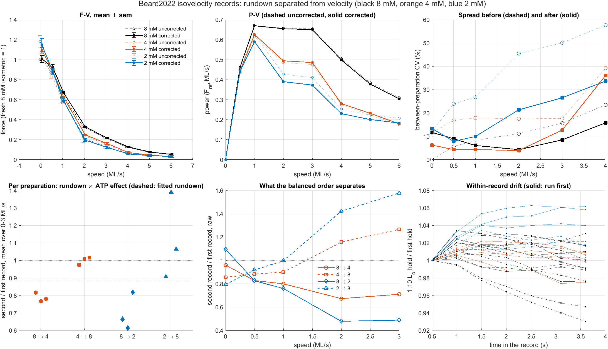

# Rundown correction of the Beard2022 F–V data

Issue #92 · 2026-11-19 · drafted by Claude (AI agent) · data only, no simulation

## Bottom line

1. **One number does most of the work: the second record of a preparation reads 0.88 of the first** (0.881, standard error 0.019, at 0–3 ML/s). It is the same for the 4 mM pairs (0.89) and the 2 mM pairs (0.88).
2. **A speed-dependent rundown is not supported at 0–3 ML/s** (it fits worse by the information criteria; the five factors are 0.85–0.92 with a standard error of 0.05 each). Above 3 ML/s something else shows: the 8 mM records run second read *higher* than those run first (0.139 against 0.110 at 4 ML/s, 0.068 against 0.033 at 6 ML/s).
3. **Within a record the drift is small**, −1 to +4 % of the hold force over the seven cycles, and correcting for it adds little. Dividing by the hold does not remove the between-record rundown: the 1.10 Lo hold runs down by 1–4 %, the F–V points by 12 %.
4. **The pooled 8 mM curve in normalised units does not change** (each preparation was already scaled by its own 8 mM isometric force). What changes is the spread, the low-ATP curves and the ATP ratios:
   - between-preparation spread at 2 ML/s: 8 mM 11 % → 4 %, 4 mM 18 % → 4 %, 2 mM 45 % → 21 %;
   - 4/8 ratio at 2 ML/s: 0.67 (8 mM first) and 0.87 (4 mM first) → **0.76 in both orders**, 0.763 ± 0.009;
   - the 2 mM curve is 3–9 % lower than the uncorrected one.
5. **What the design cannot separate:** a preparation-specific rundown from a preparation-specific ATP effect; rundown by time from an after-effect of the low-ATP exposure; and, within a record, time from speed.

Recommendation for #79: use the corrected pool at 0–3 ML/s. Treat 4–6 ML/s separately until the order effect there is understood.

## Question

Averaging fresh and run-down records gives something worse than fresh (the PI, #75, 2026-11-11). Can the force at a given velocity be separated into a rundown part and a velocity part, within a preparation and between preparations, so that the pooled curve estimates the fresh muscle?

## Method

- **Data.** 24 records from 12 preparations (`Analyses/FV_Beard2022/loadBeard2022FV.m`, reader `readIsoV.m`). Each preparation has one 8 mM record and one 4 or 2 mM record; three preparations per running order (8→4, 4→8, 8→2, 2→8). Per record: seven isovelocity points in the recorded order 6, 1, 3, 5, 0.5, 4, 2 ML/s, the isometric point at 1.00 Lo, and the 1.10 Lo hold before each cycle (mean over 20 ms). All forces have the slack baseline subtracted.
- **Factor model**, in log force, on the 120 points at 0–3 ML/s:
  log F = f0(preparation) + g(speed, [ATP]) + r + noise.
  f0 is the fresh force scale, g the F–V shape (free at each speed and [ATP], 14 parameters), r the rundown.
- **Speeds above 3 ML/s are left out of the fit** because the force there is close to the noise (lowest values 2.1, 1.2 and −0.5 kPa at 4, 5 and 6 ML/s), which a log model cannot take. The fitted correction is then applied to all speeds.
- **Rundown forms compared:**

  | Model | Rundown r |
  |---|---|
  | M0 | none |
  | M1 | one factor for every second record |
  | M1a | one factor per ATP pair (8/4, 8/2) |
  | M1p | one factor per preparation |
  | M2 | one factor per speed |
  | M3 | M1 plus β · log(hold before the cycle / first hold of the record) |
  | M3f | M1 with β fixed at 1 (hold-normalised) |
  | M4 | M1p plus the hold term |

- **Deviation from the plan:** "a continuous decay in time or in cumulative work" was not fitted as such. Within a record time is a function of speed (same order in all records), so it is collinear with g; the hold term (M3) is the form of it that the data can identify. The time between the two records of a preparation is not in the files.
- **Corrected data:** F / exp(f0) / 0.881 for second records (M1). The unit is the preparation's fresh 8 mM isometric force.
- **Uncorrected reference:** #75's scale, each preparation divided by its own 8 mM isometric force, whichever record that was.

## Results



*Top: F–V and P–V per [ATP], uncorrected (dashed, open) and corrected (solid); between-preparation spread before and after. Bottom left: second over first record per preparation, which mixes rundown and the ATP effect; the dashed line is the fitted rundown. Bottom middle: the same ratio by speed and order. Bottom right: the 1.10 Lo hold through each record.*

### 1. Within a record

Hold before the seventh cycle against the first (%, mean ± sd):

| [ATP] | All | Run first | Run second |
|---|---|---|---|
| 8 mM | −1.2 ± 2.8 (12) | −0.1 ± 1.4 (6) | −2.3 ± 3.6 (6) |
| 4 mM | 0.0 ± 1.3 (6) | −0.3 ± 1.9 (3) | +0.3 ± 0.5 (3) |
| 2 mM | +3.6 ± 2.0 (6) | +5.3 ± 1.2 (3) | +1.8 ± 0.3 (3) |

- The hold rises in the first second of most records and then drifts. At 2 mM it keeps rising, more so when 2 mM runs first.
- In the model the hold term improves the fit a little (AIC −5), with an exponent β = 2.4 ± 1.0. Hold-normalisation (β = 1) does as well. Neither changes the conclusions.
- **Hold-normalisation does not carry the between-record rundown.** First hold of the second record over that of the first, by order: 1.01 (8→4), 0.91 (4→8), 1.11 (8→2), 0.88 (2→8). Order-balanced that is 0.96 for the 4 mM pairs and 0.99 for the 2 mM pairs, against 0.88 for the F–V points.

### 2. The factor model

| Model | Parameters | Residual sd (log) | AIC | BIC |
|---|---|---|---|---|
| M0 no rundown | 26 | 0.135 | −458.7 | −386.3 |
| **M1 one factor** | 27 | 0.114 | −496.9 | −421.6 |
| M1a per ATP pair | 28 | 0.115 | −495.0 | −417.0 |
| M1p per preparation | 36 | 0.101 | −520.0 | −419.7 |
| M2 per speed | 31 | 0.116 | −491.9 | −405.5 |
| M3 one factor + hold | 28 | 0.112 | −502.2 | −424.1 |
| M3f hold-normalised | 27 | 0.112 | −501.6 | **−426.3** |
| M4 per preparation + hold | 37 | 0.100 | **−522.0** | −418.9 |

- M1: ρ = −0.127 ± 0.021, a factor of **0.881**. Leaving out one preparation at a time moves it between 0.86 and 0.90.
- M1a: 0.887 (4 mM pairs) and 0.875 (2 mM pairs). No difference.
- M2: 0.92, 0.86, 0.86, 0.85, 0.91 at 0, 0.5, 1, 2, 3 ML/s, each ± 0.047. Not distinguishable from one factor.
- M1p and M4 fit best by AIC and no better by BIC. They are not usable as a rundown model: see section 3.
- The residual sd after M1 is 11 % of force; by speed 11, 7, 7, 10 and 15 % at 0–3 ML/s. The fresh force scale varies between preparations with a CV of 13 %; the mean fresh 8 mM isometric force is 60.6 kPa.

### 3. What the design can and cannot separate

| Split | Separable? | Evidence |
|---|---|---|
| Mean rundown between records from the mean ATP effect | **Yes**, through the balanced order | Second over first record, log, by order at 0–3 ML/s: 8→4 −0.04…−0.40, 4→8 −0.16…+0.24. Half the sum is the rundown (−0.05 to −0.17), half the difference the ATP effect (4/8 = 1.06, 0.97, 0.94, 0.76, 0.75). The same for the 2 mM pairs (2/8 = 1.17, 0.95, 0.87, 0.58, 0.56). |
| A rundown per preparation from that preparation's own ATP effect | **No** | Each preparation has one record per [ATP], so its second/first ratio is the product of both. The model with a factor per preparation is rank deficient by two. Within an order the ratios agree closely for the 4 mM pairs (sd of log 0.02–0.03) and scatter for the 2 mM pairs (0.15–0.22); which of the two causes scatters cannot be told. |
| Rundown with time from an after-effect of low ATP | **No** | Half-sum and half-difference assume the loss is the same whichever solution came first. There is no 8→8 control and no closing 8 mM bracket. |
| Within-record time from speed | **Only through the holds** | The speeds run in one order in all 24 records. The hold is the only quantity measured seven times at one condition. |
| Speed-dependence of rundown | **Weakly** | From the 8 mM records alone, run second against run first, relative to the isometric point: 0.98, 0.98, 1.07, 1.13 at 0.5–3 ML/s (se 0.03–0.08). A comparison between preparations, 6 against 6. |

### 4. Corrected curves

Force in units of the fresh 8 mM isometric force, mean ± sem over records; CV between preparations.

| v (ML/s) | 8 mM uncorrected | 8 mM corrected | CV before → after | 4 mM uncorrected | 4 mM corrected | CV | 2 mM uncorrected | 2 mM corrected | CV |
|---|---|---|---|---|---|---|---|---|---|
| 0 | 1.000 | 1.007 ± 0.034 | 0 → 12 % | 1.065 ± 0.050 | 1.092 ± 0.028 | 12 → 6 % | 1.181 ± 0.058 | 1.149 ± 0.063 | 12 → 13 % |
| 0.5 | 0.924 ± 0.015 | 0.926 ± 0.024 | 6 → 9 % | 0.872 ± 0.060 | 0.888 ± 0.016 | 17 → 4 % | 0.929 ± 0.091 | 0.882 ± 0.028 | 24 → 8 % |
| 1 | 0.671 ± 0.016 | 0.670 ± 0.012 | 8 → 6 % | 0.615 ± 0.045 | 0.626 ± 0.011 | 18 → 4 % | 0.624 ± 0.068 | 0.590 ± 0.024 | 27 → 10 % |
| 2 | 0.329 ± 0.011 | 0.327 ± 0.004 | 11 → 4 % | 0.243 ± 0.017 | 0.247 ± 0.004 | 18 → 4 % | 0.214 ± 0.040 | 0.195 ± 0.017 | 45 → 21 % |
| 3 | 0.218 ± 0.010 | 0.217 ± 0.005 | 16 → 9 % | 0.158 ± 0.011 | 0.162 ± 0.008 | 18 → 13 % | 0.137 ± 0.028 | 0.124 ± 0.013 | 50 → 27 % |
| 4 | 0.126 ± 0.009 | 0.125 ± 0.006 | 24 → 16 % | 0.069 ± 0.011 | 0.070 ± 0.010 | 39 → 36 % | 0.063 ± 0.015 | 0.058 ± 0.008 | 58 → 34 % |
| 5 | 0.077 ± 0.009 | 0.076 ± 0.007 | 38 → 31 % | 0.044 ± 0.009 | 0.046 ± 0.010 | 51 → 55 % | 0.044 ± 0.013 | 0.040 ± 0.008 | 70 → 46 % |
| 6 | 0.052 ± 0.008 | 0.051 ± 0.007 | 53 → 48 % | 0.029 ± 0.009 | 0.030 ± 0.011 | 78 → 88 % | 0.035 ± 0.011 | 0.031 ± 0.006 | 76 → 51 % |

- **8 mM means do not move.** The uncorrected scale divides each preparation by its own 8 mM isometric force, so rundown cancels in the 8 mM curve's shape. In kPa the uncorrected 8 mM pool is about 6 % below fresh, since half its records are second records.
- The 8 mM spread at the isometric point goes from 0 to 12 % only because it is no longer the normalising point. From 1 ML/s up the spread falls, because the scale now rests on ten points per preparation instead of one.
- **The low-ATP curves are where the correction matters**: their spread falls two- to four-fold up to 2 ML/s.
- Power (force × speed), corrected: 8 mM 0.46, 0.67, 0.66, 0.65, 0.50 at 0.5–4 ML/s; 4 mM 0.44, 0.63, 0.49, 0.49, 0.28; 2 mM 0.44, 0.59, 0.39, 0.37, 0.23. The 8 mM plateau from 1 to 3 ML/s stays; the 2 mM power is 6–9 % lower than uncorrected.

### 5. ATP ratios by order

Low-ATP over 8 mM force within a preparation, mean of three preparations per order:

| Ratio, speed | Raw: 8 mM first | Raw: low first | Corrected: 8 mM first | Corrected: low first | Corrected, all six |
|---|---|---|---|---|---|
| 4/8, 0 | 0.96 | 1.17 | 1.09 | 1.03 | 1.06 ± 0.02 |
| 4/8, 0.5 | 0.83 | 1.13 | 0.94 | 1.00 | 0.97 ± 0.02 |
| 4/8, 1 | 0.80 | 1.11 | 0.91 | 0.98 | 0.94 ± 0.02 |
| 4/8, 2 | 0.67 | 0.87 | 0.76 | 0.76 | **0.763 ± 0.009** |
| 4/8, 3 | 0.71 | 0.79 | 0.81 | 0.70 | 0.75 ± 0.03 |
| 4/8, 4 | 0.58 | 0.54 | 0.66 | 0.48 | 0.57 ± 0.07 |
| 2/8, 0 | 1.10 | 1.26 | 1.25 | 1.11 | 1.18 ± 0.06 |
| 2/8, 0.5 | 0.84 | 1.10 | 0.95 | 0.97 | 0.96 ± 0.06 |
| 2/8, 1 | 0.77 | 1.01 | 0.87 | 0.89 | 0.88 ± 0.06 |
| 2/8, 2 | 0.48 | 0.73 | 0.55 | 0.64 | 0.59 ± 0.06 |
| 2/8, 3 | 0.49 | 0.67 | 0.56 | 0.59 | 0.57 ± 0.06 |
| 2/8, 4 | 0.43 | 0.48 | 0.49 | 0.42 | 0.46 ± 0.05 |

- The order gap of 0.2–0.3 closes to within 0.10 at 0.5–2 ML/s with the single factor (0.00 for 4/8 at 2 ML/s). The mean corrected ratio is what the order-balanced average already gave (#88: 0.763 ± 0.011 at 2 ML/s); the correction adds the agreement between the two orders.
- At 3 and 4 ML/s the 4/8 gap changes sign (−0.11, −0.18): one factor over-corrects there. This is the high-speed effect of section 6, and the protocol also differs at those speeds (#75 §5).

### 6. Checks

- **Residuals against record position:** +0.064 (first) and −0.064 (second) without rundown; zero by construction with M1.
- **Leave one preparation out:** the rundown factor stays within 0.86–0.90; the largest change of any point of g is 11 %.
- **Corrected 8 mM, run first against run second:**

  | v (ML/s) | 0 | 0.5 | 1 | 2 | 3 | 4 | 5 | 6 |
  |---|---|---|---|---|---|---|---|---|
  | run first (6) | 1.020 | 0.948 | 0.686 | 0.321 | 0.207 | 0.110 | 0.059 | 0.033 |
  | run second (6) | 0.993 | 0.904 | 0.653 | 0.334 | 0.227 | 0.139 | 0.092 | 0.068 |

  Up to 3 ML/s they agree within 5–10 %. From 4 ML/s the second records are higher, by 0.03 of the fresh isometric force (about 2 kPa), which doubles the reading at 6 ML/s. It is neither a pure factor nor a pure offset (the sign is opposite below 2 ML/s). Possible causes, not tested here: a baseline that differs after the low-ATP exposure, a slower preparation after rundown, or chance (6 against 6 preparations).

## Against the acceptance criteria

| Criterion | Result |
|---|---|
| Within-record drift per record; does hold-normalisation remove it | Drift −1.2 % (8 mM), 0.0 % (4 mM), +3.6 % (2 mM). Hold-normalisation improves the fit slightly (residual sd 0.114 → 0.112) and does not carry the between-record rundown (hold 0.96–0.99, F–V 0.88). |
| Factor model with three rundown forms, residual sd and an information criterion | Section 2: one factor, per speed, per preparation, and the hold term in place of a decay in time. |
| What the design can and cannot separate | Section 3. |
| Corrected F–V and P–V with standard errors; spread before and after | Section 4. |
| Order effect of 4/8 and 2/8 before and after | Section 5. |
| Write-up with figures and an index row | This folder. The issue left the folder name to the PI; a new dated folder was used, as the workflow asks for analyses from 2026-11 on. |

## Caveats

- The correction assumes the loss between records is the same whichever [ATP] came first. Nothing in this design tests that.
- The fit uses 0–3 ML/s. The same factor is applied at 4–6 ML/s, where section 6 shows it does not hold.
- The low-ATP protocol has a larger pre-ramp step at 0.5–4 ML/s (#75 §5). It is absorbed in g, so the corrected low-ATP curves are curves on that protocol.
- Standard errors treat the 6 or 12 records of a group as independent.
- The 2 mM preparations disagree most (CV 21–27 % at 2–3 ML/s after correction), driven by one 2→8 preparation whose 8 mM record reads 1.39 of its 2 mM record over 0–3 ML/s.

## Next steps

- #79: take the corrected pool at 0–3 ML/s as the target, with these standard errors; decide separately on 4–6 ML/s.
- The order effect at 4–6 ML/s at 8 mM is worth a look at the raw traces of the six second records (baseline after the ramp).
- A closing 8 mM bracket in new data (the target-dataset design) would settle the two things this set cannot: the after-effect of low ATP, and a rundown per preparation.

## Reproduce

```matlab
run('Analyses/26-11-19-FV_RundownCorrection/scripts/RunFVRundown.m')   % data only, ~10 s -> results/fv_rundown.log, .mat, figures/fv_rundown.png
```

The first call reads the 12 workbooks (about 2.5 minutes) unless `Analyses/FV_Beard2022/results/beard2022_fv_raw.mat` exists.
