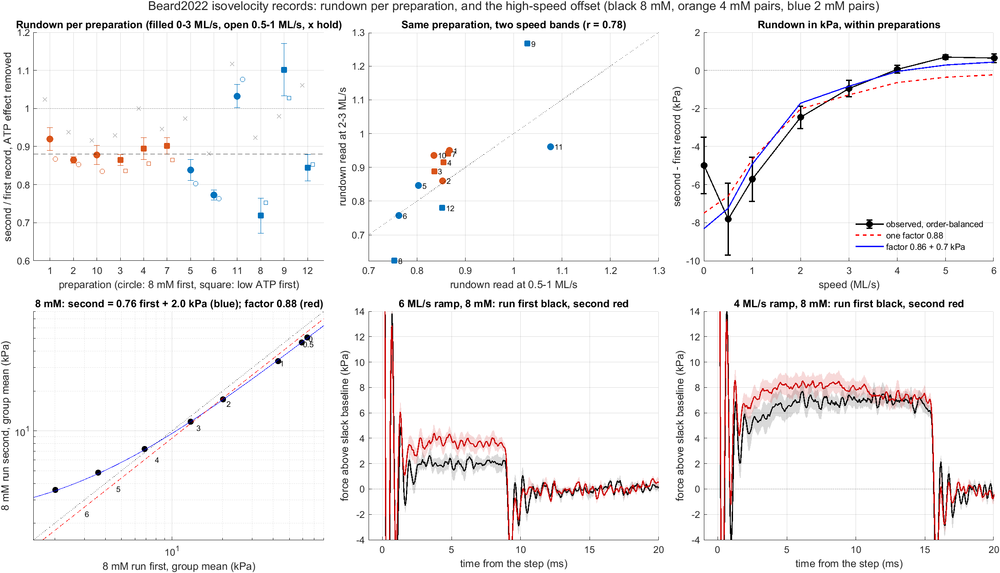
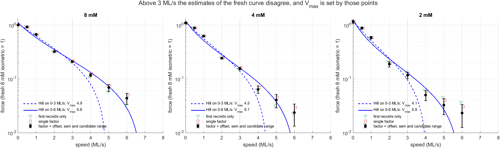

# Rundown correction of the Beard2022 F–V data

Issue #92 · 2026-11-19, review round 2026-11-25 (sections 7 to 9) · drafted by Claude (AI agent) · data only, no simulation

## Bottom line

1. **One number does most of the work: the second record of a preparation reads 0.88 of the first** (0.881, standard error 0.019, at 0–3 ML/s). It is the same for the 4 mM pairs (0.89) and the 2 mM pairs (0.88). The correction gives the same means as order-balanced averaging and removes rundown only on average: each preparation keeps its own deviation from 0.88, and the result rests on the assumption that the loss is the same whichever [ATP] came first.
2. **A speed-dependent rundown is not supported at 0–3 ML/s** (it fits worse by the information criteria; the five factors are 0.85–0.92 with a standard error of 0.05 each). **Above 3 ML/s the loss is not proportional** (section 8). Within preparations, order-balanced, the second record reads +0.1, +0.7 and +0.6 kPa against the first at 4, 5 and 6 ML/s, where the factor 0.88 predicts −0.6, −0.4 and −0.2 kPa. The whole ramp plateau is higher, with the same baseline and ramp speed, so it is not a reading artefact. It sits in the 8 mM records run after low ATP (about +2 kPa, 3 % of the isometric force); low-ATP records run after 8 mM show −0.4 kPa.
3. **Within a record the drift is small**, −1 to +4 % of the hold force over the seven cycles, and correcting for it adds little. Dividing by the hold does not remove the between-record rundown: the 1.10 Lo hold runs down by 1–4 %, the F–V points by 12 %.
4. **The pooled 8 mM curve in normalised units does not change** (each preparation was already scaled by its own 8 mM isometric force). What changes is the spread, the low-ATP curves and the ATP ratios:
   - between-preparation spread at 2 ML/s: 8 mM 11 % → 4 %, 4 mM 18 % → 4 %, 2 mM 45 % → 21 %;
   - 4/8 ratio at 2 ML/s: 0.67 (8 mM first) and 0.87 (4 mM first) → **0.76 in both orders**, 0.763 ± 0.009;
   - the 2 mM curve is 3–9 % lower than the uncorrected one.
5. **Rundown per preparation is readable once the ATP effect is taken as common to a pair** (section 7). The six 4 mM preparations agree: 0.87–0.92. The six 2 mM preparations do not: 0.72–1.10, and two of them show no rundown. The same preparations stand out at 0.5–1 ML/s, where the ATP effect is small, at 2–3 ML/s and in the hold (r = 0.78 and 0.69), so the differences are real (F test p = 0.0004). A factor per preparation does not narrow the pooled curves further.
6. **What the design still cannot separate:** rundown by time from an after-effect of the low-ATP exposure (the high-speed offset of item 2 may be exactly that); a preparation's rundown from a preparation's own force response to low ATP, if that response is the same at all speeds; and, within a record, time from speed.

7. **The points above 3 ML/s should not be used for Vmax or for exact model fitting** (section 9). The force there is 2–7 kPa, the non-scaling part is about 2 kPa, and the three ways of estimating the fresh curve differ by 6, 12 and 20 % of the 8 mM force at 4, 5 and 6 ML/s. Vmax is set by exactly these points: a Hill fit to the 8 mM curve gives 4.9 ML/s on 0–3 ML/s and 6.8 ML/s on 0–6 ML/s, and the effect of ATP on Vmax changes from none (first records only: 6.45 at 8 mM, 6.51 at 2 mM) to −13 % (factor plus offset: 6.83, 5.93).

Recommendation for #79:
- **One correction for all eight speeds**, so the curve has no break at 3 ML/s: second records as (F − 0.7 kPa) / 0.856 (factor plus offset, section 8). At 0–3 ML/s it agrees with the single factor within 2 %.
- **Fit the model to 0–3 ML/s.** The target table with its errors is in section 9.
- **Keep 4–6 ML/s as a check only**, with the wide errors of section 9: the model should pass through the band, and nothing should be tuned to it. Do not quote a Vmax from these data.

## Question

Averaging fresh and run-down records gives something worse than fresh (the PI, #75, 2026-11-11). Can the force at a given velocity be separated into a rundown part and a velocity part, within a preparation and between preparations, so that the pooled curve estimates the fresh muscle?

## Method

- **Data.** 24 records from 12 preparations (`Analyses/FV_Beard2022/loadBeard2022FV.m`, reader `readIsoV.m`). Each preparation has one 8 mM record and one 4 or 2 mM record; three preparations per running order (8→4, 4→8, 8→2, 2→8). Per record: seven isovelocity points in the recorded order 6, 1, 3, 5, 0.5, 4, 2 ML/s, the isometric point at 1.00 Lo, and the 1.10 Lo hold before each cycle (mean over 20 ms). All forces have the slack baseline subtracted.
- **Factor model**, in log force, on the 120 points at 0–3 ML/s:
  log F = f0(preparation) + g(speed, [ATP]) + r + noise.
  f0 is the fresh force scale, g the F–V shape (free at each speed and [ATP], 14 parameters), r the rundown.
- **Speeds above 3 ML/s are left out of the fit** because the force there is close to the noise (lowest values 2.1, 1.2 and −0.5 kPa at 4, 5 and 6 ML/s), which a log model cannot take. The fitted correction is then applied to all speeds.
- **Rundown forms compared:**

  | Model | Rundown r |
  |---|---|
  | M0 | none |
  | M1 | one factor for every second record |
  | M1a | one factor per ATP pair (8/4, 8/2) |
  | M1p | one factor per preparation |
  | M2 | one factor per speed |
  | M3 | M1 plus β · log(hold before the cycle / first hold of the record) |
  | M3f | M1 with β fixed at 1 (hold-normalised) |
  | M4 | M1p plus the hold term |

- **Deviation from the plan:** "a continuous decay in time or in cumulative work" was not fitted as such. Within a record time is a function of speed (same order in all records), so it is collinear with g; the hold term (M3) is the form of it that the data can identify. The time between the two records of a preparation is not in the files.
- **Corrected data:** F / exp(f0) / 0.881 for second records (M1). The unit is the preparation's fresh 8 mM isometric force.
- **Uncorrected reference:** #75's scale, each preparation divided by its own 8 mM isometric force, whichever record that was.

## Results


*Top: F–V and P–V per [ATP], uncorrected (dashed, open) and corrected (solid); between-preparation spread before and after. Bottom left: second over first record per preparation, which mixes rundown and the ATP effect; the dashed line is the fitted rundown. Bottom middle: the same ratio by speed and order. Bottom right: the 1.10 Lo hold through each record.*

### 1. Within a record

Hold before the seventh cycle against the first (%, mean ± sd):

| [ATP] | All | Run first | Run second |
|---|---|---|---|
| 8 mM | −1.2 ± 2.8 (12) | −0.1 ± 1.4 (6) | −2.3 ± 3.6 (6) |
| 4 mM | 0.0 ± 1.3 (6) | −0.3 ± 1.9 (3) | +0.3 ± 0.5 (3) |
| 2 mM | +3.6 ± 2.0 (6) | +5.3 ± 1.2 (3) | +1.8 ± 0.3 (3) |

- The hold rises in the first second of most records and then drifts. At 2 mM it keeps rising, more so when 2 mM runs first.
- In the model the hold term improves the fit a little (AIC −5), with an exponent β = 2.4 ± 1.0. Hold-normalisation (β = 1) does as well. Neither changes the conclusions.
- **Hold-normalisation does not carry the between-record rundown.** First hold of the second record over that of the first, by order: 1.01 (8→4), 0.91 (4→8), 1.11 (8→2), 0.88 (2→8). Order-balanced that is 0.96 for the 4 mM pairs and 0.99 for the 2 mM pairs, against 0.88 for the F–V points.

### 2. The factor model

| Model | Parameters | Residual sd (log) | AIC | BIC |
|---|---|---|---|---|
| M0 no rundown | 26 | 0.135 | −458.7 | −386.3 |
| **M1 one factor** | 27 | 0.114 | −496.9 | −421.6 |
| M1a per ATP pair | 28 | 0.115 | −495.0 | −417.0 |
| M1p per preparation | 36 | 0.101 | −520.0 | −419.7 |
| M2 per speed | 31 | 0.116 | −491.9 | −405.5 |
| M3 one factor + hold | 28 | 0.112 | −502.2 | −424.1 |
| M3f hold-normalised | 27 | 0.112 | −501.6 | **−426.3** |
| M4 per preparation + hold | 37 | 0.100 | **−522.0** | −418.9 |

- M1: ρ = −0.127 ± 0.021, a factor of **0.881**. Leaving out one preparation at a time moves it between 0.86 and 0.90.
- M1a: 0.887 (4 mM pairs) and 0.875 (2 mM pairs). No difference.
- M2: 0.92, 0.86, 0.86, 0.85, 0.91 at 0, 0.5, 1, 2, 3 ML/s, each ± 0.047. Not distinguishable from one factor.
- M1p and M4 fit best by AIC and no better by BIC. They are not usable as a rundown model: see section 3.
- The residual sd after M1 is 11 % of force; by speed 11, 7, 7, 10 and 15 % at 0–3 ML/s. The fresh force scale varies between preparations with a CV of 13 %; the mean fresh 8 mM isometric force is 60.6 kPa.

### 3. What the design can and cannot separate

| Split | Separable? | Evidence |
|---|---|---|
| Mean rundown between records from the mean ATP effect | **Yes**, through the balanced order | Second over first record, log, by order at 0–3 ML/s: 8→4 −0.04…−0.40, 4→8 −0.16…+0.24. Half the sum is the rundown (−0.05 to −0.17), half the difference the ATP effect (4/8 = 1.06, 0.97, 0.94, 0.76, 0.75). The same for the 2 mM pairs (2/8 = 1.17, 0.95, 0.87, 0.58, 0.56). |
| A rundown per preparation from that preparation's own ATP effect | **Yes, if the ATP effect is common to the pair** (section 7) | Each preparation has one record per [ATP], so its second/first ratio is the product of both, and the model with a factor per preparation is rank deficient by two: only the mean rundown of each pair is tied to the mean ATP effect. With the order-balanced ATP effect removed, the deviations of the preparations are estimable. They agree between 0.5–1 ML/s, where the ATP effect is 0.87–0.97, and 2–3 ML/s, where it is 0.56–0.76 (r = 0.78), which a preparation-specific ATP effect of the usual speed-dependent shape would not give. |
| Rundown with time from an after-effect of low ATP | **No** | Half-sum and half-difference assume the loss is the same whichever solution came first. There is no 8→8 control and no closing 8 mM bracket. |
| Within-record time from speed | **Only through the holds** | The speeds run in one order in all 24 records. The hold is the only quantity measured seven times at one condition. |
| Speed-dependence of rundown | **Weakly** | From the 8 mM records alone, run second against run first, relative to the isometric point: 0.98, 0.98, 1.07, 1.13 at 0.5–3 ML/s (se 0.03–0.08). A comparison between preparations, 6 against 6. |

### 4. Corrected curves

Force in units of the fresh 8 mM isometric force, mean ± sem over records; CV between preparations.

| v (ML/s) | 8 mM uncorrected | 8 mM corrected | CV before → after | 4 mM uncorrected | 4 mM corrected | CV | 2 mM uncorrected | 2 mM corrected | CV |
|---|---|---|---|---|---|---|---|---|---|
| 0 | 1.000 | 1.007 ± 0.034 | 0 → 12 % | 1.065 ± 0.050 | 1.092 ± 0.028 | 12 → 6 % | 1.181 ± 0.058 | 1.149 ± 0.063 | 12 → 13 % |
| 0.5 | 0.924 ± 0.015 | 0.926 ± 0.024 | 6 → 9 % | 0.872 ± 0.060 | 0.888 ± 0.016 | 17 → 4 % | 0.929 ± 0.091 | 0.882 ± 0.028 | 24 → 8 % |
| 1 | 0.671 ± 0.016 | 0.670 ± 0.012 | 8 → 6 % | 0.615 ± 0.045 | 0.626 ± 0.011 | 18 → 4 % | 0.624 ± 0.068 | 0.590 ± 0.024 | 27 → 10 % |
| 2 | 0.329 ± 0.011 | 0.327 ± 0.004 | 11 → 4 % | 0.243 ± 0.017 | 0.247 ± 0.004 | 18 → 4 % | 0.214 ± 0.040 | 0.195 ± 0.017 | 45 → 21 % |
| 3 | 0.218 ± 0.010 | 0.217 ± 0.005 | 16 → 9 % | 0.158 ± 0.011 | 0.162 ± 0.008 | 18 → 13 % | 0.137 ± 0.028 | 0.124 ± 0.013 | 50 → 27 % |
| 4 | 0.126 ± 0.009 | 0.125 ± 0.006 | 24 → 16 % | 0.069 ± 0.011 | 0.070 ± 0.010 | 39 → 36 % | 0.063 ± 0.015 | 0.058 ± 0.008 | 58 → 34 % |
| 5 | 0.077 ± 0.009 | 0.076 ± 0.007 | 38 → 31 % | 0.044 ± 0.009 | 0.046 ± 0.010 | 51 → 55 % | 0.044 ± 0.013 | 0.040 ± 0.008 | 70 → 46 % |
| 6 | 0.052 ± 0.008 | 0.051 ± 0.007 | 53 → 48 % | 0.029 ± 0.009 | 0.030 ± 0.011 | 78 → 88 % | 0.035 ± 0.011 | 0.031 ± 0.006 | 76 → 51 % |

- **8 mM means do not move.** The uncorrected scale divides each preparation by its own 8 mM isometric force, so rundown cancels in the 8 mM curve's shape. In kPa the uncorrected 8 mM pool is about 6 % below fresh, since half its records are second records.
- The 8 mM spread at the isometric point goes from 0 to 12 % only because it is no longer the normalising point. From 1 ML/s up the spread falls, because the scale now rests on ten points per preparation instead of one.
- **The low-ATP curves are where the correction matters**: their spread falls two- to four-fold up to 2 ML/s.
- Power (force × speed), corrected: 8 mM 0.46, 0.67, 0.66, 0.65, 0.50 at 0.5–4 ML/s; 4 mM 0.44, 0.63, 0.49, 0.49, 0.28; 2 mM 0.44, 0.59, 0.39, 0.37, 0.23. The 8 mM plateau from 1 to 3 ML/s stays; the 2 mM power is 6–9 % lower than uncorrected.

### 5. ATP ratios by order

Low-ATP over 8 mM force within a preparation, mean of three preparations per order:

| Ratio, speed | Raw: 8 mM first | Raw: low first | Corrected: 8 mM first | Corrected: low first | Corrected, all six |
|---|---|---|---|---|---|
| 4/8, 0 | 0.96 | 1.17 | 1.09 | 1.03 | 1.06 ± 0.02 |
| 4/8, 0.5 | 0.83 | 1.13 | 0.94 | 1.00 | 0.97 ± 0.02 |
| 4/8, 1 | 0.80 | 1.11 | 0.91 | 0.98 | 0.94 ± 0.02 |
| 4/8, 2 | 0.67 | 0.87 | 0.76 | 0.76 | **0.763 ± 0.009** |
| 4/8, 3 | 0.71 | 0.79 | 0.81 | 0.70 | 0.75 ± 0.03 |
| 4/8, 4 | 0.58 | 0.54 | 0.66 | 0.48 | 0.57 ± 0.07 |
| 2/8, 0 | 1.10 | 1.26 | 1.25 | 1.11 | 1.18 ± 0.06 |
| 2/8, 0.5 | 0.84 | 1.10 | 0.95 | 0.97 | 0.96 ± 0.06 |
| 2/8, 1 | 0.77 | 1.01 | 0.87 | 0.89 | 0.88 ± 0.06 |
| 2/8, 2 | 0.48 | 0.73 | 0.55 | 0.64 | 0.59 ± 0.06 |
| 2/8, 3 | 0.49 | 0.67 | 0.56 | 0.59 | 0.57 ± 0.06 |
| 2/8, 4 | 0.43 | 0.48 | 0.49 | 0.42 | 0.46 ± 0.05 |

- The order gap of 0.2–0.3 closes to within 0.10 at 0.5–2 ML/s with the single factor (0.00 for 4/8 at 2 ML/s). The mean corrected ratio is what the order-balanced average already gave (#88: 0.763 ± 0.011 at 2 ML/s); the correction adds the agreement between the two orders.
- At 3 and 4 ML/s the 4/8 gap changes sign (−0.11, −0.18): one factor over-corrects there. This is the high-speed effect of section 6, and the protocol also differs at those speeds (#75 §5).

### 6. Checks

- **Residuals against record position:** +0.064 (first) and −0.064 (second) without rundown; zero by construction with M1.
- **Leave one preparation out:** the rundown factor stays within 0.86–0.90; the largest change of any point of g is 11 %.
- **Corrected 8 mM, run first against run second:**

  | v (ML/s) | 0 | 0.5 | 1 | 2 | 3 | 4 | 5 | 6 |
  |---|---|---|---|---|---|---|---|---|
  | run first (6) | 1.020 | 0.948 | 0.686 | 0.321 | 0.207 | 0.110 | 0.059 | 0.033 |
  | run second (6) | 0.993 | 0.904 | 0.653 | 0.334 | 0.227 | 0.139 | 0.092 | 0.068 |

  Up to 3 ML/s they agree within 5–10 %. From 4 ML/s the second records are higher, by 0.03 of the fresh isometric force (about 2 kPa), which doubles the reading at 6 ML/s. It is neither a pure factor nor a pure offset (the sign is opposite below 2 ML/s). Possible causes, not tested here: a baseline that differs after the low-ATP exposure, a slower preparation after rundown, or chance (6 against 6 preparations).

### 7. Rundown per preparation (review round, 2026-11-25)



*Top left: rundown per preparation with the pair's ATP effect removed, read at 0–3 ML/s (filled, ± se over the five speeds), at 0.5–1 ML/s (open) and on the first 1.10 Lo hold (×); dashed line 0.88. Top middle: the same preparation read in two speed bands. Top right: second minus first record in kPa, order-balanced, against the single factor and the factor plus offset. Bottom left: 8 mM records, group mean of those run second against those run first, by speed. Bottom middle and right: mean force trace of the 6 and 4 ML/s ramps at 8 mM (± sem).*

Method: for each preparation, log(second/first) at each speed minus (or plus) the order-balanced ATP effect of its pair from section 3. What is left is that preparation's rundown, under the assumption that the ATP effect is the same in all preparations of a pair.

| Prep. | Order | 0.5–1 ML/s | 2–3 ML/s | 0–3 ML/s (se) | 1.10 Lo hold |
|---|---|---|---|---|---|
| 1 | 8→4 | 0.87 | 0.95 | 0.92 (0.03) | 1.02 |
| 2 | 8→4 | 0.85 | 0.86 | 0.87 (0.01) | 0.94 |
| 10 | 8→4 | 0.84 | 0.94 | 0.88 (0.03) | 0.92 |
| 3 | 4→8 | 0.84 | 0.89 | 0.87 (0.01) | 0.93 |
| 4 | 4→8 | 0.86 | 0.92 | 0.90 (0.03) | 1.00 |
| 7 | 4→8 | 0.87 | 0.94 | 0.90 (0.02) | 0.95 |
| 5 | 8→2 | 0.80 | 0.85 | 0.84 (0.03) | 0.97 |
| 6 | 8→2 | 0.76 | 0.76 | 0.77 (0.01) | 0.88 |
| 11 | 8→2 | 1.08 | 0.96 | 1.03 (0.03) | 1.12 |
| 8 | 2→8 | 0.75 | 0.62 | 0.72 (0.05) | 0.92 |
| 9 | 2→8 | 1.03 | 1.27 | 1.10 (0.07) | 0.98 |
| 12 | 2→8 | 0.85 | 0.78 | 0.84 (0.04) | 1.06 |

- **4 mM pairs: one number fits all six**, 0.87–0.92 (sd of log 0.025, less than the 0.064 expected from point scatter alone).
- **2 mM pairs: the preparations differ**, 0.72–1.10 (sd of log 0.17). Preparations 9 and 11 show no rundown, 6 and 8 lose a quarter.
- **The differences are real.** One factor against one per preparation: F(9, 84) = 3.82, p = 0.0004. Between preparations the 0.5–1 ML/s reading correlates with the 2–3 ML/s reading (r = 0.78; 0.67 without preparation 9) and with the hold (r = 0.69).
- **Why this is rundown and not the ATP effect:** the ATP effect grows with speed (2/8 = 0.95 at 0.5 ML/s, 0.56 at 3 ML/s). A preparation with a stronger ATP effect would stand out at 2–3 ML/s and not at 0.5–1 ML/s. The preparations stand out equally in both bands. What it cannot rule out is a preparation whose force responds to low ATP by the same factor at every speed.
- **Between preparations in kPa** (records run second over records run first, different preparations): 8 mM 0.80 ± 0.07 at v = 0 and 0.79 ± 0.05 at 1 ML/s; 4 mM 1.12 ± 0.13 and 0.99 ± 0.08; 2 mM 0.98 ± 0.08 and 0.87 ± 0.15. The rundown shows in the 8 mM records only. With a force scale that varies 13 % between preparations, three or six per group resolve it no better than this.
- **A factor per preparation does not improve the pooled curves.** Means change by less than 1 %; the spread at 2 ML/s goes 4.3 → 7.8 % (8 mM), 3.9 → 4.3 % (4 mM) and 21.4 → 20.7 % (2 mM). The single factor stays the correction; the table says which preparations it fits badly (8, 9, 11).

### 8. Why one factor fails above 3 ML/s (review round, 2026-11-25)

All eight speeds of a record come from one activation, so a rundown that only scales the force must scale them all alike. It does not:

| v (ML/s) | 0 | 0.5 | 1 | 2 | 3 | 4 | 5 | 6 |
|---|---|---|---|---|---|---|---|---|
| second − first, kPa, order-balanced | −5.0 | −7.8 | −5.7 | −2.5 | −1.0 | +0.1 | +0.7 | +0.6 |
| se | 1.5 | 1.9 | 1.2 | 0.6 | 0.4 | 0.2 | 0.1 | 0.2 |
| predicted by the factor 0.88 | −7.5 | −6.6 | −4.7 | −2.0 | −1.3 | −0.6 | −0.4 | −0.2 |
| as a ratio second/first | 0.92 | 0.86 | 0.85 | 0.85 | 0.91 | 1.01 | 1.23 | 1.33 |

- **Size.** The misfit is about 1 kPa, 1.5 % of the isometric force. It looks large above 3 ML/s only because the force there is 2–7 kPa.
- **Not a reading artefact.** In the 8 mM records the ramp plateau is flat from 2 ms after the step and higher over its whole length in the records run second (6 ML/s: 3.6 against 1.9 kPa; 4 ML/s: 7.8 against 6.6 kPa). Slack baseline (0.7 against 0.6 kPa) and ramp speed (5.997 against 6.000 ML/s) are the same.
- **It sits in the 8 mM records run after low ATP.** Group means of those six against the six run first follow second = 0.76 × first + 2.0 kPa at all eight speeds, largest residual 0.6 kPa. Within preparations, 8 mM exceeds its low-ATP partner at 5 and 6 ML/s by 2.4 and 1.7 kPa when it ran second, and by 1.0 and 0.4 kPa when it ran first (se 0.2–0.3).
- **Models in kPa on all 192 points** (weights 1 kPa plus 10 % of the force):

  | Rundown form | Parameters | χ² | AIC | Fitted |
  |---|---|---|---|---|
  | none | 35 | 223.4 | 293.4 | |
  | one factor | 36 | 190.4 | 262.4 | 0.894 |
  | factor + offset | 37 | 182.5 | 256.5 | 0.856, +0.7 kPa (jackknife se 0.4) |
  | **factor + offset by [ATP] of the second record** | 38 | 157.2 | **233.2** | 0.847; +2.1 kPa when 8 mM ran second (se 0.8), −0.4 kPa when low ATP ran second (se 1.2) |
  | factor per speed | 43 | 168.3 | 254.3 | 0.91, 0.86, 0.85, 0.85, 0.91, 1.05, 1.29, 1.46 |

- **With the factor plus offset** the corrected 8 mM curves of first and second records agree better at high speed but not fully (4 ML/s 0.109 against 0.127; 6 ML/s 0.033 against 0.055; single factor 0.111 against 0.137 and 0.033 against 0.067). The 4/8 order gap at 4 ML/s closes from 0.17 to 0.05. Below 3 ML/s nothing changes (4/8 at 2 ML/s 0.761 ± 0.010).
- **What it is, as far as the data go.** A force of about 2 kPa that does not scale with the activation and appears in 8 mM after a low-ATP activation. Two readings fit, and this set cannot choose:
  - an after-effect of the low-ATP exposure (for example a stiffer passive or slowly detaching component that resists shortening);
  - a difference between the two groups of six preparations. The force at 6 ML/s is partly a property of the preparation (first against second record of the same preparation r = 0.59), and preparations 8 and 9, both high, are in the run-second group.
- The records hold no relaxed segment, so a change in passive force at 1.00 Lo cannot be checked directly.

### 9. What the points above 3 ML/s can carry (review round, 2026-11-25)



*Per [ATP], log force scale: the fresh curve from the factor plus offset (black, error = sem and the range of the candidates combined), from first records only (green) and from the single factor (red); Hill hyperbola fitted to 0–3 ML/s (dashed) and to 0–6 ML/s (solid).*

**The three estimates of the fresh curve part above 3 ML/s.** Force in units of the fresh 8 mM isometric force:

| [ATP] | Estimate | 2 ML/s | 3 ML/s | 4 ML/s | 5 ML/s | 6 ML/s |
|---|---|---|---|---|---|---|
| 8 mM | first records only (n = 6) | 0.319 | 0.205 | 0.109 | 0.058 | 0.033 |
| | factor + offset (n = 12) | 0.321 | 0.210 | 0.118 | 0.069 | 0.044 |
| | single factor (n = 12) | 0.325 | 0.215 | 0.124 | 0.075 | 0.050 |
| | half range, % of the force | 1 | 2 | 6 | 12 | 20 |
| | half range / sem | 1.0 | 1.2 | 1.6 | 1.5 | 1.5 |
| 4 mM | first records only (n = 3) | 0.247 | 0.151 | 0.062 | 0.032 | 0.023 |
| | factor + offset (n = 6) | 0.242 | 0.156 | 0.064 | 0.040 | 0.024 |
| | single factor (n = 6) | 0.245 | 0.161 | 0.069 | 0.046 | 0.029 |
| | half range, % of the force | 1 | 3 | 5 | 17 | 14 |
| 2 mM | first records only (n = 3) | 0.212 | 0.134 | 0.062 | 0.045 | 0.037 |
| | factor + offset (n = 6) | 0.188 | 0.117 | 0.050 | 0.033 | 0.023 |
| | single factor (n = 6) | 0.194 | 0.124 | 0.057 | 0.040 | 0.030 |
| | half range, % of the force | 6 | 7 | 11 | 19 | 29 |

- At 8 mM the estimates agree within 1–2 % up to 3 ML/s and part by 6, 12 and 20 % at 4, 5 and 6 ML/s, 1.5 times the standard error. Which one is the fresh muscle depends on whether the 2 kPa of section 8 is an after-effect of low ATP (then: first records only) or a group difference (then: the pooled estimates). The data cannot say.
- At 4 and 2 mM the first-records estimate rests on three preparations and its scatter is as large as the disagreement.

**Vmax is set by these points.** Hill hyperbola F = F0 (1 − v/Vmax) / (1 + v/(a·Vmax)), fitted to the mean curves (weights 1 % of isometric plus 5 % of the force):

| [ATP] | Estimate | Vmax, fit on 0–6 ML/s | Vmax, fit on 0–3 ML/s |
|---|---|---|---|
| 8 mM | first records only | 6.45 | 4.72 |
| | factor + offset | 6.83 (bootstrap 6.46–7.28) | 4.89 (4.68–5.16) |
| | single factor | 7.05 | 4.96 |
| 4 mM | first records only | 5.91 | 4.31 |
| | factor + offset | 6.10 (5.59–6.85) | 4.54 (4.28–4.97) |
| | single factor | 6.30 | 4.61 |
| 2 mM | first records only | 6.51 | 4.36 |
| | factor + offset | 5.93 (5.37–6.71) | 4.07 (3.76–4.46) |
| | single factor | 6.25 | 4.17 |

- **Including or leaving out 4–6 ML/s moves Vmax by 40 %** (8 mM: 4.9 to 6.8 ML/s). The two intervals do not overlap, so this is not noise: one hyperbola does not describe 0–6 ML/s. The tail lies 0.04 to 0.07 of the isometric force (2.5–4 kPa) above the hyperbola through 0–3 ML/s, which reaches zero at 4.9 ML/s while 7 kPa is still measured at 4 ML/s.
- **The excess is the size of the non-scaling force of section 8** (about 2 kPa). A Vmax read from 0–6 ML/s may therefore measure where that component ends, not the unloaded shortening speed of the cross-bridges.
- **The correction changes Vmax by 0.6 ML/s** at 8 mM (6.45–7.05) and at 2 mM (5.93–6.51).
- **The ATP effect on Vmax is not resolved.** 2 mM against 8 mM on 0–6 ML/s: 6.51 against 6.45 with first records only (no effect), 5.93 against 6.83 with the factor plus offset (−13 %), 6.25 against 7.05 with the single factor (−11 %).

**The force itself is close to its limits there.**

| | 3 ML/s | 4 ML/s | 5 ML/s | 6 ML/s |
|---|---|---|---|---|
| 8 mM mean force, kPa (sd between preparations) | 12.3 (1.9) | 7.1 (1.3) | 4.2 (1.3) | 2.8 (1.3) |
| 4 mM | 9.5 (1.1) | 4.1 (1.4) | 2.7 (1.4) | 1.7 (1.5) |
| 2 mM | 7.0 (3.3) | 3.3 (1.9) | 2.3 (1.6) | 1.8 (1.3) |
| records below 2 kPa (8 / 4 / 2 mM) | 0 / 0 / 0 | 0 / 0 / 0 | 0 / 2 / 3 | 4 of 12 / 4 of 6 / 5 of 6 |

- The spread between preparations stays at 1.3–1.9 kPa while the force falls from 12 to 2 kPa, so it is an additive spread, not a proportional one. The slack baseline itself varies by 0.18 kPa (sd over the seven cycles of a record).
- The low-ATP protocol also differs from the 8 mM protocol at these speeds (#75 §5).

**Target for #79** (factor plus offset; error = sem and half the candidate range, combined in quadrature):

| v (ML/s) | 8 mM | 4 mM | 2 mM | Use |
|---|---|---|---|---|
| 0 | 1.002 ± 0.033 | 1.090 ± 0.040 | 1.147 ± 0.083 | fit |
| 0.5 | 0.921 ± 0.024 | 0.884 ± 0.017 | 0.880 ± 0.041 | fit |
| 1 | 0.665 ± 0.014 | 0.621 ± 0.014 | 0.586 ± 0.032 | fit |
| 2 | 0.321 ± 0.004 | 0.242 ± 0.005 | 0.188 ± 0.022 | fit |
| 3 | 0.210 ± 0.006 | 0.156 ± 0.009 | 0.117 ± 0.017 | fit |
| 4 | 0.118 ± 0.008 | 0.064 ± 0.010 | 0.050 ± 0.011 | check only |
| 5 | 0.069 ± 0.010 | 0.040 ± 0.011 | 0.033 ± 0.011 | check only |
| 6 | 0.044 ± 0.011 | 0.024 ± 0.010 | 0.023 ± 0.011 | check only |

The errors at 4–6 ML/s are 7–25 % of the force at 8 mM and 16–48 % at low ATP. They cover the disagreement between the estimates, not the question of what the tail is.

## Against the acceptance criteria

| Criterion | Result |
|---|---|
| Within-record drift per record; does hold-normalisation remove it | Drift −1.2 % (8 mM), 0.0 % (4 mM), +3.6 % (2 mM). Hold-normalisation improves the fit slightly (residual sd 0.114 → 0.112) and does not carry the between-record rundown (hold 0.96–0.99, F–V 0.88). |
| Factor model with three rundown forms, residual sd and an information criterion | Section 2: one factor, per speed, per preparation, and the hold term in place of a decay in time. |
| What the design can and cannot separate | Section 3. |
| Corrected F–V and P–V with standard errors; spread before and after | Section 4. |
| Order effect of 4/8 and 2/8 before and after | Section 5. |
| Write-up with figures and an index row | This folder. The issue left the folder name to the PI; a new dated folder was used, as the workflow asks for analyses from 2026-11 on. |

## Caveats

- The correction assumes the loss between records is the same whichever [ATP] came first. Nothing in this design tests that.
- The fit uses 0–3 ML/s. The same factor is applied at 4–6 ML/s in section 4, where sections 6 and 8 show it does not hold.
- The rundown per preparation of section 7 assumes a common ATP effect within a pair.
- The Hill fits of section 9 are on mean curves with one choice of weights; the 0–3 ML/s fit has five points for three parameters. They show how much Vmax depends on the tail, not what Vmax is.
- The split of the high-speed offset by the [ATP] of the second record leans on comparing the 8 mM curve shape between two groups of six preparations.
- The low-ATP protocol has a larger pre-ramp step at 0.5–4 ML/s (#75 §5). It is absorbed in g, so the corrected low-ATP curves are curves on that protocol.
- Standard errors treat the 6 or 12 records of a group as independent.
- The 2 mM preparations disagree most (CV 21–27 % at 2–3 ML/s after correction), driven by one 2→8 preparation whose 8 mM record reads 1.39 of its 2 mM record over 0–3 ML/s.

## Next steps

- #79: take the section 9 table as the target: fit 0–3 ML/s, keep 4–6 ML/s as a check, quote no Vmax from these data.
- Vmax needs its own measurement (unloaded shortening by slack test), which does not rest on forces of 2 kPa.
- The order effect at 4–6 ML/s was traced to the ramp plateau itself (section 8); the baseline is not the cause.
- A closing 8 mM bracket in new data (the target-dataset design) would settle what this set cannot: the after-effect of low ATP, including the 2 kPa high-speed offset, and a rundown per preparation without the common-ATP-effect assumption. A relaxed record at 1.00 Lo before each activation would test the passive reading.

## Reproduce

```matlab
run('Analyses/26-11-19-FV_RundownCorrection/scripts/RunFVRundown.m')   % data only, ~10 s -> results/fv_rundown.log, .mat, figures/fv_rundown.png
```

```matlab
run('Analyses/26-11-19-FV_RundownCorrection/scripts/RunFVRundownPerPrep.m')   % sections 7 to 9, ~40 s; needs results/fv_rundown.mat -> results/fv_rundown_perprep.log, .mat, figures/fv_rundown_perprep.png, fv_rundown_highspeed.png
```

The first call reads the 12 workbooks (about 2.5 minutes) unless `Analyses/FV_Beard2022/results/beard2022_fv_raw.mat` exists.
