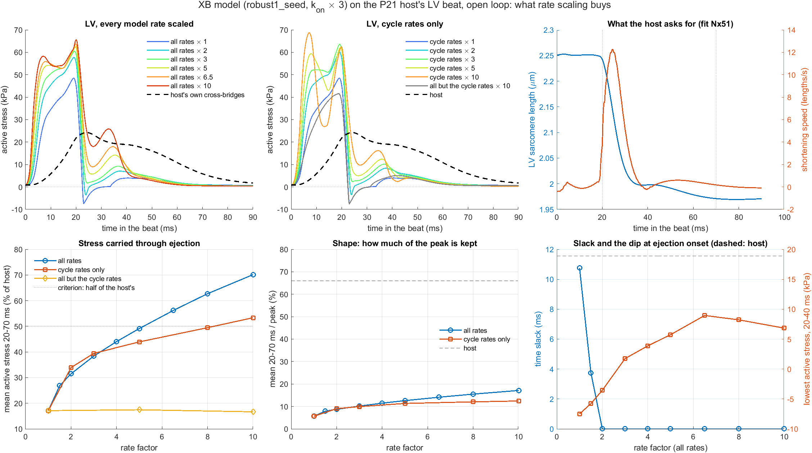

# Kinetics at the host's temperature and rate: what rate scaling buys on the P21 beat

Issue #98 (work package WP3 of #82) · 2026-11-19 · drafted by Claude (AI agent) · status: open-loop part done, closed loop not done

## Bottom line

1. **The slack is a temperature effect.** With every rate of the model 2 times faster the wall is never slack on the Nx51 beat, and from 3 times the cross-bridge stress is never negative. Room temperature to 37 °C gives a factor of 2.3 to 13 for the published Q10 values, so this is well inside the range.
2. **Early ejection (20–40 ms) is matched at a factor of 6.5**: 18.0 kPa against the host's 20.3 kPa. That factor is a Q10 of 3.5 from 22 °C, the value measured for k_tr and ATPase in skinned rat trabeculae.
3. **Late ejection (40–70 ms) is not a kinetics problem.** The model carries 2–3 kPa there at every factor from 1 to 10, against the host's 12.6 kPa. The thin-filament gate has closed (0.03 at 50 ms) while the host's Ca is still 0.47 µM. With `k_on` ×10 the gate stays open and the stress is 27 kPa, twice the host's. This is the activation model, not the cross-bridge rates.
4. **Only the seven cycle rates matter.** Scaling everything except them (SRX, availability gate, viscous passive, thin filament) by 10 changes nothing: 17 % of the host's stress, 8.5 ms slack, as unscaled.
5. **The acceptance criterion is met at a uniform factor of about 5.5 to 6.5** (never slack; 49 % of the host's mean active stress over 20–70 ms at 5, 56 % at 6.5). With the cycle rates alone it needs 8 to 10.

Share of the missing stress on the Nx51 beat (host 16.0 kPa mean over 20–70 ms, model 2.7 kPa): temperature 47 % (at ×6.5), activation time course 45 %, left for the kinetics themselves 7 %. The temperature share runs from about 20 % (×2.3) to 64 % (×10) over the plausible range of rig temperature and Q10.

## Question

On the host's own sarcomere kinematics the incumbent model's force collapses at ejection onset and it is slack for 10.5 ms (#82). How much of that is temperature (the preparation is at room temperature, the host at 37 °C), how much is structure, and is there a rate scaling inside the literature Q10 range under which the model is never slack and carries at least half of the host's stress through ejection?

## Method

- Open loop, as in #82: the LV wall is driven by the host's stored Ls(t) and Ca(t) of fit Nx51 (325 bpm) through `Analyses/TriSegCaPlan/dPUdT_HostWall.m`. Parameter set `robust1_seed`, 60 strain bins with the sliding window, imposed velocity, `k_on` ×3, 4 beats, last beat read. **No model file is changed.**
- **Uniform scaling, done exactly.** Scaling every rate of the model by *s* on the real beat is the same system as the unscaled model on a beat slowed *s* times. So the host signals are stretched in time (Ls(t/s), Ca(t/s), velocity / s) and the result is read back in host time. This needs no list of rates and cannot miss one. It covers the cross-bridge cycle, SRX, the availability gate, the viscous passive and the thin filament.
- **Cycle rates only**: `kah`, `kamh`, `ka`, `kd`, `k1`, `k_1`, `k2` multiplied by *s*, as in arm E7 of #82.
- **Everything but the cycle rates**: the slowed beat with the cycle rates divided by *s*.
- Also: septal and RV walls at ×1 and ×5; `k_on` ×1 and ×10 at ×5 and ×10.
- Reference: the host's own cross-bridge stress (`sigma_XB`), its 9-moment model.
- Measures, in host time: peak active stress; lowest active stress in 20–40 ms (the shortening spike); mean active stress over 20–70 ms, 20–40 ms and 40–70 ms; time with total stress below 0.05 kPa (slack); time with negative cross-bridge stress.
- 24 runs, 3 to 12 s per beat, one core, about 11 minutes in total.

The unscaled arm reproduces #82: peak 48.5 kPa, slack 10.75 ms (10.5 ms there, on a coarser output grid).

## Results



*Top: active stress of the LV wall over the beat, with all rates scaled (left) and the cycle rates only (middle); dashed is the host's own cross-bridge stress. Top right: the host's sarcomere length and shortening speed; dotted lines mark the 20–70 ms window. Bottom: mean stress through ejection as a share of the host's, the share of the peak that is kept, and slack time with the lowest stress at ejection onset.*

### 1. Uniform scaling (LV)

| Factor | Peak (kPa) | Lowest, 20–40 ms (kPa) | Mean 20–40 ms | Mean 40–70 ms | Mean 20–70 ms, share of host | Slack (ms) | Negative cross-bridge stress (ms) |
|---|---|---|---|---|---|---|---|
| host | 24.3 | 18.9 | 20.3 | 12.6 | 100 % | 0 | 0 |
| 1 | 48.5 | −7.5 | 2.7 | 2.5 | 17 % | 10.75 | 8.0 |
| 1.5 | 54.4 | −5.8 | | | 27 % | 3.75 | 4.25 |
| 2 | 57.7 | −3.6 | | | 31 % | 0 | 1.75 |
| 3 | 60.5 | 1.8 | 10.0 | 3.3 | 38 % | 0 | 0 |
| 4 | 61.5 | 3.9 | | | 44 % | 0 | 0 |
| 5 | 62.5 | 5.7 | 14.7 | 3.0 | 49 % | 0 | 0 |
| 6.5 | 63.8 | 9.0 | 18.0 | 2.6 | 56 % | 0 | 0 |
| 8 | 64.8 | 8.2 | | | 63 % | 0 | 0 |
| 10 | 65.6 | 6.8 | 24.4 | 2.2 | 70 % | 0 | 0 |

- The stress still dips at ejection onset at every factor (to 6–9 kPa from a peak above 60), then recovers. At ×10 it recovers to 26 kPa at 33 ms, above the host.
- The share of the peak that is kept through ejection rises only from 6 % to 17 %, against the host's 66 %. Two things make this number low and neither is the cycle speed: the model's isovolumic peak is 2.5 times the host's and comes at 5–20 ms instead of 24 ms, and the stress is gone after 45 ms.

### 2. Which rates

| Scaled | Factor | Mean 20–70 ms, share of host | Slack (ms) |
|---|---|---|---|
| cycle rates only | 2 | 34 % | 0 |
| | 3 | 39 % | 0 |
| | 5 | 44 % | 0 |
| | 8 | 49 % | 0 |
| | 10 | 53 % | 0 |
| everything but the cycle rates | 5 | 17 % | 9.0 |
| | 10 | 17 % | 8.5 |

Up to a factor of 3 the cycle rates alone do as much as the uniform scaling. Above that the uniform scaling does more (70 % against 53 % at ×10), because the faster thin filament opens the gate earlier in the slowed frame; the rest of the model contributes nothing by itself. A Q10 block (#44) therefore needs one well-founded factor for the cycle group; the factors of the other groups do not show on this beat.

### 3. The late-ejection gap is activation

| | Gate at 30 ms | at 50 ms | at 70 ms | Mean active stress 40–70 ms (kPa) |
|---|---|---|---|---|
| host | | | | 12.6 |
| all rates ×1, `k_on` ×3 | 0.16 | 0.03 | 0.01 | 2.5 |
| all rates ×6.5, `k_on` ×3 | 0.24 | 0.03 | 0.01 | 2.6 |
| all rates ×10, `k_on` ×3 | 0.33 | 0.03 | 0.01 | 2.2 |
| all rates ×5, `k_on` ×10 | 0.93 | 0.48 | 0.03 | 27.1 |
| all rates ×5, `k_on` ×1 | | | | (mean 20–70 ms: 9 % of host) |

The host's Ca is 2.1 µM at 10 ms, 1.4 at 30 ms, 0.47 at 50 ms and 0.16 at 70 ms. The thin filament used here (Marzban 2020 constants with `k_on` ×3) is shut by 50 ms, where the host's own model still carries half its peak. Between `k_on` ×3 and ×10 the stress in this window goes from a fifth of the host's to twice the host's. The activation amplitude is one steep, unidentified knob (as found in `Analyses/CalciumTwitch`), and it decides this window. It belongs to #41 and #42, not to this issue.

### 4. Other walls

| Wall | Factor | Peak (kPa) | Mean 20–70 ms, share of host | Slack (ms) |
|---|---|---|---|---|
| septum | 1 | 10.6 | 20 % | 19.5 |
| septum | 5 | 14.1 | 42 % | 0 |
| RV | 1 | 37.6 | 17 % | 14.25 |
| RV | 5 | 53.8 | 50 % | 0 |

The same picture as the LV.

### 5. Is the factor inside the literature range?

Rig temperature: room temperature (the PI, #43, 2026-11-19); no number is recorded, so 20–25 °C is carried as the range.

| Q10 | Source | Factor to 37 °C from 20 / 22 / 25 °C |
|---|---|---|
| 3.5 | k_tr and Ca-activated ATPase at saturating Ca, skinned rat trabeculae, 15–25 °C (de Tombe and Stienen, J Physiol 2007;584:591, doi:10.1113/jphysiol.2007.138693) | 8.4 / 6.5 / 4.5 |
| 4.6 | unloaded shortening velocity, intact rat trabeculae, 18–33 °C (de Tombe and ter Keurs, Circ Res 1990;66:1239) | 13.4 / 9.9 / 6.2 |
| 2.0–2.5 | a conservative band, no source of its own | 3.2–4.7 / 2.8–4.0 / 2.3–3.0 |

- Removing the slack needs ×2 (Q10 1.6 from 22 °C): inside every row.
- The criterion (half the host's stress) needs ×5.5–6.5 (Q10 3.1–3.5 from 22 °C): at the measured k_tr value, not beyond it.
- Both sources are taken from the background notes of #82 (`Analyses/TriSegCaPlan/background/literature_background.md`), where the first is marked as read and the second as abstract only. Both Q10 values were measured below 33 °C and are extrapolated to 37 °C; if Q10 falls with temperature, the factors are too high. No mouse value was found.
- **Correction to #82 and to the text of #98:** a Q10 of 3.5 from 22 to 37 °C is a factor of 6.5, not 5 (5.1 is the factor from 24 °C).

## Against the acceptance criteria

| Criterion | Result |
|---|---|
| Share due to temperature and share due to structure, on the Nx51 beat | Of the 13.3 kPa missing from the mean active stress over 20–70 ms: 47 % returns with the uniform factor 6.5 (20 % at ×2.3, 64 % at ×10); 45 % is the 40–70 ms window, where the activation has ended; 7 % is left in 20–40 ms. The slack itself is gone at ×2. The structural defect of #77 could not be separated by its fix, which does not exist yet; what is left for it on this beat is the dip at ejection onset (to 6–9 kPa) and the 7 %. |
| A rate scaling, with sources, under which the model is never slack and carries at least half of the host's stress through ejection | **Met**: all rates ×6.5 (Q10 3.5 from 22 °C, de Tombe and Stienen 2007): never slack, 56 %. Cycle rates only: ×8–10, which needs Q10 4–4.6 from 22 °C. |
| With the scaling off the 8 mM objective is unchanged | Met by construction: the scaling is applied in the analysis script, and no file under `Model/`, `params/` or `Auxiliary/` is changed. The objective was not re-run. |
| Closed loop: ejection time within 20 % of the host's | **Not done.** The harness (#97, PR 106) is not merged and has no steady beat yet (#105). |

## Deviations from the plan

- Step 1 asked for the host beat with #77's fix; that fix does not exist. The two causes were separated by the scaling itself.
- Step 2, a Q10 block with one factor per rate group, was not built. The group test (section 2) shows that on this beat only the cycle group matters, so a block with six factors would have five that nothing here constrains.
- Added: the split of the ejection window into 20–40 and 40–70 ms, which is what shows the activation gap.

## Caveats

- **Open loop.** The host's sarcomere shortens as its own, weaker cross-bridge model lets it. A wall with a 60 kPa isovolumic peak would not see this length trace in a closed loop. The numbers say what the model does on this kinematics, not what a heart built on it would do.
- **`k_on` ×3 is not calibrated**, and the "share of the host's stress" depends on it more than on any rate factor (9 % at ×1, 180 % at ×10, both at rates ×5). The slack result does not depend on it in the tested range.
- A uniform factor scales the thin filament and the viscous passive with the same Q10 as the cycle. That is the simplest assumption, not a measured one.
- One host fit (Nx51, 12.3 lengths/s). The 19 fits span 6.2–16.9 lengths/s; the fastest was not run.
- The stress dips at ejection onset at every factor. The same shape shows on the isovelocity records after a fast step (#77).
- The Q10 sources were not re-read for this report.

## Next steps

- Closed-loop check once #105 gives the harness a steady beat: all rates ×6.5 against the host's ejection time and stroke volume.
- The activation time course on the host's Ca decides late ejection; it needs the force–pCa work (#41, #42) before any rate factor is tuned further.
- #44 can be reduced to the cycle group for the organ model.

## Reproduce

```matlab
run('Analyses/26-11-19-HostKinetics/scripts/RunHostKinetics.m')    % 24 arms, ~11 min on one core -> results/hostKinetics_Nx51.mat
run('Analyses/26-11-19-HostKinetics/scripts/PlotHostKinetics.m')   % -> results/tables.log, figures/rate_scaling.png
```

Needs the host repository next to this one (`../Multiscale-Hx-P21-Model`, or set `HOSTROOT`).
