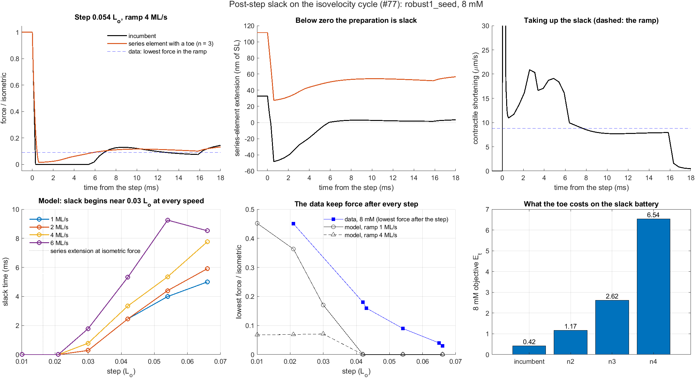

# Post-step slack on the isovelocity cycle: what carries it

Issue #77 · 2026-11-19 · drafted by Claude (AI agent) · status: carrier named; no fix that keeps the 8 mM objective

## Bottom line

1. **The carrier is the series elastic element.** At the isometric force of the 1.10 Lo hold it is stretched by 0.016 Lo (33 nm of sarcomere length). The pre-ramp steps are 0.042–0.066 Lo. The step unloads the element completely, the preparation goes slack, and the contractile part has to take up the rest at its unloaded speed while the ramp keeps going.
2. **The slack starts at a step of about 0.03 Lo at every ramp speed** (1, 2, 4 and 6 ML/s). The speed only sets how long it lasts. The data keep force after every step: 0.45, 0.18, 0.09 and 0.03 of isometric at steps of 0.021, 0.042, 0.054 and 0.066 Lo.
3. **A series element with a toe removes it.** With the force–extension exponent raised from 0.85 to 3 (same force and same stiffness at the isometric point) the slack at 4 ML/s goes from 5.35 ms to 0, the lowest force is 0.02 (data 0.09), and the trough at 1 ML/s is 0.447 (data 0.45; incumbent 0.36).
4. **The same change breaks the 8 mM slack battery.** The objective goes from 0.424 to 1.17 (exponent 2), 2.62 (3) and 6.54 (4). So the second acceptance item is **not met**: no parameter change tested gives less than 1 ms of slack at 4 ML/s and leaves the objective within its noise.
5. **Not the carrier:** the availability gate (fully open, or 100 times slower: the slack gets longer) and attachment (`ka` ×2: no change). The cycle speed is the second carrier: all cycle rates ×2 cut the slack to 1.8 ms, detachment `k2` ×2 to 2.7 ms, and both change the isometric force or the F–V curve.

The two data sets pull the series element in opposite directions under this model. They are also different preparations (2021 and 2026), and the series compliance is largely the preparation's ends, so it need not be the same in both.

## Question

On the Beard2022 isovelocity protocol the incumbent model is slack for 2–8.5 ms after the pre-ramp step at 2–6 ML/s, and the 12 preparations never are (#75). Which part of the model carries this, and is there a small change that removes it without moving the 8 mM objective?

## Method

- **Synthetic cycle** (`scripts/simStepRamp.m`): 2 s hold at 1.10 Lo, a step in 0.6 ms (as measured), a ramp to 0.985 Lo, then a hold. 8 mM. Model: `robust1_seed` with the fit-A k2 gate, set up as in `Analyses/FV_Beard2022/RunFVBeard2022.m`. Slack = time in the ramp with force below 1 % of the isometric force.
- **Step scan**: steps 0.010–0.066 Lo at ramps of 1, 2, 4 and 6 ML/s.
- **Levers, one at a time**, on the measured cycles (0.021 Lo / 1 ML/s, 0.054 Lo / 4 ML/s, 0.066 Lo / 6 ML/s): the series-element exponent `ekSE` (force = (kSE · extension)^ekSE) with `kSE` reset to keep either the stiffness or the extension at the isometric point; the availability gate; the cycle rates.
- **Cost of the candidates**: the pooled 8 mM objective, scored as in `Analyses/LowATP_Refit9K2Sweep/RunBaseline8mM.m` (5 workers, 35–47 s each). The incumbent reproduces 0.424047.
- No model file is changed; every candidate is a parameter change.

**Deviation from the plan.** Step 3 asked for a state transplant (start the ramp with one block swapped). The trace already shows which block is at its limit, and levers answer the same question with a number, so levers were used. The cycle is synthetic, not cut from a record; it gives 5.35 ms at 4 ML/s against 4.6 ms on the records.

## Results



*Top: force, series-element extension and contractile shortening speed through one cycle (step 0.054 Lo, ramp 4 ML/s); black incumbent, orange the series element with a toe. Bottom: slack time against step size; lowest force after the step, model against data; the 8 mM objective of the candidates.*

### 1. What happens in the cycle (0.054 Lo, 4 ML/s)

| Time from the step (ms) | Force / isometric | Series-element extension (nm of SL) | Contractile shortening (µm/s) |
|---|---|---|---|
| −1 | 1.00 | 33 | 0 |
| 0.2 | 0.34 | 9 | 77 |
| 0.6 (end of the step) | 0 | −48 | 11 |
| 2 | 0 | −40 | 16 |
| 4 | 0 | −19 | 17 |
| 5 | 0 | −8 | 19 |
| 6 | 0.03 | 0.5 | 15 |
| 8 | 0.13 | 3 | 8.5 |

The step is 119 nm of sarcomere length. The series element gives back 33 nm and the cross-bridges a little more; the remaining 48 nm is slack. The ramp shortens the sarcomere at 8.8 µm/s and the contractile part at 11–20 µm/s, so the slack closes at 2–11 µm/s and takes 5.4 ms. Force then overshoots to 0.13 and settles at 0.08.

### 2. Step scan

Slack time (ms):

| Step (Lo) | 0.010 | 0.021 | 0.030 | 0.042 | 0.054 | 0.066 |
|---|---|---|---|---|---|---|
| 1 ML/s | 0 | 0 | 0.28 | 2.46 | 3.99 | 5.00 |
| 2 ML/s | 0 | 0 | 0.28 | 2.46 | 4.40 | 5.91 |
| 4 ML/s | 0 | 0 | 0.78 | 3.34 | 5.35 | 7.76 |
| 6 ML/s | 0 | 0 | 1.78 | 5.33 | 9.25 | 8.52 (the whole ramp) |

Lowest force after the step, model at 1 ML/s against the data: 0.36 against 0.45 at 0.021 Lo; 0 against 0.18 at 0.042; 0 against 0.09 at 0.054; 0 against 0.03 at 0.066. The data fall roughly exponentially with the step, with a length constant near 0.025 Lo. The model's series element reaches zero force at a finite extension, and with an exponent below 1 it is stiffest where the force is lowest.

### 3. Levers

Slack (ms) and lowest force (of isometric) per cycle; isometric force at the hold in kPa.

| Change | Isometric force | 0.021 Lo, 1 ML/s | 0.054 Lo, 4 ML/s | 0.066 Lo, 6 ML/s |
|---|---|---|---|---|
| data, lowest force | | 0.45 | 0.09 | 0.03 |
| incumbent | 71.0 | 0 ms, 0.36 | 5.35 ms, 0 | 8.52 ms, 0 |
| exponent 1.5, same stiffness at isometric | 67.6 | 0, 0.41 | 3.70, 0 | 8.17, 0 |
| exponent 2, same stiffness | 65.6 | 0, 0.43 | 2.42, 0 | 8.16, 0 |
| **exponent 3, same stiffness** | 62.3 | 0, 0.447 | **0**, 0.02 | 5.65, 0 |
| exponent 4, same stiffness | 60.0 | 0, 0.455 | 0, 0.04 | 2.90, 0.01 |
| exponent 2, same extension | 71.0 | 0, 0.24 | 5.81, 0 | 8.50, 0 |
| exponent 3, same extension | 71.0 | 0, 0.20 | 6.29, 0 | 8.51, 0 |
| gate fully open (`A0` = 1) | 118.8 | 0, 0.31 | 6.31, 0 | 8.40, 0 |
| gate 100 times slower | 71.0 | 0, 0.27 | 6.80, 0 | 8.52, 0 |
| cycle rates ×2 | 70.4 | 0, 0.48 | 1.81, 0 | 3.31, 0 |
| attachment `ka` ×2 | 93.4 | 0, 0.45 | 5.40, 0 | 8.44, 0 |
| detachment `k2` ×2 | 51.8 | 0, 0.42 | 2.69, 0 | 4.20, 0 |

- What helps is a longer series element at isometric force with a soft foot: at exponent 3 its extension at the hold is 112 nm instead of 33. The same exponent with the extension kept (a shape change only) makes things worse.
- Even at exponent 4 the 6 ML/s cycle is still slack for 2.9 ms. The data are not.
- Share of the 5.35 ms at 4 ML/s removed: series-element shape 100 % (exponent 3 or 4), cycle rates ×2 66 %, `k2` ×2 50 %, the gate 0 % (it adds 1–1.5 ms), attachment 0 %.

### 4. What the candidates cost

| Candidate | 8 mM objective | Largest feature-cost changes |
|---|---|---|
| incumbent | 0.424047 | |
| exponent 2 | 1.17 | `ktrfit` +0.29, `PS_holdDecayRMSE` +0.22, `A` +0.08 |
| exponent 3 | 2.62 | `PS_holdDecayRMSE` +0.64, `ktrfit` +0.45, `peak1_y` +0.31, `A` +0.25 |
| exponent 4 | 6.54 | `FV_normpowerAvg` +2.03, `PS_holdDecayRMSE` +1.04, `peak1_y` +0.75 |

The slack battery reads the series element through the redevelopment rate, the re-stretch peak and the passive hold decay, and it wants the stiff, short element of the incumbent. No other parameter was refitted, so these numbers say the swap is not free, not that a toe is incompatible with the battery.

## Against the acceptance criteria

| Criterion | Result |
|---|---|
| The carrier is named, with its share of the slack at 4 ML/s, 8 mM | **Met.** The series elastic element: its shape and length account for all of the 5.35 ms. Cycle speed is second (66 % at ×2). The availability gate and attachment carry none. |
| A candidate fix gives < 1 ms slack at 4 ML/s and leaves `Et` and the ktr-protocol error within their noise floors | **Not met.** The series element with exponent 3 gives 0 ms, and `Et` goes from 0.424 to 2.62. The ktr-protocol error was not run, because the objective already fails. |

Not done from the plan: the re-run of the 24 records with a fix (there is no fix to run), and the 4 and 2 mM cycles.

## Caveats

- One parameter at a time. A toe together with a retuned stiffness, `kSE_M` and rates may fit both; that is a refit, which the issue puts out of scope.
- The 2021 isovelocity preparations and the 2026 slack preparations are different muscles on what may be different mounts. End compliance is a property of the preparation.
- In the data the "lowest force after the step" is read from 2 ms after the onset with 2 ms smoothing (#75), in the model from 1 ms after the end of the step without smoothing.
- The synthetic step is a straight 0.6 ms ramp; the motor's real step rings.
- 8 mM only.

## Next steps (a decision for the PI)

1. **A series element per data set.** Fit `kSE`, `ekSE` (and nothing else) to the six step troughs of the isovelocity records, keep the incumbent's element for the slack battery, and state that the two preparation sets differ in end compliance. Cheap, and it makes the F–V comparison of #75 and #79 meaningful at 2–6 ML/s.
2. **One element for both**, with `ekSE` free in a joint refit that scores the step troughs. Costs a campaign.
3. Leave the model, and score the isovelocity records only where the model is not slack (up to 1 ML/s on the measured protocol), using the step-free F–V above that.

Recommendation: option 1 as the next issue, since it is one day of work and decides whether option 2 is needed.

## Reproduce

```matlab
run('Analyses/26-11-19-PostStepSlack/scripts/RunStepScan.m')          % 39 simulations, ~4.5 min, one core
run('Analyses/26-11-19-PostStepSlack/scripts/RunScoreCandidates.m')   % 4 objective evaluations, 5 workers, ~3 min; runs in the checkout that has data/
run('Analyses/26-11-19-PostStepSlack/scripts/PlotStepScan.m')         % figure
```
