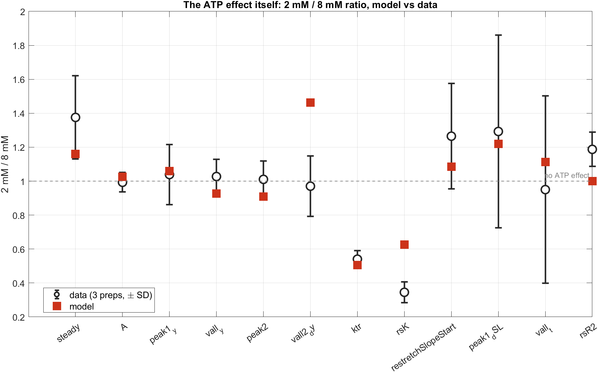
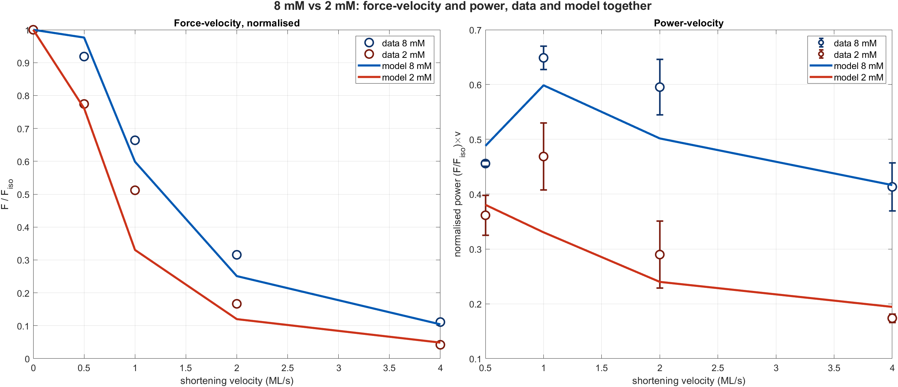
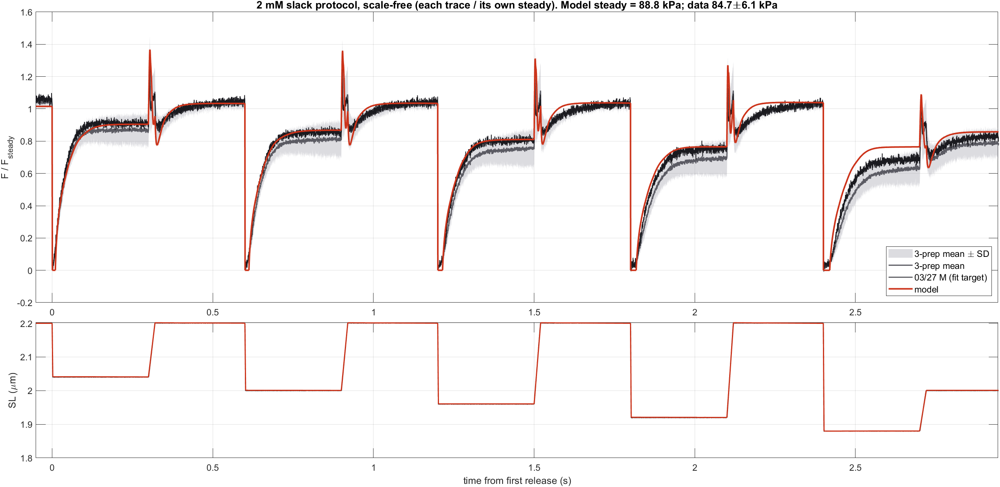
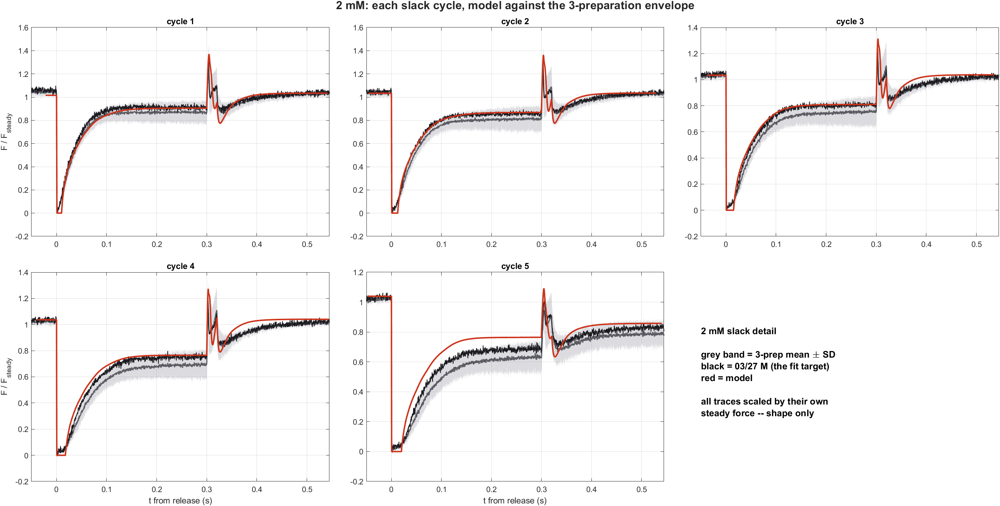
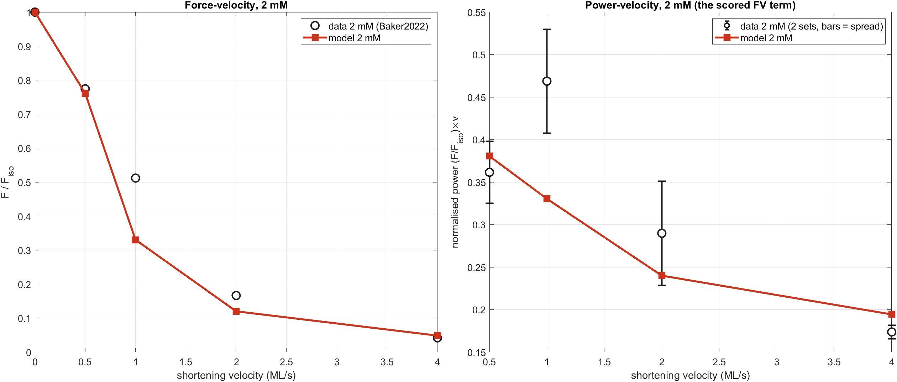
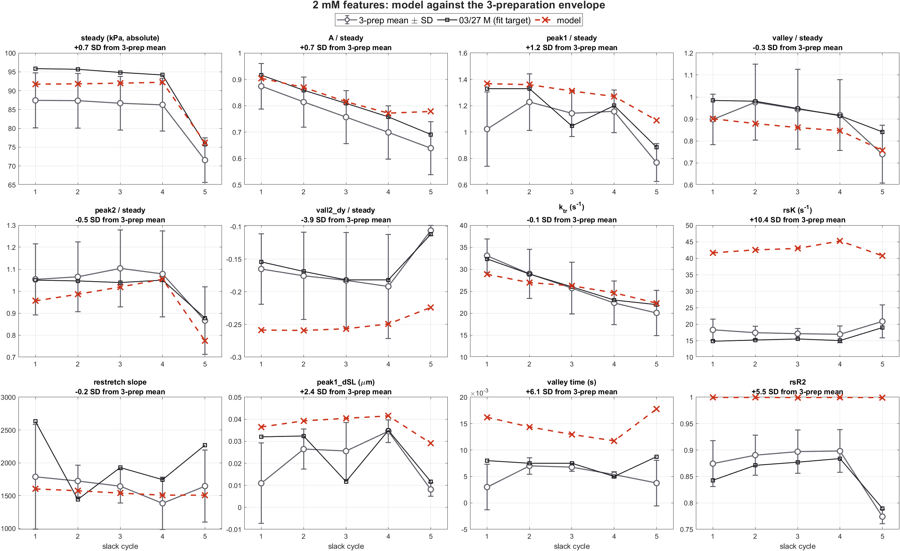
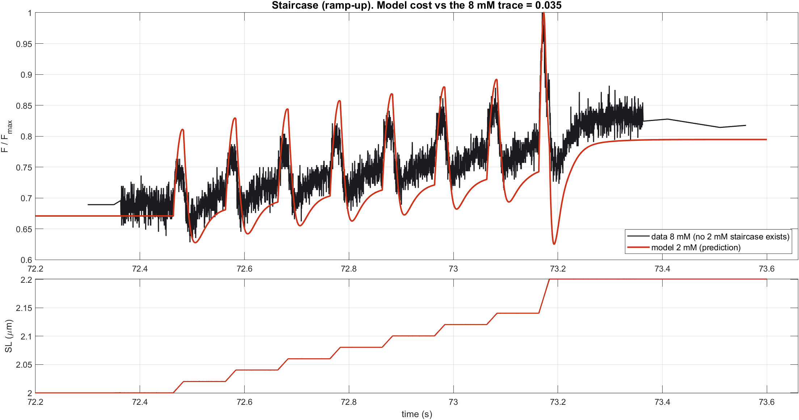

# ATP effect hypotheses — low-ATP fit and the 8 vs 2 mM head-to-head

Two questions, one parameter set. The ATP gates are exactly 1 at `MgATP_ref`, so
**both conditions below come from a single parameter file and differ only by
`[MgATP]`** — the 8 mM and 2 mM curves are not two fits.

Baseline: the same parametrisation as the H0–H4 hypothesis ladder
(`params/lowATP_H2_chem_opt.m` = the ladder's core + the H2, seven-gate,
chemically-defensible set). See §4 for a caveat about that core.

---

## 1. Headline

**The model reproduces the ATP effect within between-preparation scatter for 10 of
12 scored features.** Only `vall2_dy` and `rsK` genuinely fail.

That is a stronger and better-grounded verdict than every previous report in this
project, because it judges the model against the *spread of what the data is*
(three 2026 protocol days) rather than against the single preparation it was
fitted to.

## 2. The ATP effect itself

Ratios are formed **per preparation** and then averaged, so the SD is the real
between-prep spread of the *effect*, not of the levels.

| feature | data 2/8 | ±SD | model | inside ±1 SD? |
|---|---|---|---|---|
| `steady` | 1.376 | 0.246 | 1.160 | yes |
| `A` | 0.993 | 0.057 | 1.025 | yes |
| `peak1_y` | 1.039 | 0.177 | 1.059 | yes |
| `vall_y` | 1.027 | 0.102 | 0.927 | yes |
| `peak2` | 1.011 | 0.107 | 0.909 | yes |
| **`vall2_dy`** | 0.970 | 0.178 | **1.464** | **no** |
| `ktr` | 0.540 | 0.051 | 0.506 | yes |
| **`rsK`** | 0.345 | 0.061 | **0.627** | **no** |
| `restretchSlopeStart` | 1.265 | 0.310 | 1.085 | yes |
| `peak1_dSL` | 1.293 | 0.568 | 1.219 | yes |
| `vall_t` | 0.950 | 0.552 | 1.113 | yes |
| `rsR2` | 1.187 | 0.101 | 1.001 | no — but see below |

Three things worth reading off this:

- **`ktr` is essentially exact** (0.506 vs 0.540 ± 0.051). The isometric
  redevelopment slowdown at low ATP is a solved problem.
- **Most features show no ATP effect at all** once each preparation is scaled by
  its own steady force — `A`, `peak1_y`, `vall_y`, `peak2`, `vall2_dy` all sit at
  1.0 ± 0.1 in the data. The 2 mM phenotype is **a force scale-up plus two rate
  slowdowns**, not a change of waveform shape. The model gets that structure right.
- **`rsR2` is a non-defect.** The model produces a noise-free single exponential,
  so the restretch-recovery R² pins at exactly 1.000 while real traces sit at 0.87.
  It is bounded 0.4–1.0 in the objective and scores zero either way.

**Absolute force**: 2 mM **84.7 ± 6.1 kPa** vs 8 mM **63.3 ± 14.8 kPa**, ratio
**×1.34** — consistent with ATPEffectReconciliation's rundown-corrected ×1.36. The
8 mM spread is 3× wider (CV 23 % vs 7 %), which is why `steady` carries the loosest
error bar despite being the largest effect.

## 3. Force-velocity and power, both conditions

The model separates the two conditions in the right direction and by about the
right amount. Two residuals:

- **8 mM mid-velocity concavity** — the known error: model is +6 % at 0.5 ML/s and
  −20 % at 2 ML/s. Pinned correctly at both ends.
- **2 mM power peak position.** Data peak power is at **v = 1.0 ML/s at both
  concentrations**; the model puts the 2 mM peak at **0.5**. The model predicts a
  leftward shift with low ATP that the data do not show. (An earlier report of mine
  offered that shift as a *falsifiable prediction* and claimed the data did not
  exist. It did — `Data_ATP` column 4 — and it falsifies the prediction.)

## 4. The low-ATP fit against the 3-preparation envelope

Every trace and every force-dimension feature is divided by **its own** mean steady
before averaging, because absolute force is not transferable between preparations.
The band is therefore the spread of the *shape*. 03/27 — the fit target — is drawn
separately in every panel: a deviation from the 3-prep mean is only a defect if it
is **also** a deviation from 03/27.

Model steady 88.8 kPa against data 84.7 ± 6.1 — inside 1 SD. The model tracks 03/27
almost exactly through cycles 1–3. The systematic error is confined to two places:
the **re-stretch spike overshoots** (model 1.35 vs data 1.18 at cycle 1, in every
cycle), and cycles 4–5 sit above the band — though 03/27 itself is at the top of
the band there, so part of that is the fit target being the strongest preparation.

Distance from the 3-prep mean, in SD:

| within ±1.5 SD | | outside |
|---|---|---|
| `ktr` −0.1 | | `rsK` **+10.4** |
| `restretch slope` −0.2 | | `vall_t` **+6.1** |
| `valley` −0.3 | | `rsR2` +5.5 *(the R²=1 artifact)* |
| `peak2` −0.5 | | `vall2_dy` **−3.9** |
| `steady` +0.7, `A` +0.7 | | `peak1_dSL` +2.4 |
| `peak1` +1.2 | | |

**There is no 2 mM staircase dataset** — only `protocol_*_velocitytable_stairs.mat`
at 8 mM. That panel is therefore the 2 mM model as an *unconstrained prediction*
against the 8 mM trace, and the cost of 0.035 is against 8 mM data. It is shown for
completeness, not as evidence. The model's step-transients overshoot the 8 mM
measurement substantially; whether that is an ATP effect or a model defect cannot be
told without a 2 mM staircase.

## 5. Caveat on the baseline

This report keeps the H0–H4 parametrisation, as requested, so it is directly
comparable with the hypothesis ladder. But that core is **`joint82_opt`, whose 8 mM
cost is 4.0094 against `realign4_opt`'s 3.8513** — the joint refit traded 8 mM away
to buy 2 mM, and the ladder was then seeded from the traded-away core.

- The ladder's **ranking** is unaffected: every rung shared this core.
- The **absolute costs** are inflated by roughly that 0.16 at 8 mM plus whatever the
  distortion costs at 2 mM.
- The **production H1/H2/H3 runs should start from `realign4_opt`**, with the core
  snapshot as an explicit top-of-file parameter rather than buried in a `loadParams`
  call — which is how this slipped past unnoticed.

## 6. Where the residual actually is

Stripping out the non-defects (`rsR2`) and the features that are within
between-preparation scatter, the low-ATP model has exactly three problems, and two
of them are the same problem:

1. **`rsK`** — post-restretch recovery, ×1.8 too fast as a *ratio* and +10.4 SD in
   absolute terms. Note this is the residual of a defect already seriously attacked
   in `RestretchSRXRecoil` (load realignment took it ×2.35 → ×1.12); the present
   core partially undid that.
2. **The re-stretch spike overshoots** in every cycle, which is `vall2_dy` (−3.9 SD)
   and `peak1_dSL` (+2.4 SD) in feature terms. Same window as (1).
3. **`vall_t`** (+6.1 SD) — model 12–18 ms vs data 3–8 ms. A sub-10 ms timing error,
   low-weighted, but real.

Everything in the low-ATP phenotype outside the re-stretch window is reproduced
within the spread of the data.

---

*Drivers: `RunLowAtpFitReport.m`, `RunAtpHeadToHead.m`. Both are standalone and can
be run in parallel. Results in `results/`.*
