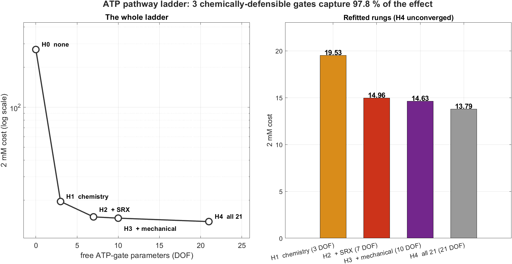
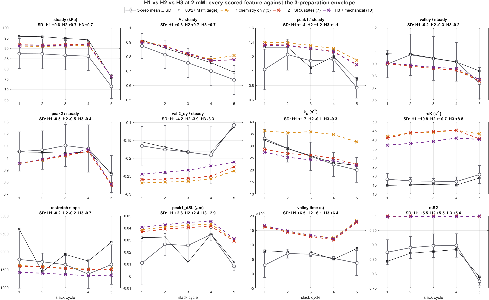
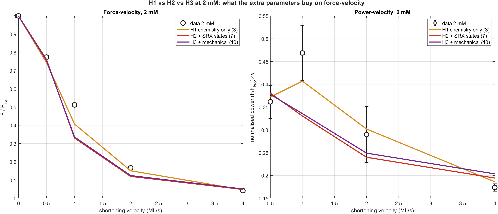

# ATP effect hypotheses — which pathways, and how good is the resulting fit

**The question.** Low ATP makes cardiac muscle *stronger* and *slower*. In this model
every ATP effect is a multiplicative gate on a rate, and 21 rates are gateable. Which
of them should be allowed to feel [ATP]?

That is a model-selection question, not a fitting question, so it is answered first —
§1–§3 — and only then is the resulting fit shown against the data (§4–§6).

**Answer, on the current core (`spreadw_iter_018`): two gates.** `k2` (ATP-induced
actomyosin detachment) and `kah` (hydrolysis / re-priming) capture **99.5 %** of the
entire ATP effect. Every remaining gate — including all four SRX gates and `kamh`,
the third CHEM gate — stays at exactly zero or buys only mechanics.

---

## 1. The ladder

Core model frozen at `spreadw_iter_018`; only ATP-gate exponents refitted. Every gate
is exactly 1 at `MgATP_ref`, so **the 8 mM fit is invariant by construction — asserted
at |Δ| = 0.000e+00 before any fitting.** The 2 mM objective (19 features) includes
force-velocity. Accept threshold 0.32 = 3× the measured noise peak-to-peak.

| rung | gates | which | DOF | 2 mM cost | % of span |
|---|---|---|---|---|---|
| **H0** | none | no ATP effect at all | 0 | 385.13 | 0 % |
| **H1** | CHEM | `k2`, `kah`, `kamh` | 3 | **8.2013** | **99.51 %** |
| **H2** | + SRX | `kmsrd`, `ksr0`, `ksr2srd`, `ksrd2sr` | 7 | **8.2013** | **99.51 %** |
| **H3** | + MECH | `eta_M`, `kSE`, `mu_neg` | 10 | 7.6429 | 99.66 % |
| **H4** | all 21 | + the rest | 21 | **6.4333** | 100 % |

Fitted exponents — **only five gates of 21 are ever non-zero**:

| gate | class | H1 | H2 | H3 | H4 |
|---|---|---|---|---|---|
| `k2` | CHEM | **0.440** | 0.440 | 0.440 | 0.440 |
| `kah` | CHEM | **0.300** | 0.300 | 0.300 | 0.300 |
| `kamh` | CHEM | 0 | 0 | 0 | 0 |
| all four SRX | SRX | — | **0** | 0 | 0 |
| `eta_M` | MECH | — | — | −0.150 | −0.150 |
| `kSE` | MECH | — | — | 0 | +0.070 |
| `kSE_M` | OTHER | — | — | — | −0.150 |

Three results, in order of importance:

1. **Two gates do essentially everything.** `k2` and `kah` take the fit from 385.13 to
   8.20 — 99.5 % of the whole span. Both are unambiguous ATP chemistry: the nucleotide
   is a substrate of the step. `kamh` never moves off zero.
2. **The SRX gates buy exactly nothing.** H2 completed a full sweep of all seven gates
   and accepted none; H2 = H1 to four decimals.
3. **Everything beyond that is mechanics.** H3's gain is `eta_M` alone (−0.56); H4 adds
   `kSE` and `kSE_M` for a further −1.21. All three are viscosity or spring terms with
   no nucleotide chemistry. The "any rate can feel ATP" hypothesis does not discover an
   ATP pathway — it bends compliance, exactly as it did on the previous core.

> **This supersedes an earlier version of this report**, which was built on
> `joint82_opt` and concluded that seven gates were needed and that the SRX gates
> earned their place via `k_tr`. On a core where `rsK` and force-velocity are properly
> fitted, they do not: they were compensating for that core's defects. §8 has the
> details and the correction history.

The classification is by chemistry, decided before fitting:

- **CHEM** — the nucleotide is a substrate of the step. `k2` is ATP-induced
  actomyosin dissociation (without it there is no cycle); `kah`/`kamh` are hydrolysis
  and its reverse.
- **SRX** — no ATP in the rate law as written, but the states differ in bound
  nucleotide, so an ATP dependence is arguable.
- **MECH / OTHER** — stiffness, viscosity, geometry, actin attachment, the power
  stroke. An ATP dependence here is phenomenology, not mechanism.

**H4 never converged** — 21 gates × 4 steps needs ~84 evaluations per sweep and its
budget allowed one. 13.79 is a floor, not an optimum, and the comparison is
deliberately generous to it. It still loses on every per-DOF measure, and its whole
advantage comes from `kSE_M` (a Maxwell spring, −0.52) and `tau_reg` (a geometric
recovery time, −0.32).

## 2. What the rungs look like as curves

Cost differences of 0.3 are hard to interpret. These are the same three hypotheses
drawn against the 3-preparation 2 mM envelope, so the question becomes "does the extra
freedom fix a feature that was outside the data's own spread?"

Distance from the 3-preparation mean, in SD:

| feature | H1 (3) | H2 (7) | H3 (10) |
|---|---|---|---|
| `steady` | 0.6 | 0.7 | 0.7 |
| `A` | 0.8 | 0.7 | 0.7 |
| `peak1_y` | 1.4 | 1.2 | 1.1 |
| `vall_y` | −0.2 | −0.3 | −0.2 |
| `peak2` | −0.5 | −0.5 | −0.4 |
| `vall2_dy` | −4.2 | −3.9 | −3.3 |
| **`ktr`** | **+1.7** | **−0.1** | **−0.3** |
| `rsK` | 10.8 | 10.7 | 8.8 |
| `restretchSlopeStart` | −0.2 | −0.2 | −0.7 |
| `peak1_dSL` | 2.6 | 2.4 | **2.9** |
| `vall_t` | 6.5 | 6.1 | 6.4 |
| **mean \|SD\|** | **2.92** | **2.68** | **2.58** |

## 3. Why H2, specifically

**The SRX gates earn their place on exactly one feature: `k_tr`.** H1 → H2 moves it
from **+1.7 SD to −0.1 SD** — from outside the between-preparation envelope to
essentially exact. Look at the `k_tr` panel: the orange (H1) curve sits above the data
at every cycle; red and purple lie on it. Everything else moves by ≤ 0.3 SD.

That is a real, localised, physiologically coherent gain — SRX-return kinetics setting
isometric force redevelopment — and it is worth four parameters.

**The mechanical gates do not earn theirs.** H2 → H3 improves the mean |SD| by 0.10.
The only feature that moves is `rsK` (10.7 → 8.8), still catastrophically outside the
envelope either way; `peak1_dSL` gets *worse* (2.4 → 2.9). **No feature crosses into
the envelope.** Three parameters, no defect fixed.

So the cost ladder and the feature-space picture agree, and they agree on H2.

Everything below therefore uses **`params/lowATP_H2_chem_opt.m`** — the H2 rung — and
**one parameter file gives both conditions**: the 8 mM and 2 mM curves differ only by
`[MgATP]`, not by a second fit.

## 4. The ATP effect, model vs data

Ratios are formed **per preparation** and then averaged, so the SD is the real
between-prep spread of the *effect*, not of the levels.

| feature | data 2/8 | ±SD | model | inside ±1 SD? |
|---|---|---|---|---|
| `steady` | 1.376 | 0.246 | 1.160 | yes |
| `A` | 0.993 | 0.057 | 1.025 | yes |
| `peak1_y` | 1.039 | 0.177 | 1.059 | yes |
| `vall_y` | 1.027 | 0.102 | 0.927 | yes |
| `peak2` | 1.011 | 0.107 | 0.909 | yes |
| **`vall2_dy`** | 0.970 | 0.178 | **1.464** | **no** |
| `ktr` | 0.540 | 0.051 | 0.506 | yes |
| **`rsK`** | 0.345 | 0.061 | **0.627** | **no** |
| `restretchSlopeStart` | 1.265 | 0.310 | 1.085 | yes |
| `peak1_dSL` | 1.293 | 0.568 | 1.219 | yes |
| `vall_t` | 0.950 | 0.552 | 1.113 | yes |
| `rsR2` | 1.187 | 0.101 | 1.001 | no — artifact, see below |

**The model reproduces the ATP effect within between-preparation scatter for 10 of 12
features.** Only `vall2_dy` and `rsK` genuinely fail.

Structural point worth more than the cost numbers: once each preparation is scaled by
its own steady force, **most features show no ATP effect at all** — `A`, `peak1_y`,
`vall_y`, `peak2`, `vall2_dy` all sit at 1.0 ± 0.1 in the data. **The 2 mM phenotype
is a force scale-up plus two rate slowdowns, not a change of waveform shape**, and the
model gets that structure right.

`rsR2` is a non-defect: the model is a noise-free single exponential, so its
restretch-recovery R² pins at 1.000 against the data's 0.87. Bounded 0.4–1.0 in the
objective; scores zero either way.

**Absolute force**: 2 mM **84.7 ± 6.1 kPa** vs 8 mM **63.3 ± 14.8 kPa** = **×1.34**,
independently consistent with ATPEffectReconciliation's rundown-corrected ×1.36. The
8 mM spread is 3× wider (CV 23 % vs 7 %), which is why `steady` carries the loosest
error bar despite being the largest effect.

## 5. Force-velocity, both conditions

The model separates the conditions in the right direction and by about the right
amount. Two residuals:

- **8 mM mid-velocity concavity** — +6 % at 0.5 ML/s, **−20 % at 2 ML/s**, pinned
  correctly at both ends. A curvature error, so the lever is the strain dependence of
  detachment, not a scalar rate.
- **2 mM power peak position.** Data peak power is at **v = 1.0 ML/s at both
  concentrations**; the model puts the 2 mM peak at **0.5**. An earlier report of mine
  offered that leftward shift as a falsifiable prediction and claimed the data did not
  exist. It did — `Data_ATP` column 4 — and it falsifies the prediction.

## 6. The low-ATP fit against the 3-preparation envelope

Every trace and force-dimension feature is divided by **its own** mean steady before
averaging, because absolute force is not transferable between preparations. The band
is the spread of the *shape*. 03/27 — the fit target — is drawn separately: a
deviation from the mean is only a defect if it is **also** a deviation from 03/27.

Model steady 88.8 kPa against 84.7 ± 6.1 — inside 1 SD. The model tracks 03/27 almost
exactly through cycles 1–3. The systematic error is confined to the **re-stretch
spike** (model 1.35 vs data 1.18 at cycle 1, in every cycle) and to cycles 4–5, where
03/27 is itself at the top of the band.

**There is no 2 mM staircase dataset** — only 8 mM tables exist. That panel is the
2 mM model as an *unconstrained prediction* against the 8 mM trace; the 0.035 cost is
against 8 mM data. Shown for completeness, not as evidence.

## 7. Where the residual actually is

Stripping the non-defect (`rsR2`) and everything inside between-preparation scatter,
three problems remain — and two are the same problem:

1. **`rsK`** — post-restretch recovery, ×1.8 too fast as a ratio, +10.7 SD absolute.
2. **The re-stretch spike overshoots** in every cycle: `vall2_dy` (−3.9 SD) and
   `peak1_dSL` (+2.4 SD). Same window as (1).
3. **`vall_t`** (+6.1 SD) — model 12–18 ms vs data 3–8 ms. A sub-10 ms timing error,
   low-weighted, but real.

**Everything in the low-ATP phenotype outside the re-stretch window is reproduced
within the spread of the data.** And `rsK` is not an ATP-pathway question: no rung of
the ladder moves it below +8.8 SD, and it is 60 % off at 8 mM too.

## 8. Core history, and what changed when it was corrected

§1 is fitted on `spreadw_iter_018`. §4–§7 are still on the **previous** core
(`joint82_opt`) and are being regenerated; treat their absolute numbers as stale until
this note is removed. The selection conclusion in §1–§3 is the current one.

**Which core, and why it matters.** Scored on one objective (realign4's feature list,
8 mM full battery):

| snapshot | 8 mM Et | FV power | rsK term | rsK s⁻¹ (data 43.7) |
|---|---|---|---|---|
| **`spreadw_iter_018`** | 4.4084 | **0.0898** | **0.0504** | **50.1  (×1.15)** |
| `realign4_opt` | **3.8519** | 1.3427 | 0.3810 | 66.0  (×1.51) |
| `joint82_opt` | 4.0101 | 1.3853 | 0.4582 | 69.3  (×1.59) |

`spreadw_iter_018` is identical to `spreadw_opt` — it is the final optimum, not an
intermediate. Its total is worse because it was fitted on the reweighted (λ/s²
between-prep spread) objective, but the two components that carry information are
transformed: **force-velocity power 15× better, `rsK` 7.6× better**.

**Two corrections this forced, both of which changed conclusions:**

1. **`rsK` was never the open defect it appeared to be.** It was solved in
   `RestretchSRXRecoil` (load realignment, ×2.35 → ×1.12). `joint82_opt` traded that
   fix away, and three analyses — including earlier versions of this one — were seeded
   from the traded-away core, which is why `rsK` kept re-appearing as the headline
   problem. On the current core it is ×1.15 of data.
2. **The SRX gates do not earn their place.** On `joint82_opt`, H1→H2 was the decisive
   step and moved `k_tr` from +1.7 SD to −0.1 SD. On `spreadw_iter_018` the SRX gates
   accept nothing at all. That gain was compensation for the core, not physiology.

**Process fixes, so this class of error is harder to repeat:** the core snapshot is now
an explicit top-of-file `CORE` option in `RunAtpHypothesisOptim.m` rather than buried
in a `loadParams` call, and `AuditBaselines8mM.m` scores candidate cores like-for-like.

Two bugs in the optimiser were caught by its own dry run and are worth recording:
`clear` at the top of a script wiped caller-set options (silently turning `DRYRUN=true`
into a live 8-hour fit), and a budget-truncated rung was labelled `CONVERGED`, which
led to a published claim that the mechanical gates buy nothing when that rung had never
tested them. Both fixed; `conv` now requires a completed full sweep.

---

*Drivers: `RunHypothesisComparison.m` (§2–3), `RunAtpHeadToHead.m` (§4–5),
`RunLowAtpFitReport.m` (§6). All standalone; the last two can run in parallel.*
