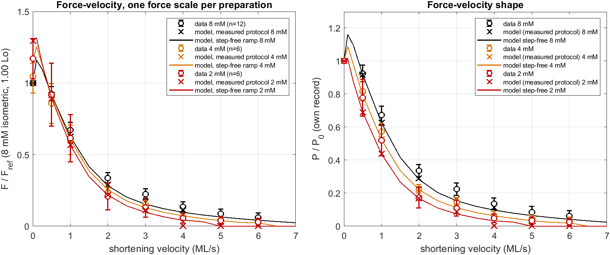
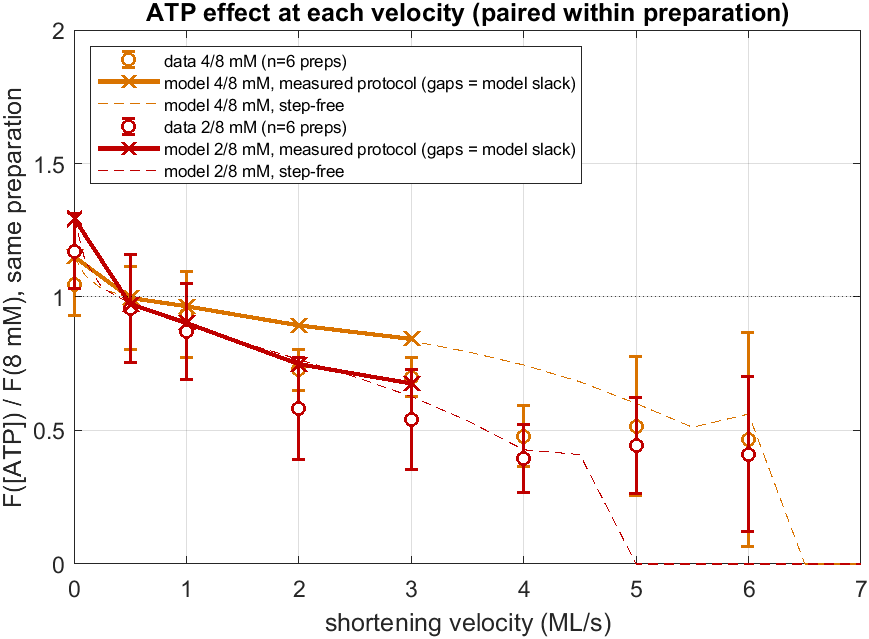
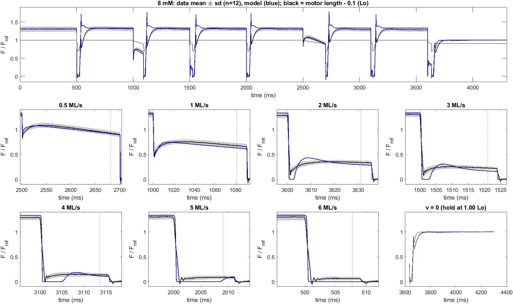
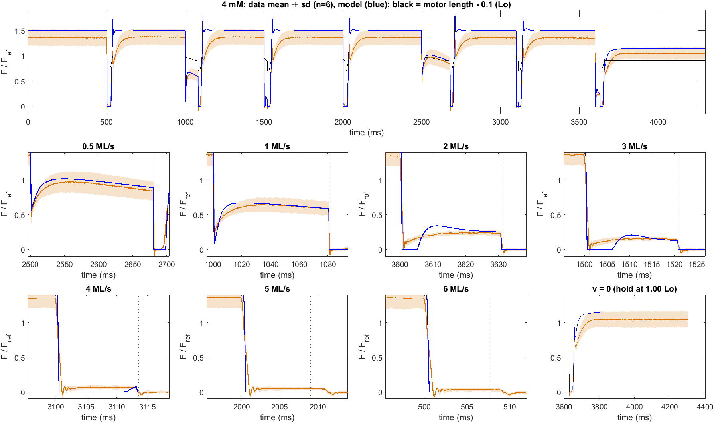
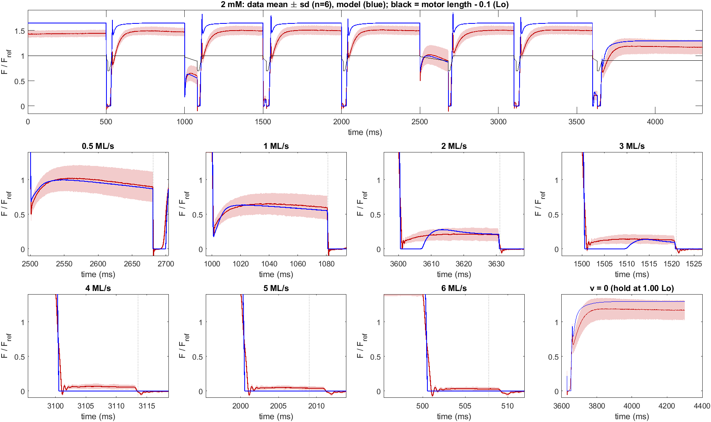

# FV_Beard2022: the incumbent against the full Beard/Baker 2022 isovelocity dataset (8 / 4 / 2 mM)

**Issue:** #75 · **Status:** done (findings; needs the PI's judgment) · **Authors:** Claude (AI agent) for fjezek · **Date:** 2026-11-05
**Data:** `data/Beard2022/` (untracked; `data/` is gitignored). 12 rat-trabecula preparations, 2021-05-11 to 06-30, the dataset behind Beard, …, Baker, *Reduced cardiac muscle power with low ATP simulating heart failure*, Biophys J 2022.
**Model:** `robust1_seed` (the Paper-1 incumbent, as in `Analyses/PooledFitFigures`). 2 mM uses fit A, the k2 power gate with R2 ×0.54. **4 mM uses the same gate evaluated at 4 mM** (R2 ×0.735), so it is a pure prediction from [ATP]. Nothing was refitted.

## Bottom line

1. **At 8 mM the model's F–V sits 0.045–0.06 F_ref below the 12-preparation mean at 1–6 ML/s** (z −0.8 to −1.9). Vmax is **4.6 vs 5.8 ML/s** (Hill medians). Half of that gap is not F–V at all: at ≥ 2 ML/s the protocol's pre-ramp step leaves the **model slack for 2–8.5 ms**, so it goes to **0 kPa at 6 ML/s**, while the data never go slack.
2. **The 4 mM prediction is within 1 sd up to 3 ML/s on F–V level** (|z| ≤ 0.9, RMS 0.040 F_ref). The **ATP effect does not grow with speed the way the data's does.** At 2–3 ML/s the measured 4/8 ratio is **0.70–0.73**, against a model **0.84–0.89** (≈2 sd, and the gap survives a split by running order). 2 mM shows the same pattern at 1 sd (0.54–0.58 vs 0.68–0.75).
3. **The isometric ATP effect is over-predicted.** 4/8 is **1.15 vs 1.05 ± 0.12** and 2/8 is **1.30 vs 1.17 ± 0.14**; both are within 1 sd, but the data ratios are rundown-contaminated (§4). On the traces, **every re-stretch gives the wrong-signed transient**: 5 ms after the +0.3 ML re-stretch the data sit at **0.68** of the following hold and the model at **1.04** (an overshoot). The data take ~50 ms to recover.

What this changes: the single-prep F–V target (`2021 06 15`, one of these 12) is replaceable by a 12-prep pool with error bars and a held-out 4 mM arm. Two model defects that the old target could not see are now measurable: the post-step slack and the speed-dependence of the ATP effect.

## Question

How well does the incumbent, with no refit, reproduce three things:
1. the raw isovelocity traces, which were never used before;
2. the 4 mM F–V points, which were never fitted;
3. the 4 mM traces?

The only freedom is one force scale per preparation.

## Method

- **Data.** Each workbook sheet is **one continuous 4.3 s motor record** (Time ms, L in Lo, F in kPa; 0.05 ms). It holds the whole sequence. The muscle holds isometric at 1.10 Lo. Each cycle is a fast step, then constant-velocity shortening through 1.00 Lo, then a slack release to ~0.80 Lo, then a +0.3 ML re-stretch to 1.10 Lo. The cycles run at v = 6, 1, 3, 5, 0.5, 4 and 2 ML/s. Last comes a slack and re-stretch to 1.00 Lo and a hold there, which gives the v = 0 point. Cycle onsets agree to **< 0.7 ms across all 24 sheets**, so the traces pool on one time axis. Design: 3 preps each of 8→4, 4→8, 8→2 and 2→8 (n = 12 at 8 mM, 6 at 4 mM, 6 at 2 mM).
- **Loader** `loadBeard2022FV.m` (cached in `results/`). **Reader** `readIsoV.m`: the mean force over ±0.5 ms around the first sample where the measured length crosses 1.00 Lo; v = 0 is the mean of the last 200 ms. Against the workbook's own `iso-V force` column it agrees to a **median 0.13 kPa (95 % 0.63, max 2.07 kPa; n = 192)**. Measured ramp speeds are 0.996–1.006 × nominal.
- **Model input.** Each sheet's own length record is converted to a piecewise-constant velocity table (`buildVelocityTable.m`, Ramer–Douglas–Peucker, tol 5·10⁻⁴ Lo, RMS 2·10⁻⁴ Lo), after a 2 s isometric warm-up at 1.10 Lo (SL 2.2 µm). There are 24 simulations, one per sheet at that sheet's [ATP] (`RunFVBeard2022.m`).
- **Model readout.** Model force is read with **the same reader on the data's own length timing**, so reader bias is shared.
- **Scale.** There is one scale per preparation: model 8 mM F(1.00 Lo) := measured 8 mM F(1.00 Lo). It is carried unchanged to that preparation's 4 or 2 mM record, so the ATP force ratio is predicted. Scales are a median 1.01 (0.84–1.64); F_ref = 58.0 ± 11.7 kPa. Everything below is in units of F_ref.
- **Reference.** The model's own step-free F–V (`RunFVBeard2022Steady.m`: pure ramp SL 2.2 → 2.0, the `runFVExperiment` protocol) separates F–V from the step.

## Results

### 1. F–V points, all three [ATP]



| v (ML/s) | 8 mM data (n=12) | model | z | 4 mM data (n=6) | model | z | 2 mM data (n=6) | model | z |
|---|---|---|---|---|---|---|---|---|---|
| 0 | 1 | 1 | — | 1.047 ± 0.118 | 1.152 | +0.9 | 1.171 ± 0.141 | 1.295 | +0.9 |
| 0.5 | 0.925 ± 0.050 | 0.916 | −0.2 | 0.858 ± 0.140 | 0.913 | +0.4 | 0.919 ± 0.220 | 0.892 | −0.1 |
| 1 | 0.672 ± 0.055 | 0.628 | −0.8 | 0.604 ± 0.103 | 0.605 | 0.0 | 0.615 ± 0.165 | 0.567 | −0.3 |
| 2 | 0.336 ± 0.038 | 0.291 | −1.2 | 0.237 ± 0.036 | 0.260 | +0.6 | 0.207 ± 0.093 | 0.217 | +0.1 |
| 3 | 0.224 ± 0.036 | 0.165 | −1.6 | 0.153 ± 0.025 | 0.139 | −0.6 | 0.130 ± 0.067 | 0.112 | −0.3 |
| 4 | 0.136 ± 0.035 | 0.113 | −0.6 | 0.066 ± 0.026 | 0.000 | −2.6 | 0.056 ± 0.034 | 0 | −1.7 |
| 5 | 0.086 ± 0.033 | 0.033 | −1.6 | 0.044 ± 0.023 | 0 | −1.9 | 0.040 ± 0.028 | 0 | −1.4 |
| 6 | 0.061 ± 0.032 | 0 | −1.9 | 0.030 ± 0.023 | 0 | −1.3 | 0.028 ± 0.027 | 0 | −1.0 |
| **RMS (v>0)** | | **0.046** | mean \|z\| 1.14 | | **0.040** | 1.06 | | **0.036** | 0.70 |

Hill fits per record (P/P0, v > 0; medians, because single-record fits on 7 noisy points have outliers):

| | Vmax data | Vmax model | a/F0 data | a/F0 model | max power data | model |
|---|---|---|---|---|---|---|
| 8 mM | **5.8** (IQR 1.8) | **4.6** | 0.60 | 0.89 | 0.69 | 0.63 |
| 4 mM | 4.4 (0.9) | 3.7 | 0.75 | 0.79 | 0.58 | 0.53 |
| 2 mM | 3.4 (1.2) | 3.7 | 0.66 | 0.44 | 0.52 | 0.44 |

The data's **Vmax falls 5.8 → 4.4 → 3.4 ML/s with [ATP]**. The model's measured-protocol Vmax is set by where it goes slack (§3), so it barely moves (4.6 → 3.7 → 3.7). Its step-free curve does move: it reaches zero at > 7, 6.5 and 5.0 ML/s. Even the step-free model is **~30 % low at high speed** at 8 mM (4 ML/s: 0.097 vs 0.136; 6 ML/s: 0.042 vs 0.061). The step-free curve also shows the known non-monotonic hump, **+16 % at 0.1 ML/s** (`Analyses/KtrProtocolVsSlackKtr`). The data have no point there to test it.

### 2. The ATP effect at each speed (paired within preparation)



| ratio | 0 | 1 | 2 | 3 ML/s |
|---|---|---|---|---|
| 4/8 data, mean (8 first \| 4 first) | 1.047 (0.954 \| 1.140) | 0.934 (0.790 \| 1.078) | **0.727** (0.659 \| 0.795) | **0.699** (0.677 \| 0.721) |
| 4/8 model | 1.152 | 0.965 | **0.894** | **0.843** |
| 2/8 data, mean (8 first \| 2 first) | 1.171 (1.095 \| 1.248) | 0.872 (0.763 \| 0.982) | **0.582** (0.465 \| 0.699) | **0.541** (0.472 \| 0.610) |
| 2/8 model | 1.295 | 0.903 | **0.749** | **0.676** |

In the data, low ATP raises isometric force but **cuts force at 2–3 ML/s by 30 % (4 mM) and 45 % (2 mM)**. The model cuts it by only 11–16 % and 25–32 %. At 4 mM the gap is ~2 sd and lies outside **both** running orders, so it is not rundown. A k2-only gate at a fixed power exponent cannot carry this. At ≥ 4 ML/s the model ratio is undefined (the model is slack).

### 3. Traces





Every record is shown separately in [figures/appendix_all_records.png](figures/appendix_all_records.png).

| | ramp-window RMSE (per record, F_ref) | samples within 1 sd / 2 sd of the data envelope | envelope sd | hold at 1.00 Lo, RMS |
|---|---|---|---|---|
| 8 mM (n=12) | 0.070 ± 0.018 | 80 % / 94 % | 0.048 | 0.005 (scaled here) |
| **4 mM (n=6)** | **0.118 ± 0.040** | **77 % / 89 %** | 0.097 | 0.105 |
| 2 mM (n=6) | 0.153 ± 0.041 | 80 % / 92 % | 0.134 | 0.116 |

Three trace-level defects show up in every record:

- **Post-step slack.** For how long the model force is < 0.01 F_ref after the pre-ramp step (median, ms), against ramp durations of 199 / 90 / 35 / 23 / 15 / 10.5 / 8.6 ms:

  | v (ML/s) | 0.5 | 1 | 2 | 3 | 4 | 5 | 6 |
  |---|---|---|---|---|---|---|---|
  | 8 mM | 0 | 0 | 2.1 | 2.4 | 4.6 | 8.2 | 8.5 (whole ramp) |
  | 4 mM | 0 | 0 | 4.7 | 5.7 | 11 | 10 (whole) | 8.5 (whole) |
  | 2 mM | 0 | 0 | 6.7 | 9.4 | 13 | 10 (whole) | 8.5 (whole) |

  The data **never go slack**: the 8 mM minima during the ramps are 0.178 / 0.162 / 0.094 / 0.044 / 0.034 at 2–6 ML/s. After the slack the model **overshoots** (2–3 ML/s), so its read value is partly right for the wrong reason. **The step stiffness itself is right**: at 1 ML/s the step trough is 0.447 model vs 0.452 data. The defect is redevelopment while shortening, and it worsens as ATP falls. (This corrects a first impression, given in chat while the runs were going, that the model is ~2× too stiff.)
- **Re-stretch transient has the wrong sign.** The re-stretch is +0.3 ML at ~15 ML/s, from slack to the 1.10 hold. Force after it, as a fraction of the following hold (median over 7 cycles):

  | | +5 ms data / model | +20 ms | +50 ms |
  |---|---|---|---|
  | 8 mM | 0.68 / **1.04** | 0.81 / 1.05 | 0.96 / 1.01 |
  | 4 mM | 0.70 / 0.98 | 0.81 / 1.01 | 0.93 / 1.00 |
  | 2 mM | 0.65 / 0.88 | 0.76 / 0.94 | 0.90 / 0.98 |

  The data dip and recover over ~50 ms. The model spikes and is settled in ~10 ms. This is the same family as the slack-protocol re-stretch overshoot (#19, #20), seen here on a different preparation set and a larger stretch.
- **Length dependence and the low-ATP lift.** Force in the 1.10 Lo holds, in units of F(1.00 Lo, 8 mM):

  | | data | model |
  |---|---|---|
  | 8 mM | 1.28 | 1.33 |
  | 4 mM | 1.35 | 1.50 |
  | 2 mM | 1.50 | 1.65 |

  At 8 mM the model's F(1.10)/F(1.00) is 4 % steep. The ATP lift is over-predicted at both lengths, consistent with §4.
- **The 0.5 and 1 ML/s ramps decline too steeply.** The model loses force faster along the ramp than the data (1 ML/s, figure panel). That is the force–length slope during shortening, from 1.10 to 1.00 Lo.

### 4. Caveat: rundown is in the ATP ratios

The paired ratios move strongly with running order. At v = 0, 4/8 is 0.954 when 8 mM ran first and 1.140 when 4 mM ran first; 2/8 is 1.095 vs 1.248. Whichever record ran second is depressed. The balanced design cancels this only to first order, and `RundownCorrection/strategy.md` shows that 2→8 carries ≈3× the bias of 8→2. **No rundown correction is applied here.** The isometric over-prediction (+0.10 / +0.12) is therefore inside the uncertainty. The speed-dependence of the ATP effect (§2) is not: it holds in both orders.

## Did the expectation hold?

The issue set no numeric prediction. The implicit one was that a model fitted to the single 06/15 F–V would land inside the 12-prep pool at 8 mM and predict 4 mM. **Partly.** On level it does: 8 mM is within 2 sd at every point and 4 mM within 1 sd to 3 ML/s. It fails on the **high-speed end**, through post-step slack and Vmax 4.6 vs 5.8, and on **how the ATP effect scales with speed**.

## Next steps (filed as issues)

See the hand-off comment on #75 for the issue numbers.

- Post-step slack and too-slow force redevelopment while shortening (model defect, worse at low ATP).
- ATP effect at 2–3 ML/s is under-predicted by the k2-only gate (relates to #23 and #4).
- Replace the single-prep F–V target with the 12-prep Beard2022 pool, with 4 mM as a held-out arm (relates to #28).

## Reproduce

```matlab
% ~15 min on 4 workers (24 x ~130 s), then ~1 min, then ~20 s
run('Analyses/FV_Beard2022/RunFVBeard2022.m')          % -> results/sims.mat (+ per-record checkpoints)
run('Analyses/FV_Beard2022/RunFVBeard2022Steady.m')    % -> results/steady.mat
run('Analyses/FV_Beard2022/RunFVBeard2022Analysis.m')  % -> results/metrics.mat, figures/*.png, tables
```

The first `loadBeard2022FV()` call reads the 12 xlsx files (~2.5 min) and caches them to `results/beard2022_fv_raw.mat`. On a machine with < 8 GB free, use ≤ 4 workers: a 6-worker pool lost a worker mid-run here.
