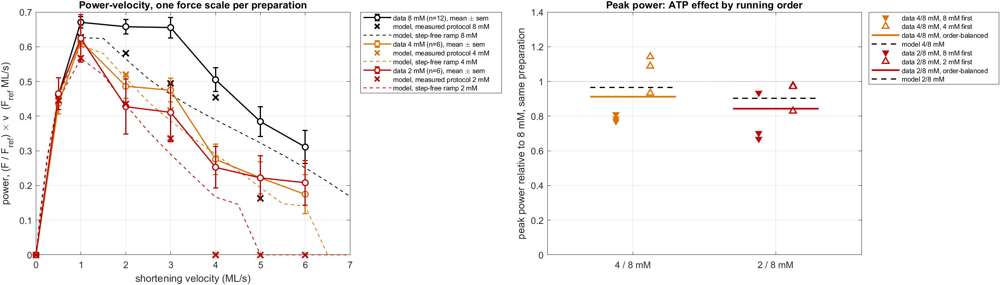

# FV_Beard2022: the incumbent against the full Beard/Baker 2022 isovelocity dataset (8 / 4 / 2 mM)

**Issue:** #75 · **Status:** done, revised after the PI review of 2026-11-09 · **Authors:** Claude (AI agent) for fjezek · **Reviewed by:** fjezek · **Date:** 2026-11-05, revised 2026-11-10
**Data:** `data/Beard2022/` (untracked; `data/` is gitignored). 12 mouse-trabecula preparations (C57BL/6J per the paper; the lab should confirm), 2021-05-11 to 06-30, the dataset behind Beard, …, Baker, *Reduced cardiac muscle power with low ATP simulating heart failure*, Biophys J 2022.
**Model:** `robust1_seed` (the Paper-1 incumbent, as in `Analyses/PooledFitFigures`). 2 mM uses fit A, the k2 power gate with R2 ×0.54. **4 mM is that gate's power law evaluated at 4 mM** (R2 ×0.735): an interpolation through the 2 mM point with nothing tuned at 4 mM. The concentration-driven nucleotide set (ADP/Pi/rigor) was not run. Nothing was refitted.

## Bottom line

1. **At 8 mM the model's F–V sits 0.04–0.05 F_ref below the 12-preparation mean at 1–6 ML/s** (except 4 ML/s, −0.01). That is inside the spread of preparations (z −0.4 to −1.9) but **not the mean preparation**: five of the seven points are 2.7–6.6 standard errors low. Vmax is **4.6 vs 5.5 ML/s** (Hill medians). Part of the gap is not F–V at all: at ≥ 2 ML/s the pre-ramp step leaves the **model slack for 2–8.5 ms**, so it reads **0 at 6 ML/s**, while the data never go slack.
2. **The 4 mM prediction is within 1 sd and within 2 standard errors up to 3 ML/s** (|z| ≤ 0.7, RMS 0.038 F_ref). **The model under-predicts how much low ATP cuts force at 2–3 ML/s, but the evidence is weaker than first reported.** With the force baseline subtracted, the measured 4/8 ratio is **0.77 / 0.75** against a model **0.89 / 0.84** (1.2–1.3 sd, about 3 standard errors). The gap is carried by the preparations that ran 8 mM first (0.67 / 0.71); in those that ran 4 mM first the ratio is 0.87 / 0.79, within 0.03–0.05 of the model. At 2 mM the same direction holds at 1.3–1.8 standard errors (0.60 / 0.58 vs 0.75 / 0.68).
3. **The isometric ATP effect is over-predicted, within the uncertainty.** 4/8 is **1.15 vs 1.07 ± 0.12** and 2/8 is **1.30 vs 1.18 ± 0.14**; the data ratios are rundown-contaminated (§4). On the traces, **every re-stretch gives the wrong-signed transient**: 5 ms after the +0.3 ML re-stretch the data sit at **0.67** of the following hold and the model at **1.04** (an overshoot). The data take ~50 ms to recover.
4. **The 4 and 2 mM protocol is not the 8 mM protocol** (new in this revision). At 0.5–4 ML/s its pre-ramp step is 0.01 Lo larger and the force is read 2–20 ms sooner after the step. The model is driven by each record's own length, so model and data are compared like for like, but the measured ATP ratio at those speeds is not a pure ATP effect. #88 quantifies it.

What this changes: the single-prep F–V target (`2021 06 15`, one of these 12) is replaceable by a 12-prep pool with error bars and a held-out 4 mM arm. One model defect that the old target could not see is now firmly measurable (the post-step slack). The speed-dependence of the ATP effect is a second candidate, at about 3 standard errors and not separable from rundown.

## What the revision changed

| | first version | revised |
|---|---|---|
| Force baseline | not subtracted | every force is F − F0, with F0 read in the slack after each ramp (the workbook's `zero` column), the same for data and model |
| 4/8 at 2 / 3 ML/s (data) | 0.73 / 0.70 | **0.77 / 0.75** |
| 2/8 at 2 / 3 ML/s (data) | 0.58 / 0.54 | **0.60 / 0.58** |
| Gap to the model at 3 ML/s | 0.144 (4 mM), 0.135 (2 mM) | **0.091, 0.098** |
| "Outside both running orders" | claimed | **withdrawn**: with 4 mM first the ratio is within 0.03–0.05 of the model |
| Trace windows | the 8 mM cycle timing for all [ATP] | each [ATP]'s own timing (the protocols differ) |
| z-scores | against the between-preparation sd | also against the standard error of the mean |
| Species | "rat" | mouse |

The baseline matters because it differs by [ATP]: **+0.61 ± 1.11 kPa at 8 mM, 0.00 ± 0.85 at 4 mM, −0.30 ± 0.57 at 2 mM** (the model's is 0). At 6 ML/s it is 18 % of the 8 mM point. Our baseline reader agrees with the workbook's `zero` column to a median 0.07 kPa (95 % 0.25, max 0.51; n = 192).

## Question

How well does the incumbent, with no refit, reproduce three things:
1. the raw isovelocity traces, which were never used before;
2. the 4 mM F–V points, which were never fitted;
3. the 4 mM traces?

The only freedom is one force scale per preparation.

## Method

- **Data.** Each workbook sheet is **one continuous 4.3 s motor record** (Time ms, L in Lo, F in kPa; 0.05 ms). It holds the whole sequence. The muscle holds isometric at 1.10 Lo. Each cycle is a fast step, then constant-velocity shortening through 1.00 Lo, then a slack release to ~0.80 Lo, then a +0.3 ML re-stretch to 1.10 Lo. The cycles run at v = 6, 1, 3, 5, 0.5, 4 and 2 ML/s. Last comes a slack and re-stretch to 1.00 Lo and a hold there, which gives the v = 0 point. Design: 3 preps each of 8→4, 4→8, 8→2 and 2→8 (n = 12 at 8 mM, 6 at 4 mM, 6 at 2 mM).
- **Protocol differs by [ATP].** Cycle onsets are common to all 24 sheets, and within one [ATP] every record agrees to < 0.1 ms. Between 8 mM and the low-ATP sheets, five of the seven cycles differ:

  | v (ML/s) | 0.5 | 1 | 2 | 3 | 4 | 5 | 6 |
  |---|---|---|---|---|---|---|---|
  | length after the step, 8 mM (Lo) | 1.090 | 1.079 | 1.058 | 1.057 | 1.046 | 1.036 | 1.035 |
  | length after the step, 4 and 2 mM | 1.080 | 1.069 | 1.048 | 1.047 | 1.036 | 1.036 | 1.035 |
  | onset to the 1.00 Lo read, 8 mM (ms) | 180 | 80 | 31 | 21 | 13 | 8.7 | 7.3 |
  | onset to the read, 4 and 2 mM (ms) | 160 | 71 | 26 | 17 | 11 | 8.7 | 7.3 |

  The ramp speed and the length at the read are the same. Traces are therefore pooled and windowed per [ATP].
- **Loader** `loadBeard2022FV.m` (cached in `results/`). **Reader** `readIsoV.m`: the mean force over ±0.5 ms around the first sample where the measured length crosses 1.00 Lo; v = 0 is the mean of the last 200 ms; the baseline F0 is the mean force while the preparation hangs slack after the ramp. Against the workbook's own `iso-V force` column the raw read agrees to a **median 0.13 kPa (95 % 0.63, max 2.07 kPa; n = 192)**. Measured ramp speeds are 0.996–1.006 × nominal.
- **Model input.** Each sheet's own length record is converted to a piecewise-constant velocity table (`buildVelocityTable.m`, Ramer–Douglas–Peucker, tol 5·10⁻⁴ Lo, RMS 2·10⁻⁴ Lo), after a 2 s isometric warm-up at 1.10 Lo (SL 2.2 µm). There are 24 simulations, one per sheet at that sheet's [ATP] (`RunFVBeard2022.m`).
- **Model readout.** Model force is read with **the same reader on the data's own length timing**, baseline included, so reader bias is shared.
- **Scale.** There is one scale per preparation: model 8 mM F(1.00 Lo) := measured 8 mM F(1.00 Lo). It is carried unchanged to that preparation's 4 or 2 mM record, so the ATP force ratio is predicted. Scales are a median 0.99 (0.84–1.62); F_ref = 57.4 ± 11.5 kPa. Everything below is in units of F_ref.
- **Two z-scores.** *z* divides the model's error by the between-preparation sd: is the model inside the spread of preparations? *z_sem* divides by sd/√n: is the model the mean preparation?
- **Reference.** The model's own step-free F–V (`RunFVBeard2022Steady.m`: pure ramp SL 2.2 → 2.0, the `runFVExperiment` protocol) separates F–V from the step.

## Results

### 1. F–V points, all three [ATP]


| v (ML/s) | 8 mM data (n=12) | model | z | z_sem | 4 mM data (n=6) | model | z | z_sem | 2 mM data (n=6) | model | z | z_sem |
|---|---|---|---|---|---|---|---|---|---|---|---|---|
| 0 | 1 | 1 | — | — | 1.065 ± 0.123 | 1.152 | +0.7 | +1.7 | 1.182 ± 0.143 | 1.295 | +0.8 | +2.0 |
| 0.5 | 0.924 ± 0.052 | 0.916 | −0.1 | −0.5 | 0.872 ± 0.147 | 0.913 | +0.3 | +0.7 | 0.929 ± 0.223 | 0.892 | −0.2 | −0.4 |
| 1 | 0.671 ± 0.056 | 0.628 | −0.8 | −2.7 | 0.615 ± 0.110 | 0.605 | −0.1 | −0.2 | 0.624 ± 0.167 | 0.567 | −0.3 | −0.8 |
| 2 | 0.329 ± 0.037 | 0.291 | −1.0 | −3.6 | 0.243 ± 0.043 | 0.260 | +0.4 | +1.0 | 0.214 ± 0.097 | 0.217 | 0.0 | +0.1 |
| 3 | 0.218 ± 0.034 | 0.165 | −1.6 | −5.4 | 0.158 ± 0.028 | 0.139 | −0.7 | −1.7 | 0.137 ± 0.069 | 0.112 | −0.4 | −0.9 |
| 4 | 0.126 ± 0.030 | 0.113 | −0.4 | −1.5 | 0.069 ± 0.027 | 0.000 | −2.5 | −6.2 | 0.063 ± 0.036 | 0 | −1.7 | −4.2 |
| 5 | 0.077 ± 0.029 | 0.033 | −1.5 | −5.2 | 0.044 ± 0.023 | 0 | −2.0 | −4.8 | 0.044 ± 0.031 | 0 | −1.4 | −3.5 |
| 6 | 0.052 ± 0.027 | 0 | −1.9 | −6.6 | 0.029 ± 0.023 | 0 | −1.3 | −3.1 | 0.035 ± 0.026 | 0 | −1.3 | −3.2 |
| **RMS (v>0)** | | **0.040** | mean \|z\| 1.05 | 3.6 | | **0.038** | 1.03 | 2.5 | | **0.042** | 0.77 | 1.9 |

Read by z, the model is inside the envelope almost everywhere. Read by z_sem, the 8 mM curve is systematically low from 1 ML/s up, and all three [ATP] fail at ≥ 4 ML/s, where the model is slack.

Hill fits per record (P/P0, v > 0; medians, because single-record fits on 7 noisy points have outliers):

| | Vmax data | Vmax model | a/F0 data | a/F0 model | max power data | model |
|---|---|---|---|---|---|---|
| 8 mM | **5.5** (IQR 1.9) | **4.6** | 0.61 | 0.89 | 0.68 | 0.63 |
| 4 mM | 4.4 (0.9) | 3.7 | 0.72 | 0.79 | 0.58 | 0.53 |
| 2 mM | 3.5 (0.8) | 3.7 | 0.64 | 0.44 | 0.52 | 0.44 |

The data's **Vmax falls 5.5 → 4.4 → 3.5 ML/s with [ATP]**. The model's measured-protocol Vmax is set by where it goes slack (§3), so it barely moves (4.6 → 3.7 → 3.7). Its step-free curve does move: it reaches zero at > 7, 6.5 and 5.0 ML/s. Even the step-free model is **~20 % low at high speed** at 8 mM (4 ML/s: 0.097 vs 0.126; 6 ML/s: 0.042 vs 0.052). The step-free curve also shows the known non-monotonic hump, **+16 % at 0.1 ML/s** (`Analyses/KtrProtocolVsSlackKtr`). The data have no point there to test it.

### 2. The ATP effect at each speed (paired within preparation)


| ratio | 0 | 1 | 2 | 3 ML/s |
|---|---|---|---|---|
| 4/8 data, mean (8 first \| 4 first) | 1.065 (0.961 \| 1.169) | 0.955 (0.800 \| 1.111) | **0.769** (0.673 \| 0.865) | **0.751** (0.711 \| 0.791) |
| 4/8 data without the baseline | 1.047 | 0.934 | 0.727 | 0.699 |
| 4/8 model | 1.152 | 0.965 | **0.894** | **0.843** |
| 4/8 model − data, in sd \| in standard errors | +0.7 \| +1.7 | +0.1 \| +0.1 | +1.2 \| +2.8 | +1.3 \| +3.2 |
| 2/8 data, mean (8 first \| 2 first) | 1.182 (1.103 \| 1.260) | 0.889 (0.768 \| 1.010) | **0.604** (0.481 \| 0.728) | **0.578** (0.491 \| 0.666) |
| 2/8 data without the baseline | 1.171 | 0.872 | 0.582 | 0.541 |
| 2/8 model | 1.295 | 0.903 | **0.749** | **0.676** |
| 2/8 model − data, in sd \| in standard errors | +0.8 \| +2.0 | +0.1 \| +0.2 | +0.7 \| +1.8 | +0.5 \| +1.3 |

In the data, low ATP raises isometric force but **cuts force at 2–3 ML/s by 23–25 % (4 mM) and 40–42 % (2 mM)**. The model cuts it by 11–16 % and 25–32 %. Three things limit what this shows:

- **Size.** The 4 mM gap is about 3 standard errors (n = 6); the 2 mM gap is under 2.
- **Rundown.** The gap sits in the preparations that ran 8 mM first. Where the low-ATP record ran first, the 4/8 ratio (0.87 / 0.79) is within 0.03–0.05 of the model, and the 2/8 ratio (0.73 / 0.67) is at the model.
- **Protocol.** At 2–3 ML/s the low-ATP records step 0.01 Lo further and are read 3–5 ms sooner (Method). The model sees the same lengths, so this does not bias model against data, but it means the measured ratio mixes an ATP effect with a protocol effect.

A Michaelis–Menten gate through the same 2 mM point would give R2 ×0.78 at 4 mM instead of the power law's ×0.735, so it would predict a slightly smaller 4 mM effect and a slightly larger gap. At ≥ 4 ML/s the model ratio is undefined (the model is slack).

### 2b. Power–velocity (added 2026-11-11 on the PI's request)

Power = (F / F_ref) × v per preparation, in F_ref·ML/s. The same data as §1, but the ATP levels separate more clearly because power weights the mid-speed range.



Mean power at each measured speed:

| v (ML/s) | 0.5 | 1 | 2 | 3 | 4 | 5 | 6 |
|---|---|---|---|---|---|---|---|
| 8 mM data (n = 12) | 0.46 | 0.67 | 0.66 | 0.66 | 0.51 | 0.38 | 0.31 |
| 8 mM model | 0.46 | 0.63 | 0.58 | 0.50 | 0.45 | 0.16 | 0 |
| 4 mM data (n = 6) | 0.44 | 0.62 | 0.49 | 0.48 | 0.28 | 0.22 | 0.18 |
| 4 mM model | 0.46 | 0.61 | 0.52 | 0.42 | 0 | 0 | 0 |
| 2 mM data (n = 6) | 0.47 | 0.62 | 0.43 | 0.41 | 0.25 | 0.22 | 0.21 |
| 2 mM model | 0.45 | 0.57 | 0.44 | 0.34 | 0 | 0 | 0 |

- **At 8 mM the measured power is flat from 1 to 3 ML/s** (0.66–0.67) and the model's is not: it peaks at 1 ML/s (0.63) and has lost a quarter by 3 ML/s (0.50). This is the same 0.04–0.05 F_ref force gap as §1, but in power it is a missing plateau, not a small offset.
- **Low ATP removes that plateau.** At 2–3 ML/s the 4 and 2 mM records give 0.41–0.49 against 0.66 at 8 mM, while at 0.5–1 ML/s the three levels agree within 0.05. The ATP effect on power is a loss of the high-speed half of the curve.
- **Peak power** (largest of the seven measured speeds, 1 ML/s in the median preparation at every ATP level) is 0.70 ± 0.02 at 8 mM against a model 0.63.
- **Peak power paired within a preparation**, low ATP over 8 mM:

| | 8 mM first | low ATP first | order-balanced | model |
|---|---|---|---|---|
| 4 / 8 mM | 0.79 | 1.05 | 0.91 ± 0.03 | 0.97 |
| 2 / 8 mM | 0.77 | 0.93 | 0.84 ± 0.04 | 0.90 |

The model under-predicts the loss of peak power by 0.05–0.06, which is 1.4–1.9 standard errors of the order-balanced mean. The running order moves the ratio by more than the ATP level does (#92).

The speeds are coarse around the peak (0.5, 1, 2 ML/s), so peak power and its speed are lower bounds on the true maximum; no curve was fitted.

### 3. Traces


Every record is shown separately in [figures/appendix_all_records.png](figures/appendix_all_records.png).

| | ramp-window RMSE (per record, F_ref) | samples within 1 sd / 2 sd of the data envelope | envelope sd | hold at 1.00 Lo, RMS |
|---|---|---|---|---|
| 8 mM (n=12) | 0.069 ± 0.018 | 82 % / 94 % | 0.048 | 0.005 (scaled here) |
| **4 mM (n=6)** | **0.124 ± 0.038** | **80 % / 91 %** | 0.112 | 0.087 |
| 2 mM (n=6) | 0.157 ± 0.051 | 81 % / 92 % | 0.148 | 0.105 |

Trace-level defects that show up in every record:

- **Post-step slack.** For how long the model force is < 0.01 F_ref between the cycle onset and the slack release (median over records, ms). Ramp durations are 199 / 90 / 35 / 23 / 15 / 10.5 / 8.6 ms at 8 mM and 180 / 80 / 30 / 20 / 12.7 / 10.5 / 8.6 ms at 4 and 2 mM:

  | v (ML/s) | 0.5 | 1 | 2 | 3 | 4 | 5 | 6 |
  |---|---|---|---|---|---|---|---|
  | 8 mM | 0 | 0 | 2.1 | 2.4 | 4.6 | 8.2 | 8.5 (whole ramp) |
  | 4 mM | 0 | 0 | 4.7 | 5.7 | 11.3 | 10.5 (whole) | 8.5 (whole) |
  | 2 mM | 0 | 0 | 6.7 | 9.4 | 12.6 (whole) | 10.5 (whole) | 8.5 (whole) |

  The data **never go slack**. Their lowest force during the ramp (pooled mean, 2 ms smoothing, from 2 ms after the onset, so the step's ringing is left out) is 0.191 / 0.173 / 0.098 / 0.049 / 0.039 at 2–6 ML/s at 8 mM, 0.114 / 0.088 / 0.050 / 0.042 / 0.027 at 4 mM and 0.126 / 0.099 / 0.059 / 0.043 / 0.028 at 2 mM. After the slack the model **overshoots** (2–3 ML/s), so its read value is partly right for the wrong reason. **At 8 mM the step itself is right**: at 1 ML/s the step trough is 0.447 in both model and data. After the larger low-ATP step the model falls further than the data (1 ML/s trough: 0.089 vs 0.199 at 4 mM, 0.176 vs 0.212 at 2 mM). The defect is redevelopment while shortening, and it worsens as ATP falls.
- **Re-stretch transient has the wrong sign.** The re-stretch is +0.3 ML at ~15 ML/s, from slack to the 1.10 hold. Force after it, as a fraction of the following hold (median over 7 cycles):

  | | +5 ms data / model | +20 ms | +50 ms |
  |---|---|---|---|
  | 8 mM | 0.67 / **1.04** | 0.81 / 1.05 | 0.96 / 1.01 |
  | 4 mM | 0.67 / 0.97 | 0.79 / 1.01 | 0.93 / 1.00 |
  | 2 mM | 0.63 / 0.87 | 0.74 / 0.94 | 0.89 / 0.98 |

  The data dip and recover over ~50 ms. The model spikes and is settled in ~10 ms. This is the same family as the slack-protocol re-stretch overshoot (#19, #20), seen here on a different preparation set and a larger stretch.
- **Length dependence and the low-ATP lift.** Force in the first 1.10 Lo hold, in units of F(1.00 Lo, 8 mM):

  | | data | model |
  |---|---|---|
  | 8 mM | 1.30 | 1.33 |
  | 4 mM | 1.38 | 1.50 |
  | 2 mM | 1.45 | 1.65 |

  At 8 mM the model's F(1.10)/F(1.00) is 2 % steep. The ATP lift is over-predicted at both lengths, consistent with §4.
- **The 0.5 and 1 ML/s ramps decline too steeply.** The model loses force faster along the ramp than the data (1 ML/s, figure panel). That is the force–length slope during shortening, from 1.10 to 1.00 Lo.

### 4. Caveat: rundown is in the ATP ratios

The paired ratios move strongly with running order. At v = 0, 4/8 is 0.961 when 8 mM ran first and 1.169 when 4 mM ran first; 2/8 is 1.103 vs 1.260. Whichever record ran second is depressed. The balanced design cancels this only to first order, and `RundownCorrection/strategy.md` shows that 2→8 carries ≈3× the bias of 8→2. **No rundown correction is applied here.** The isometric over-prediction (+0.09 / +0.11) is therefore inside the uncertainty, and so is most of the speed-dependence gap of §2.

## Did the expectation hold?

The issue set no numeric prediction. The implicit one was that a model fitted to the single 06/15 F–V would land inside the 12-prep pool at 8 mM and predict 4 mM. **Partly.** As a member of the population it does: 8 mM is within 2 sd at every point and 4 mM within 1 sd to 3 ML/s. As the mean preparation it does not: 8 mM is 3–7 standard errors low at most speeds. It fails on the **high-speed end**, through post-step slack and Vmax 4.6 vs 5.5. Whether it also fails on **how the ATP effect scales with speed** is not settled by these data.

## Next steps (filed as issues)

- **#77**: post-step slack and too-slow force redevelopment while shortening (model defect, worse at low ATP).
- **#78**: the ATP effect at 2–3 ML/s (now about 3 standard errors at 4 mM, rundown-confounded). First arm: the same 24 records on the concentration-driven set.
- **#79**: replace the single-prep F–V target with the 12-prep Beard2022 pool, with 4 mM as a held-out arm (after #77, with s²/n floors).
- **#88**: can the model be identified from these records alone, and are the data sound enough for a paper? It also quantifies the protocol difference between [ATP].
- **#86**: one pointer for the incumbent (`robust1_seed`).
- The re-stretch transient (§3) belongs to the existing #19 and #20, with no new issue.
- The `ktr fit` and `Passive fit` workbooks in the same folders are not analysed here.

## Reproduce

```matlab
% ~15 min on 4 workers (24 x ~130 s), then ~1 min, then ~20 s
run('Analyses/FV_Beard2022/RunFVBeard2022.m')          % -> results/sims.mat (+ per-record checkpoints)
run('Analyses/FV_Beard2022/RunFVBeard2022Steady.m')    % -> results/steady.mat
run('Analyses/FV_Beard2022/RunFVBeard2022Analysis.m')  % -> results/metrics.mat, figures/*.png, tables
```

`RunFVBeard2022Analysis.m` finds its own folder, so it runs from any checkout or worktree. Set `ZERO = false` before running it to get the numbers without the baseline subtraction. The first `loadBeard2022FV()` call reads the 12 xlsx files (~2.5 min) and caches them to `results/beard2022_fv_raw.mat`. On a machine with < 8 GB free, use ≤ 4 workers: a 6-worker pool lost a worker mid-run here.
