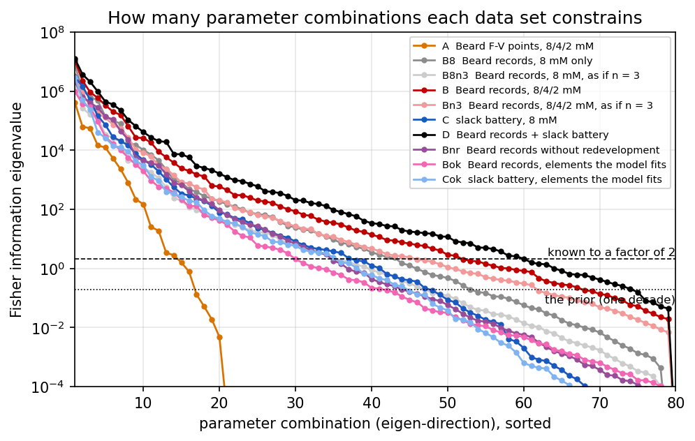
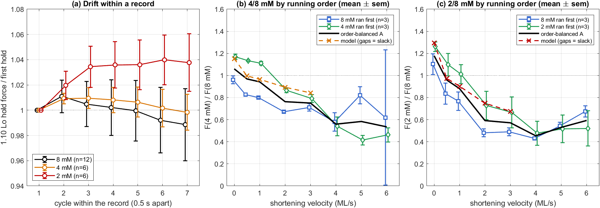

# FV_Identifiability: can the model be identified from the Beard2022 isovelocity data alone?

**Issue:** #88 · **Status:** findings · **Authors:** Claude (AI agent) for fjezek · **Reviewed by:** not yet · **Date:** 2026-11-10
**Data:** `data/Beard2022/` (untracked), 12 mouse-trabecula preparations, 24 isovelocity records (8 mM n = 12, 4 mM n = 6, 2 mM n = 6), baseline-subtracted with the #75 loader. Compared with the slack battery of the Paper-1 objective (pooled 8 mM, n = 3).
**Model:** `robust1_seed` + fit A (k2 power gate) as it stands. No model change, no refit, no objective change.

## Bottom line

1. **The F–V points alone cannot identify the model.** 23 points (8/4/2 mM) pin 5 of 80 parameters and about 10 parameter combinations.
2. **The full records carry as much information as the slack battery, and add the ATP dimension.** At 8 mM the two span the same number of constrained directions (15 / 24 / 35 within 4 / 5 / 6 decades of the stiffest, against 15 / 24 / 36). With the low-ATP records the Beard2022 set nominally identifies 45 parameters against the battery's 23, and nothing is identified by the battery that the records miss. The two together identify 55.
3. **The model cannot use most of that information.** It reproduces 133 of the 384 record elements within 3 standard errors (χ²/N = 123 on the traces, 11 on the F–V points), against 89 of 95 for the slack battery (χ²/N = 2.1). 75 % of the records' information sits in the redevelopment after the re-stretch, which the model gets wrong (#19, #20). Restricted to what the model fits, the records identify 21 parameters, the battery 22.
4. **The linear verdicts are not validated.** A known move of one parameter is recovered within ±50 % in about half the tests (15 of 28 for the records, 5 of 12 for the battery); a known move of all parameters at once (sd 10 %) is not recovered at all in either data set. A real ×2 move along directions the Fisher information calls nearly free for the records changes them by 220–2,500 χ² units against a predicted 1–2 (§5). Read the counts as a like-for-like comparison of two data sets, not as a promise that a fit would recover those parameters.
5. **The dataset is sound at 8 mM and not sufficient alone for the ATP claim.** Each preparation saw two ATP levels in one order with no 8 mM bracket; at 2 ML/s the 4/8 ratio is 0.67 when 8 mM ran first and 0.87 when 4 mM ran first. The ATP effect exists only under a symmetric-rundown assumption with n = 3 per order.

**For the decision:** identification is limited by the model, not by the amount of data. The Beard2022 records are a strong second target or held-out test at 8 mM. They do not replace the bracketed 8-4-8-2-8 experiments, whose job is the order-free ATP effect.

## Method

Feature vector per data tier, each element with the standard error of its mean (sem):

| Tier | Content | Elements | sem |
|---|---|---|---|
| A | Beard2022 F–V points at the 1.00 Lo crossing, 8/4/2 mM | 23 | between-preparation sd / √n, per-prep normalised by the 8 mM isometric force |
| B8 | Beard2022 records, 8 mM: F–V points + trace samples | 128 | same |
| B | Beard2022 records, 8/4/2 mM | 384 | same (n = 12 / 6 / 6) |
| C | slack battery (slack + ktr + passive + F–V), 8 mM | 95 | the objective's own floors, s²/n with n = 3 |
| D | B and C together | 479 | |

Trace samples are protocol-locked: 12 times after each cycle onset (step and ramp), 9 after each re-stretch (redevelopment), one in the first hold; slack periods are not sampled. Six battery entries are priors (bounds, penalties) and are left out.

Jacobian in log-parameters by a one-sided ×1.10 step over the 79 non-zero parameters of the lean pool plus `pAtp_k2`; Fisher information F = JᵀJ. Per parameter: `sFix` = 1/√F_jj (all others known) and `sFree` = √[(F + I/ln(10)²)⁻¹]_jj (all others free, one-decade prior). Verdict at ln 2: **identified** (sFree ≤ ln 2), **sloppy** (sFix ≤ ln 2 < sFree), **unidentified** (sFix > ln 2).

241 model evaluations (366 record simulations, 119 battery runs), none failed. Variants: `B8n3`/`Bn3` rescale the record sems to n = 3; `Bnr` drops the redevelopment samples; `Bok`/`Cok` keep only elements the incumbent reproduces within 3 sem.

## 1. What each tier constrains

| Tier | Elements | Identified | Sloppy | Unidentified | Directions within 4 / 5 / 6 decades |
|---|---|---|---|---|---|
| A, F–V points 8/4/2 mM | 23 | 5 | 50 | 25 | 10 / 12 / 16 |
| B8, records 8 mM | 128 | 28 | 49 | 3 | 15 / 24 / 35 |
| B8n3, as if n = 3 | 128 | 20 | 53 | 7 | 15 / 24 / 35 |
| B, records 8/4/2 mM | 384 | 45 | 33 | 2 | 18 / 28 / 41 |
| Bn3, as if n = 3 | 384 | 35 | 40 | 5 | 18 / 28 / 41 |
| C, slack battery | 95 | 23 | 44 | 12 | 15 / 24 / 36 |
| D, records + battery | 479 | 55 | 23 | 2 | 20 / 34 / 48 |
| Bnr, records without redevelopment | 195 | 27 | 38 | 15 | 17 / 25 / 34 |
| Bok, records the model fits | 133 | 21 | 48 | 11 | 17 / 24 / 33 |
| Cok, battery the model fits | 89 | 22 | 43 | 14 | 14 / 22 / 34 |



- **Sample size is not the main reason.** At n = 3 the 8 mM records identify 20 parameters (battery 23) and the three ATP levels 35.
- **The two noise models differ in kind.** Record sems are shape agreement after per-prep normalisation (median 0.015–0.026 F_ref). Battery sems are the objective floors (median 0.084 relative), which the force-block deadband defect is known to make too wide. The identified counts therefore favour the records; the direction counts in the last column do not depend on the overall sem scale and show the two at par at 8 mM.
- **Low ATP adds information beyond the ATP gate.** B identifies 17 parameters that B8 does not, among them `kd`, `kah`, `tau_reg`, `k_cr`, `tau_cr` and three SRX parameters.

## 2. Per parameter

Identified parameters by mechanism group:

| Group | Size | A | B8 | B | C | D |
|---|---|---|---|---|---|---|
| ATP gate (`pAtp_k2`) | 1 | 0 | 0 | 1 | not in tier | 1 |
| Cycle rates | 8 | 0 | 2 | 4 | 1 | 5 |
| Cross-bridge mechanics | 10 | 3 | 6 | 7 | 6 | 7 |
| Series elasticity | 5 | 0 | 3 | 4 | 3 | 4 |
| SRX | 10 | 0 | 2 | 5 | 1 | 5 |
| Regulation | 4 | 0 | 3 | 4 | 0 | 4 |
| Recoil | 3 | 0 | 0 | 2 | 0 | 2 |
| Geometry | 5 | 0 | 4 | 4 | 4 | 5 |
| Passive | 2 | 0 | 1 | 2 | 2 | 2 |
| Strain-dependence shape | 32 | 2 | 7 | 12 | 6 | 20 |

- **Battery but not the 8 mM records:** `kSE_M`, `k_pas`, `PieceWiseStrainDep2X__2`.
- **8 mM records but not the battery:** `ka`, `eta_M`, `sigma_srd1`, `A0`, `v_ref_reg`, `P_bound_max`, `PieceWiseStrainDep2X__4`, `PieceWiseStrainDep2Params__5`.
- **Only the two together (D):** `k1`, `sigma_lattice` and eight strain-shape parameters.
- **Unidentified by everything:** `k_2`, `sSRXrip`. 24 more stay sloppy under both B and C, most of them strain-shape heights.
- **`pAtp_k2`** is known to 9 % from the records (sFree 0.088), and only sloppily from the F–V points (0.95).

Full table: [`figures/verdicts.csv`](figures/verdicts.csv). Figure: [`figures/fvid_parameters.png`](figures/fvid_parameters.png).

## 3. Identifiable is not the same as fits

Fit of the incumbent, χ² per element against the sem:

| Data | χ²/N | Median \|model − data\| |
|---|---|---|
| F–V points, 8 / 4 / 2 mM | 18.2 / 9.9 / 5.8 | |
| Ramp samples, 8 / 4 / 2 mM | 33.6 / 18.3 / 17.0 | 0.05–0.06 F_ref |
| Redevelopment samples, 8 / 4 / 2 mM | 488 / 95 / 58 | 0.17–0.28 F_ref |
| Slack battery | 2.1 | |

Share of the records' information (trace of F) and how much of it the model reproduces:

| Element kind | Share of information | Elements within 3 sem |
|---|---|---|
| F–V points | 4 % | 13 of 23 |
| Step and ramp | 21 % | 69 of 169 |
| Redevelopment after re-stretch | 75 % | 49 of 189 |

For the median parameter, 81 % of its information comes from the redevelopment samples. A fit to these records would be driven by the part of the trace where the model has the wrong-signed transient, so its parameters would be precise and biased. Restricted to elements the model fits (Bok), the records lose `k2`, `kstiff1`, `kSE_M`, `kmsrd`, `k_pas` and `PieceWiseStrainDep2X__2` relative to the battery and keep `ka`, `A0`, `PieceWiseStrainDep2X__4` and `pAtp_k2`.

## 4. Method checks

**Step convergence** (19 parameters; column from ×1.05 and from ×1/1.10 against the ×1.10 used):

| Tier | Half step: norm ratio, cos (median) | Other side: norm ratio, cos (median) | cos < 0.9 on either |
|---|---|---|---|
| B | 1.02, 0.984 | 0.96, 0.924 | 7 of 19: `ekSE`, `dr2`, `k_cr`, `tau_cr`, `PieceWiseStrainDep2X_logOffset`, `ksrd`, `sigma_srd2` |
| C | 1.02, 0.991 | 0.98, 0.967 | 6 of 18: `ka`, `k2`, `dr2`, `L_thin`, `PieceWiseStrainDep2X_logOffset`, `sigma_srd2` |

`PieceWiseStrainDep2X_logOffset` fails outright: its response to +10 % and −10 % points in opposite directions (cos −0.38, norm ratio 10), so the incumbent sits on a kink in that parameter (#90).

**Single-parameter recovery** (truth = one parameter moved ×1.05 or ×1/1.10, all 80 estimated by one Gauss–Newton step): for identified parameters the move is recovered within 0.5–1.5 of truth in 15 of 28 cases for B (median 0.53) and 5 of 12 for C (median 0.23). `pAtp_k2` recovers 0.92 and 0.62. Strongly correlated parameters (`ka`, `k2`, `kstiff1`) recover about half: the part of their signature that is unique is smaller than the curvature over a 5 % step.

**All-parameter recovery** (three truths, every parameter moved by exp(0.10·N(0,1))): fails in both tiers. Recovered and true changes are uncorrelated (B: r = −0.02, C: r = 0.06; [`figures/fvid_recovery.png`](figures/fvid_recovery.png)). The real feature move is 53–118 sem against 11–18 predicted for B, in a different direction (cos 0.43, 0.75, −0.67). A few hyper-stiff, non-linear parameters (`PieceWiseStrainDep2X_logOffset`, `PieceWiseStrainDepX_logOffset`, `estiff`, `dr`, `dr2`, `L_thin`) dominate. In the battery, 28–32 of 95 features vanish at these truths because the re-stretch peak detector finds no peak (#89).

Consequence: the Fisher information is valid only very close to the incumbent. The tier comparison is like for like (same model, same method, same non-linearity), but a real answer on recoverability needs multi-start refits on each data set, which this issue excluded.

## 5. Profiles of the three worst-identified parameters

No parameter is identified by the battery and missed by the records, so the profile takes the three battery-identified parameters the records constrain worst: `k_pas`, `kSE_M`, `PieceWiseStrainDep2X__2`. Each is moved ×2 and ×1/2 while every other parameter compensates as the record Fisher information says it can, and the point is simulated on the three records and on the battery. "Move" is the squared distance of the model features from the incumbent's, in sem (χ² units).

| Parameter | Factor | Records: predicted move | Records: real move | Records: change of misfit to data | Battery: predicted move | Battery: real move | Battery: change of misfit |
|---|---|---|---|---|---|---|---|
| `k_pas` | ×0.5 | 1.2 | 221 | −2,824 | 120 | 37 | +12 |
| `k_pas` | ×2 | 1.2 | 694 | +6,933 | 120 | 86 | +165 |
| `kSE_M` | ×0.5 | 1.5 | 407 | −5,329 | 257 | 164 | +38 |
| `kSE_M` | ×2 | 1.5 | 745 | +6,320 | 257 | 344 | +532 |
| `PieceWiseStrainDep2X__2` | ×0.5 | 1.7 | 1.06·10⁶ | +1.46·10⁶ | 733 | 4,973 (28 features lost) | +4,874 |
| `PieceWiseStrainDep2X__2` | ×2 | 1.7 | 2,464 | −16,401 | 733 | 146 | +192 |

For scale, the incumbent's total misfit is about 44,600 on the records (384 elements) and about 200 on the battery (95 elements).

- **The linear verdict does not survive a real ×2 move.** Directions the Fisher information calls nearly free for the records (1–2 χ² units) move them by 220–2,500, and in one case by 10⁶. The linear compensation is not a compensation at this amplitude. Whether a non-linear one exists can only be answered by a refit.
- **For the battery the prediction holds to within a factor of 3** for `k_pas` and `kSE_M` (37–344 against 120–257).
- **The two data sets pull in different directions.** Three of the six points lower the misfit to the records by 6–37 % (2,800–16,400 of 44,600) and raise the battery's by 6–97 % (12–192 of about 200). The incumbent is far from the records' optimum, and a fit to the records would give a different parameter set from the battery fit.

The final numbers of §1–4 come from `analyzeFvid.py`, a Python twin of `AnalyzeFvid.m`, because MATLAB could not start when the Jacobian runs finished (online-licence hang). It reproduces the MATLAB feature vectors on 23,424 values to 4·10⁻¹³ and writes the inputs of `RunFvidProfile.m`.

## 6. Is the dataset sound enough for a publication?

| Criterion | Measured | Verdict |
|---|---|---|
| n at 8 mM | 12 preparations | pass |
| n at low ATP | 6 at 4 mM, 6 at 2 mM, 3 per running order | marginal |
| Order balance | 3 each of 8→4, 4→8, 8→2, 2→8 | pass |
| Bracketing | no 8 mM bracket; no preparation has all three levels | fail |
| Rundown between records | second record at 0.85–0.95 (4 mM pairs) and 0.81–0.94 (2 mM pairs) of the first, v ≤ 3 ML/s | fail without an assumption |
| Drift within a record | hold force −1.1 ± 2.9 % (8 mM), −0.2 ± 1.4 % (4 mM), +3.8 ± 2.3 % (2 mM, all six rising) | pass at 8 and 4 mM; flag 2 mM |
| Zero baseline | +0.61 ± 1.11, 0.00 ± 0.85, −0.30 ± 0.57 kPa; now subtracted | pass after correction |
| Spread against effect, 8 mM | CV 5.7 % at 0.5 ML/s rising to 53 % at 6 ML/s | pass to 4 ML/s |
| Spread against effect, low ATP | order-balanced 4/8 ratio ± 0.007–0.025 to 3 ML/s; ± 0.04–0.31 at 4–6 ML/s; 2/8 ± 0.05–0.08 | pass to 3 ML/s at 4 mM; weak at 2 mM |
| Timing repeatability | slack 11.25 ms in all 24 records; holds settled to 0.7 % | pass |
| Same protocol at every ATP | low-ATP sheets have a 0.01 Lo larger step and shorter ramps at 0.5–4 ML/s | fail at ≥ 3 ML/s |
| Outliers at 8 mM | 2 of 12 preparations beyond 3 sd (2021-06-18 at 2–6 ML/s, 2021-06-30 at 0.5 ML/s) | flag |
| Noise | 0.4–2.2 kPa per sample | pass |

Order-balanced ATP effect (A = √(r_8first · r_lowFirst), ρ = rundown of the second record):

| | v (ML/s) | 8 mM first | low first | A | ρ | sem |
|---|---|---|---|---|---|---|
| 4/8 | 0 | 0.961 | 1.169 | 1.060 | 0.906 | 0.021 |
| 4/8 | 1 | 0.800 | 1.111 | 0.943 | 0.848 | 0.009 |
| 4/8 | 2 | 0.673 | 0.865 | 0.763 | 0.882 | 0.011 |
| 4/8 | 3 | 0.711 | 0.791 | 0.750 | 0.948 | 0.025 |
| 2/8 | 0 | 1.103 | 1.260 | 1.179 | 0.935 | 0.052 |
| 2/8 | 1 | 0.768 | 1.010 | 0.881 | 0.872 | 0.060 |
| 2/8 | 2 | 0.481 | 0.728 | 0.592 | 0.813 | 0.067 |
| 2/8 | 3 | 0.491 | 0.666 | 0.572 | 0.859 | 0.072 |



**This refines #75 and #78.** With running order as a fixed effect the 4 mM miss of the k2 gate at 2–3 ML/s is 4–12 sem (model 0.894 / 0.843 against 0.763 ± 0.011 / 0.750 ± 0.025), not "about 3, not separable from rundown". The model tracks the low-ATP-first preparations. If the rundown sat entirely in the second record of the low-first preparations, the gap would shrink to 0.03–0.05. The data cannot tell these apart.

**Protocol difference, in the model** (8 mM model on the low-ATP protocol ÷ on its own): 1.00 up to 2 ML/s, 1.04 at 3, 1.25 at 4. The 4/8 ratio at 3 ML/s is 0.85 as measured and 0.81–0.82 on one protocol; 2/8 is 0.69 against 0.57–0.67. The effect comes from the model's post-step slack, which the data do not show, so its size in the muscle is unknown.

**What the records cannot show:** a length or slack-duration ladder (slack is fixed at 11.25 ms), passive force, speeds below 0.5 ML/s, lengthening, three ATP levels in one preparation. Sex is not available from the files used here. The data are published (Beard et al., Biophys J 2022), so they support identification and validation, not a new experimental result.

**Must fix before these data carry a claim in a paper:**

1. Report low-ATP effects as order-balanced means with order as a fixed effect, show both orders, and state the symmetric-rundown assumption.
2. Subtract the force baseline (done in the #75 loader).
3. Compare ATP levels only to 3 ML/s, and always simulate each level on its own protocol.
4. Do not fit the F–V points alone.
5. Fix the re-stretch transient and the post-step slack (#19, #20, #77) before fitting the records; until then two thirds of the elements pull the fit toward a structural error.
6. Show the result with and without the two outlying preparations.
7. Confirm with the lab: strain and sex, and why the low-ATP protocol differs.

**Not loaded (by decision):** the "ktr fit" workbook would give a redevelopment rate per ATP level from a dedicated protocol, independent of the re-stretch transient; the "Passive fit" workbook would constrain `k_pas` and `gamma`, which the 8 mM records leave half-identified.

## Reproduce

```
matlab -batch "TIER='beard';   NW=6; run('Analyses/FV_Identifiability/RunFvidJacobian.m')"   % 366 simulations, ~6 h
matlab -batch "TIER='battery'; NW=4; run('Analyses/FV_Identifiability/RunFvidJacobian.m')"   % 119 battery runs, ~4 h
matlab -batch "run('Analyses/FV_Identifiability/AuditBeard2022.m')"
matlab -batch "run('Analyses/FV_Identifiability/RunProtocolSwap.m')"
matlab -batch "run('Analyses/FV_Identifiability/AnalyzeFvid.m')"       % data features -> results/fvid*.mat
python Analyses/FV_Identifiability/analyzeFvid.py                      % tables and figures of this report, profile inputs
matlab -batch "NW=6; run('Analyses/FV_Identifiability/RunFvidProfile.m')"   % 24 simulations, ~15 min
```

Run the two Jacobian tiers one after the other: together on 10 workers each simulation took three times longer.

## Open

- `AnalyzeFvid.m` has run on partial results only; its complete-set branch (synthetic recovery, profile plan) is untested. The Python twin is the analysis of record.
- Recoverability and the size of the conflict between the two data sets (§5) need multi-start refits on each, which this issue excluded.
- Filed: #89 (battery re-stretch features vanish under 10 % moves), #90 (incumbent on a kink in `PieceWiseStrainDep2X_logOffset`).
