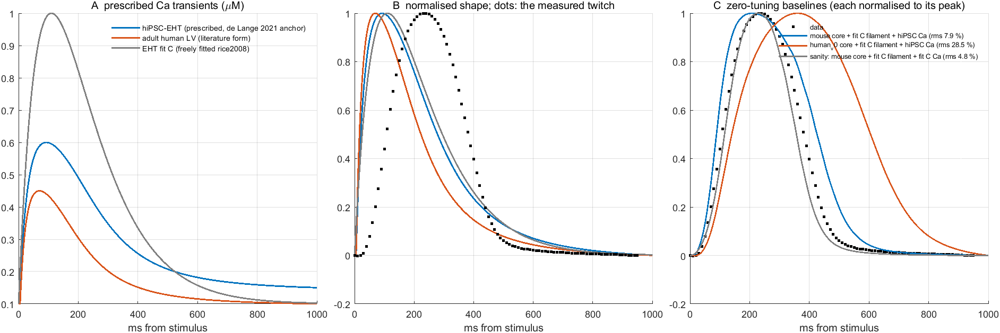
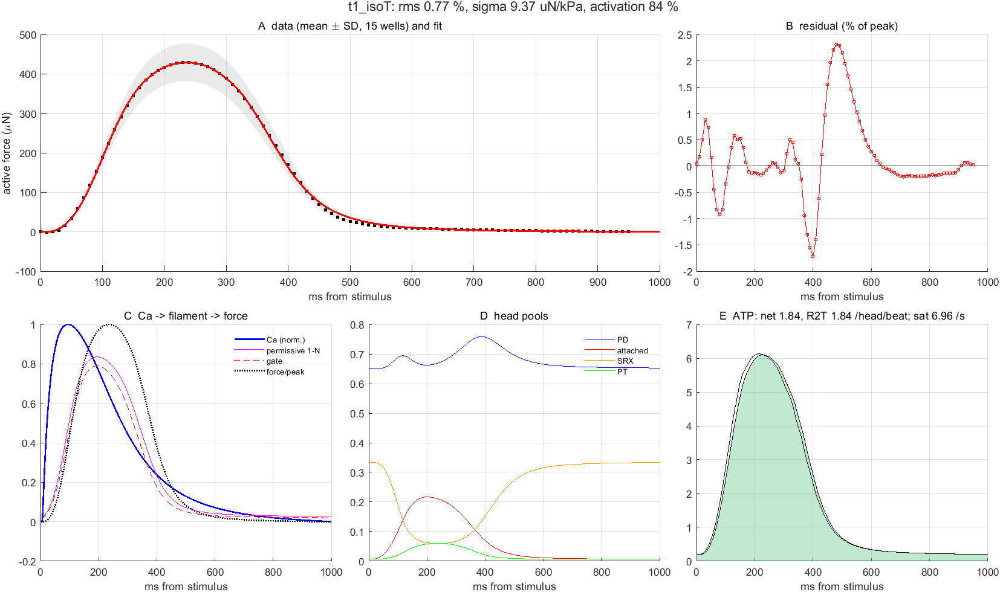
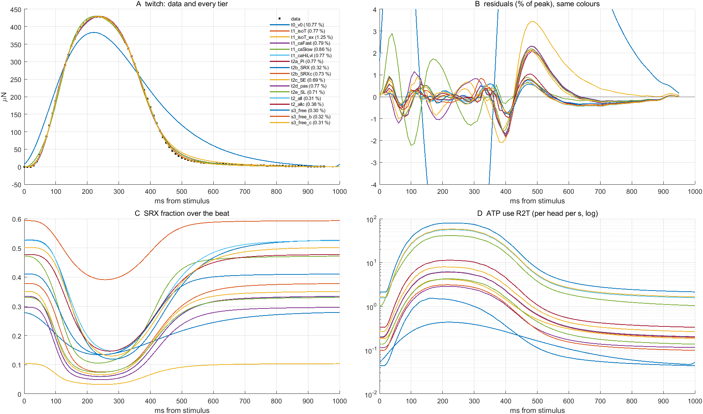
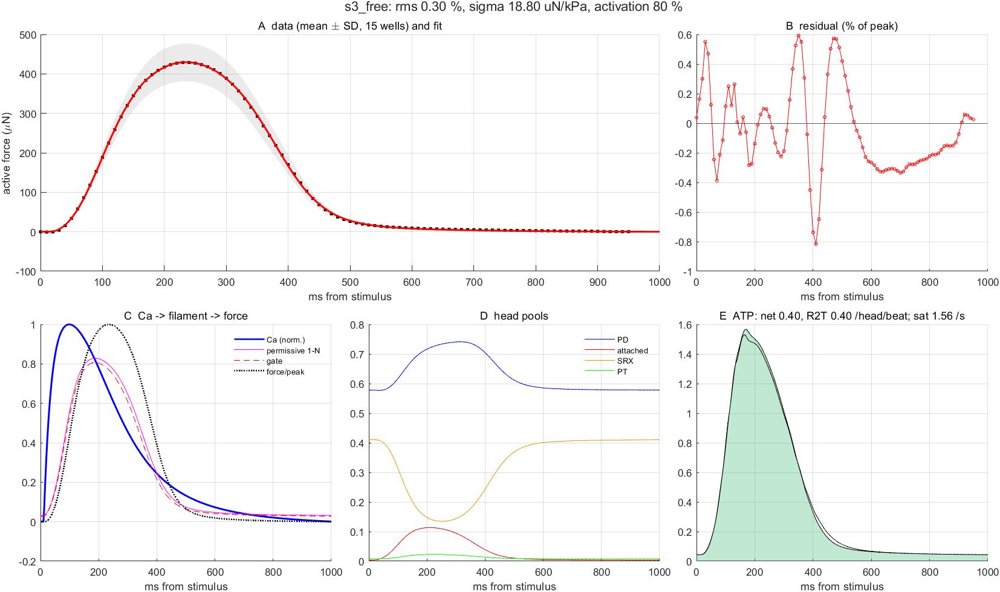

# Human iPSC-EHT twitch with a fixed, literature-based Ca transient: how far do "humanizing" changes carry the mouse cross-bridge core?

**Status:** 2026-10-08, complete (all 17 fits converged; ~3.5 h wall clock on the shared box).
**Branch/worktree:** `HumanTwitch` in `C:\home\git\ATP-wt-human` = `PooledTarget-8mM` + the CaActivation Ca layer
(cherry-picked, uncommitted; `Analyses/CalciumTwitch/TestCaActivation.m` T2–T7 pass on the merged model).
**Target:** the Plate 6 control EHT twitch of the EHT report (`Analyses/CalciumTwitch/EHT_identification_report.md`,
15 wells, 60 beats each; TTP 230, 10 %→peak 176, RT50 152, RT90 243 ms; template SEM 0.35 % of peak).
**Scripts:** `Stage1_CaTransient.m`, `tierConfigs.m` → `runTier` → `fitTwitchTier` (resumable), `simHumanTwitch.m`,
`caTransientMetrics.m`, `sequencer.sh`. Results in `results/` (`<tier>.log`, `<tier>_fit.mat`, `<tier>.png`).
Numbers are measured on this machine unless marked *literature*.

## 0. What changed against the EHT report's fit C

| | EHT report, fit C (2026-10-02) | this campaign |
|---|---|---|
| Ca transient | free: bi-exponential (rice2008), τ 112/108 ms, levels 0.10 → 1.0 µM assumed, onset fitted | **fixed** from literature (§1): exp-rise × Hill-decay, 0.15 → 0.60 µM, TTP 93 ms, peak→50 % 186 ms, peak→90 % 448 ms |
| cross-bridge core | adult mouse `ExampleHighATP`, frozen | `robust1_seed` (the HumanizeXB incumbent) moved along the human/rodent literature directions (stage 2), then free (stage 3) |
| thin filament | 3 constants free (K_coop ≤ 20) | the same (never calibrated on any data; §2) |
| offset, σ | free, closed form | the same |

## 1. Stage 1: the fixed Ca transient

Full survey with sources: [`literature_ca_transient.md`](literature_ca_transient.md). The anchor is **de Lange et al.
2021** (*AJP Heart* 320:H1670; Fura-2, 37 °C, 1 Hz, 3D fibrin hiPSC engineered tissue): Ca TTP 83 ± 5 ms,
peak→50 % 185 ± 15 ms, and a force twitch of TTP 229 / RT50 160 / RT90 262 ms, which is our twitch to within
10 ms. Hamburg GCaMP6f EHTs (Saleem 2020) agree on the order (TTP-80 % 116 ms, DT80 173 ms, slowed by the
indicator). Absolute levels are the weak point: no calibrated EHT value exists; 0.15 µM diastolic and 0.60 µM
peak are taken from "comparable to rabbit" (Hwang 2015) and adult human 0.1 / 0.45 µM (Coppini 2013,
Beuckelmann 1992, ToR-ORd). Because the thin filament sees only `k_on·Ca`, the levels set the gauge of `k_on`
and the diastolic/peak ratio, not the shape result.

Implementation: `caTransient` kind `'risedecay'`, h(x) = (1 − e^(−x/τr))^m / (1 + (x/t50)^h), summed over the
current and three previous beats (so the inter-beat carry-over is in the signal), mapped to min = Cadia,
max = Camax. Mono- and bi-exponential decays cannot match peak→50 % and peak→90 % together (*literature file*);
the Hill decay does. hiPSC set: τr 25 ms, m 1, t50 265 ms, h 3, onset 5 ms after the stimulus.

| transient | dia (µM) | peak | TTP (ms) | 10–90 % rise | peak→50 % | peak→90 % | CaTD90 | carry to next beat |
|---|---|---|---|---|---|---|---|---|
| **hiPSC-EHT, prescribed** | 0.15 | 0.60 | **93** | 44 | **186** | **448** | 534 | 0.1 % |
| adult human LV (same form, *literature* τr 18, t50 210, h 2.8) | 0.10 | 0.45 | 70 | 32 | 153 | 391 | 454 | 0 |
| EHT report fit C (freely fitted rice2008) | 0.10 | 1.00 | 110 | 63 | 185 | 428 | 534 | 0.3 % |

- **The freely fitted transient of fit C already had the literature decay** (185 / 428 vs 186 / 448 ms). What the
  fit had got wrong is the rise: 110 ms to peak with a 63 ms 10–90 % rise against 93 / 44 ms measured in
  tissue. Fixing the transient therefore mostly removes freedom in the rise, and removes the 1.0 µM gauge.
- Ca peaks ~140 ms before force (93 vs 230 ms), and Ca has fallen to 50 % at ~280 ms, just after the force
  peak: the twitch is a delayed, filtered image of the transient, as de Lange and Saleem describe.

### 1.1 How variable is the "human iPSC-CM Ca transient" in the literature? (`Stage1b_CaVariability.m`)

Each curve below is a `risedecay` transient fitted to the shape metrics one source reports (the metrics
differ by source: TTP, time to 80 % of peak, peak→50 %, peak→20 %, 90→10 % decay, CaTD90), so the family is
what "take the Ca transient from the literature" can mean. Panel B shows what the choice does to the
identified human core (tier-1 refits of §2.2 and the ±indicator-error refits of §5).

| source | preparation, indicator, T, pacing | TTP (ms) | peak→50 % | peak→90 % |
|---|---|---|---|---|
| de Lange 2021 (the anchor) | 3D hiPSC tissue, Fura-2, 37 °C, 1 Hz | 88 | 185 | 444 |
| Saleem 2020 | Hamburg EHT, GCaMP6f, 37 °C, 1.5–2 Hz | 177 (80 % at 116) | 100 | 234 |
| Paci 2018 (experimental) | single hiPSC-CM, Fluo-4, 37 °C, spontaneous | 269 | 225 | 493 |
| Paci 2020 / Forouzandehmehr 2021 (models) | hiPSC-CM models, spontaneous | 163–183 | 160–165 | ~400 |
| Akwaboah 2021 (model) | hiPSC-CM model, 2.3 Hz | 66 | 64 | 151 |
| adult human LV (Coppini 2013, ToR-ORd) | myocytes / model, 37 °C, 1 Hz | 60 | 174 | 406 |

The time to peak alone spans **60–270 ms** across sources that all call themselves human (iPSC) cardiac, and
even the two paced 37 °C tissue measurements disagree 2× in TTP (Fura-2 vs GCaMP6f). §2.2 showed that a
20–25 ms change in Ca TTP is a factor 2–8 on every rate of the fitted human core at an unchanged fit quality.
**No literature choice can therefore substitute for a Ca recording in the tissues being modelled**; the
prescribed set is a defensible anchor, not a measurement.

**Zero-tuning baselines** (nothing refitted; σ solved; fit C's filament with `k_on` rescaled to the new Ca
amplitude so that `k_on·ΔCa` is unchanged):

| model, untouched | rms (% of peak) | TTP | 10 %→peak | RT50 | RT90 (ms) | Ca→force lag | gate peak | SRX dia→min |
|---|---|---|---|---|---|---|---|---|
| data | (SEM 0.35) | 230 | 176 | 152 | 243 | | | |
| mouse core (`robust1_seed`) + fit C filament + hiPSC Ca | 7.9 | 208 | 162 | 218 | 337 | 115 | 0.88 | 0.38 → 0.07 |
| human_v0 core (k2,k_2,kah,kamh,ka,kd ×0.1; k1,k_1 ×0.3) + fit C filament + hiPSC Ca | 28.5 | 360 | 289 | 245 | 420 | 267 | 0.85 | 0.26 → 0.03 |
| sanity: mouse core + fit C filament + fit C's own Ca | 4.8 | 228 | 172 | 129 | 218 | 120 | 0.70 | 0.40 → 0.08 |

- `robust1_seed` is **not** the core fit C was made on (`ExampleHighATP`): with fit C's own filament and
  transient it gives 4.8 % rms, not 0.8 %, and a diastolic SRX of 0.40 instead of 0.20. The stage-2 ladder
  is therefore also run on `ExampleHighATP` (`_ex` tiers) to see which conclusions depend on the mouse base.
- **The literature human core without a temperature correction is far too slow** (28.5 %, force peaking at
  360 ms). The HumanizeXB ratios were derived at the (unknown, 20–25 °C) rig temperature; the EHT runs at
  37 °C. A Q10 of 3–3.5 over 12–17 °C is a factor 3.7–8.4 on every rate. That factor is therefore the first
  "humanizing" parameter of stage 2, not an afterthought.

## 2. Stage 2: humanizing trajectories only

The mouse incumbent is moved only along the directions the HumanizeXB literature survey supports
(`tierConfigs.m`). Every tier also fits the three thin-filament constants (never calibrated on any data;
K_coop ≤ 20 as in the EHT report) and the beat offset (stimulus record not synchronised); σ (µN per model kPa)
is solved in closed form. Residual = (σ·F_model − F_data)/F_peak on the 0–950 ms grid (96 points);
one evaluation = 2 s diastole + 2 beats, the second beat scored.

| tier | what moves (bounds) | rms (% of peak) | activation | note |
|---|---|---|---|---|
| **t0_v0**: literature human core, no temperature correction (k2,k_2,kah,kamh,ka,kd ×0.1; k1,k_1 ×0.3 fixed) | thin filament + offset | **10.8** | 25 % | RT50 202 vs 152 ms, RT90 442 vs 243 ms: a β-MHC core at 20–25 °C cannot relax a 37 °C twitch; σ 27 µN/kPa |
| **t1_isoT**: + isoform ratio r_iso on k2,k_2,kah,kamh,ka,kd (0.03–0.5) and Q10 factor r_T on all 8 cycle rates (1–15); k1,k_1 keep the literature ×0.3 | 2 + 4 | **0.77** | 84 % | r_iso 0.066, r_T 6.9 → net ×0.45 on the six isoform rates, ×2.1 on k1,k_1; TTP 235/230, 10 %→pk 181/176, RT50 145/152, RT90 252/243 ms |
| t1_isoT_ex: the same on the EHT report's core `ExampleHighATP` | 2 + 4 | 1.25 | 81 % | r_iso 0.138, r_T 2.7 → net ×0.38 on the six rates, ×0.82 on k1,k_1; RT50 138 vs 152 ms |

**Tier 1 reproduces the twitch as well as the EHT report's fit C did (0.77 vs 0.81 % rms), with the Ca
transient no longer free.** The residual is still 2.2× the template SEM and strongly autocorrelated
(lag-1 0.95); it sits at 400–500 ms (relaxation from 30 % to 5 %: model too slow then too fast) and in the
late tail, exactly where fit C's misfit was.

What the twitch identifies in tier 1 (forward-difference Jacobian, `jacobianTier`; `results/t1_isoT_jac.mat`):

| quantity | value | local 95 % | comment |
|---|---|---|---|
| r_iso · r_T (net multiplier on k2, k_2, kah, kamh, ka, kd) | **0.454** | ×/÷ 1.12 | r_iso and r_T are correlated −1.00: the twitch pins the product, not the split |
| r_T alone (k1, k_1 see only this) | 6.9 | ×/÷ 29 | not identified: the twitch is insensitive to the Pi-release step (EHT report §6: k1 ×0.5 → 1.2 % rms) |
| tf_k_on, tf_k_off | 9.2 µM⁻¹s⁻¹, 5.1 s⁻¹ | ×/÷ 1.11 each, r = +1.00 | their ratio (Ca₅₀ relative to the 0.60 µM peak) and their common scale are both set |
| tf_K_coop | 20 (bound) | ± 1.2 | the data want at least this much cooperativity, as before |
| offset | +1.7 ms | ± 2.4 ms | the fixed 5 ms stimulus→Ca onset is consistent with the record |

Reading the net ×0.45 as isoform × temperature: with the literature isoform ratio 0.1 it needs r_T ≈ 4.5,
i.e. Q10 3–3.5 over 13–15 °C, which puts the Baker rig at **22–24 °C** — inside the 20–25 °C assumed in
HumanizeXB. With the bounds of the Q10 window (×3.7–8.4) the isoform ratio would be 0.054–0.12. So the
"realistic" human core for a 37 °C hiPSC twitch is the mouse core with ADP release, hydrolysis, attachment and
weak-binding detachment all slowed to 0.45× (k2 53 s⁻¹, kah 80 s⁻¹, ka 133 s⁻¹, kd 42 s⁻¹) and the Pi-release
step left at or above the mouse value. Its saturating developed force stays 54 kPa (F0 is a ratio), saturating
ATP turnover is 7.0 s⁻¹ per head (mouse 14), and the twitch costs 1.8 ATP per head per beat.

On `ExampleHighATP` the same two directions reach only 1.25 % and prefer a slower Pi step (net ×0.82 on k1,k_1).
The conclusion "net ×0.4–0.45 on the six isoform rates" holds on both mouse bases; the quality of the fit and
the k1 preference do not.

### 2.1 Adding the lesser-known directions one at a time (from the tier-1 optimum)

Each tier below frees tier 1's two factors plus one more direction (plus filament and offset), starting at the
tier-1 optimum; "gain" is against tier 1's 0.773 %.

| tier | extra direction (bounds) | rms | fitted extra | r_iso, r_T, net on the six rates | ATP/head/beat | SRX dia → min | verdict |
|---|---|---|---|---|---|---|---|
| t2a_Pi | Pi release / power stroke k1, k_1 (0.1–1) | 0.769 | ×0.25 | 0.098, 4.6, **0.46** | 1.8 | 0.33 → 0.06 | **no gain**: the twitch does not see the Pi step |
| t2b_SRX | SRX/OFF exchange rates ksr0, kmsrd, ksrd, ksr2srd, ksrd2sr (0.1–15) | **0.321** | ×0.20 | **0.50 (bound), 15 (bound), 7.5** | **24** | 0.53 → 0.12 | leaves the corridor: 17× the mouse cycle speed, 13× the ATP, saturating ATPase 95 s⁻¹ per head; the SRX pool (0.53 at rest) becomes a slow reservoir that empties and refills every beat. Not a humanizing solution |
| t2b_SRXc | the same, with the cycle rates **held** at tier 1 | 0.729 | ×0.49 | (0.066, 6.9, 0.45 fixed) | 1.8 | 0.38 → 0.08 | small gain (−0.04): slower OFF exchange helps the relaxation shoulder a little |
| t2c_SE | series stiffness kSE (0.01–3; the EHT posts are compliant) | 0.694 | ×0.78 | 0.107, 5.7, 0.61 | 2.4 | 0.35 → 0.07 | small gain (−0.08); only a 22 % softer series element is wanted |
| t2d_pas | passive titin k_pas (0.1–3) | 0.769 | ×1.03 | 0.117, 3.9, 0.46 | 1.8 | 0.33 → 0.06 | **no gain**: passive force is invisible in baseline-subtracted active force and barely feeds back through the SRX force sensitivity |
| t2e_SL | sarcomere length SL0 (1.9–2.3 µm) | 0.711 | 1.91 µm (near bound) | 0.145, 2.7, 0.39 | 1.3 | 0.33 → 0.07 | small gain (−0.06) by moving to the short end of the overlap curve |
| t2_all | all of the above together (bounds as in the single tiers) | **0.315** | SRX ×0.23, kSE ×0.68, k_pas ×0.68, SL 1.95, Pi ×0.17 | **0.44, 14.4 (bound), 6.4** | **16.8** | 0.53 → 0.15 | the same escape as t2b_SRX: the gain is bought with a 14× cycle speed, not with human biology |
| t2_allc | all of the above, with r_iso ∈ 0.05–0.15 and r_T ∈ 3.7–8.4 (the literature corridor) | **0.377** | SRX ×0.30, kSE ×0.64, k_pas ×0.43, SL 1.91, Pi ×0.10 (bound) | **0.15 (bound), 8.4 (bound), 1.26** | 3.4 | 0.48 → 0.15 | the best fit inside the corridor, but at its fast corner: isoform ratio and Q10 factor both at their upper bounds (the six rates end up 1.26× the mouse), the Pi step at its lower bound, and the SRX exchange slowed 3.4× so that a 48 % resting SRX pool shapes the relaxation |

What the ladder says:

1. **Within the humanizing corridor the twitch is explained to 0.7–0.77 % rms by one quantity: a net ×0.45
   slowing of ADP release, hydrolysis, attachment and weak-binding detachment.** The lesser-known directions
   (Pi step, SRX rates, series compliance, titin, SL) each buy at most 0.08 percentage points, and none of them
   moves away from its literature value by much (kSE ×0.78, SRX ×0.49, SL 1.91 µm). Combined inside the
   corridor (t2_allc) they reach 0.38 %, but only by running to the fast corner of the corridor (net ×1.26
   on the six rates, Pi ×0.1) with the SRX exchange slowed 3.4×; every humanizing factor sits on a bound.
   The gain over tier 1 is real (the relaxation shoulder is fixed, panel B), but it is the SRX reservoir
   mechanism of item 2 operating within the allowed box rather than a sharper human parametrisation.
   Locally (`results/t2_allc_jac.mat`) its identified quantities are the SRX factor (×0.30 ×/÷ 1.24), the
   series factor (×0.64 ×/÷ 1.17), SL0 (1.91 ± 0.02 µm) and the thin filament (×/÷ 1.04); r_iso, r_T, r_Pi
   and r_pas are not (×/÷ 6–11, with r_iso and r_T again correlated −0.96).
2. **The 0.32 % solutions are a different regime, not a better human.** Whenever the SRX rates are freed
   together with the cycle rates, the optimizer takes the cycle to the fastest allowed speed (×6–7.5 on the
   six isoform rates: faster than the *mouse*), slows the OFF↔ON exchange 4–5×, and uses a 53 % resting SRX
   pool that empties to 12–15 % at the twitch peak as the slow element that shapes the relaxation. ATP per
   head per beat is 17–24 against 1.8, and the saturating ATPase 60–95 s⁻¹ against 7. The Ca-transient
   constraint alone does not exclude this; a turnover or SRX measurement on the EHT would (§4).
3. **The structured residual of tier 1 (400–500 ms) is what these solutions remove**, so the model's
   remaining systematic error is in the relaxation from 30 % to 5 % of peak: in the humanizing corridor the
   model relaxes too slowly there and then too quickly in the tail.

### 2.2 How much of the realistic fit is the Ca-transient assumption? (tier 1 refitted with the transient at the edges of the literature range)

| transient (fixed) | TTP / peak→50 % / peak→90 % (ms) | rms | r_iso, r_T | **net on the six rates** | k1,k_1 | k_on·ΔCa | k_off | Ca→F lag | ATP/head/beat | SRX dia |
|---|---|---|---|---|---|---|---|---|---|---|
| fast edge (τr 18, t50 200 ms) | 70 / 142 / 352 | 0.79 | 0.062, 3.5 | **0.21** | ×1.0 | 4.9 | 5.6 | 165 | 0.86 | 0.30 |
| **nominal (de Lange 2021)** | 93 / 186 / 448 | **0.77** | 0.066, 6.9 | **0.45** | ×2.1 | 4.1 | 5.1 | 140 | 1.8 | 0.33 |
| slow edge (τr 35, t50 330 ms) | 119 / 225 / 525 | 0.86 | 0.37, 10.4 | **3.8** | ×3.1 | 3.6 | 4.8 | 110 | 12.3 | 0.47 |
| nominal shape, levels 0.25 → 1.0 µM | 93 / 186 / 448 | 0.77 | 0.066, 6.9 | 0.45 | ×2.1 | 4.2 | 5.1 | 143 | 1.8 | 0.33 |

- **The absolute Ca levels are irrelevant** (as the `k_on·Ca` symmetry says): the same core, the same
  k_on·ΔCa, the same fit.
- **The shape is not.** The fit quality hardly moves (0.77–0.86 %), but the core that produces it does: a
  transient 20 ms faster to peak makes the human core 2× slower than nominal (×0.21), one 25 ms slower makes
  it 8× faster (×3.8, i.e. faster than the mouse, with a 47 % resting SRX pool and 12 ATP per head per beat).
  Fixing the transient to a *literature* shape therefore removes the Ca-versus-core trade-off only to the
  extent that the literature pins the shape. With de Lange's own uncertainty (TTP 83 ± 5, peak→50 %
  185 ± 15 ms) the net factor is bounded to roughly **0.3–0.7**; with the whole hiPSC range it is not
  bounded at all.
- The thin filament is again the invariant: k_on·ΔCa 3.6–4.9 µM/s·µM⁻¹, k_off 4.8–5.6 s⁻¹, K_coop 20.
- **This is the strongest argument for recording the relative Ca transient in these wells** (EHT report §7):
  a 20 ms change in Ca TTP is worth a factor 2 in every cross-bridge rate of the "human" core.

## 3. Stage 3: anything but the Ca transient

24 free parameters (`tierConfigs('s3_free*')`): individual log-multipliers on the eight cycle rates (0.01–20×),
three SRX rates (0.05–20×), the two SRX force sensitivities (0.3–3×), both cross-bridge stiffnesses (0.3–3×),
series stiffness kSE (0.01–3×), titin k_pas (0.1–3×), the registration gate A0 (0.5–4.5×), the power-stroke
step dr (0.5–2×), SL0 (1.9–2.3 µm), the thin filament with wide bounds (K_coop ≤ 100) and the offset. The Ca
transient is the fixed hiPSC set of §1. Three starts: `s3_free` from the tier-1 optimum, `s3_free_b` from the
literature human_v0 ratios with a Q10 factor 5, `s3_free_c` from the fast-cycle / slow-SRX regime of t2_all.

| start | rms (% of peak) | σ (µN/kPa) | F_dev (kPa) | F_sat,dev | activation | ATP / head / beat | sat. ATPase (s⁻¹) | SRX dia → min | bound at peak | iterations |
|---|---|---|---|---|---|---|---|---|---|---|
| data template SEM | 0.35 | | | | | | | | | |
| **s3_free** (from tier 1) | **0.296** | 18.8 | 22.9 | 28.7 | 80 % | 0.40 | 1.6 | 0.41 → 0.13 | 0.11 | 20 (converged) |
| s3_free_b (from literature ratios) | 0.320 | 29.8 | 14.4 | 18.7 | 77 % | 0.92 | 3.9 | 0.59 → 0.39 | 0.07 | 23 (converged) |
| s3_free_c (from t2_all's fast regime) | 0.312 | 13.7 | 31.3 | 38.1 | 82 % | 17.4 | 60 | 0.50 → 0.13 | 0.15 | 10 (converged): stays in the fast regime (cycle ×6–7, SRX rates ×0.25, kSE ×0.58) |

| multiplier vs the mouse incumbent | s3_free | s3_free_b | local 95 % (s3_free) |
|---|---|---|---|
| ka (attachment) | **0.36** | **0.35** | ×/÷ 2.1 (and r = +1.00 with A0: only ka·A0 is a parameter) |
| kd (weak detachment) | 0.68 | 0.59 | ×/÷ 1.8 |
| k2 / k_2 (ADP release) | 0.82 / 0.45 | 0.81 / 0.50 | ×/÷ 5 / 1.0 |
| kah / kamh (hydrolysis) | 0.79 / 0.63 | 0.58 / 0.72 | ×/÷ 2.6 / 9 |
| k1 / k_1 (Pi release) | 0.79 / 20 (bound) | 0.83 / 2.9 | ×/÷ 20 / 7.6: not identified |
| ksr0, kmsrd, ksrd (SRX) | 0.76, 0.87, 1.20 | 0.94, 0.65, 1.95 | ×/÷ 3–9 |
| kstiff1, kstiff2 | 1.36, 0.91 | 1.67, 0.73 | ×/÷ 3, 12 |
| kSE (series) | **0.44** | **0.53** | ×/÷ 2.1 |
| k_pas, A0, dr, SL0 | 0.97, 0.97, 1.12, 2.00 µm | 1.02, 0.91, 0.89, 1.99 µm | wide |
| tf_k_on, tf_k_off, tf_K_coop | 10.7, 5.0, 16.1 | 9.7, 4.2, 16.8 | ×/÷ 1.24, 1.18, ± 3.8 |
| offset | +6.0 ms | +5.2 ms | ± 4.3 ms |

**The possible fit reaches the noise floor** (0.30 % against a template SEM of 0.35 %; lag-1 autocorrelation of
the residual still 0.89, so a weak structure at 350–500 ms remains). The three starts end in **two families
that fit equally well** (0.30–0.31 %): the two starts from the humanizing side find a *slow-attachment* core,
the start from t2_all stays in the *fast-cycle / slow-SRX* core (cycle rates ×6–7, SRX exchange ×0.25, 17 ATP
per head per beat, ktr 86 s⁻¹). Stage 3 therefore does not pick a mechanism; it shows that the twitch shape
is reproduced to noise by at least two very different cores. The slow-attachment family is described below;
it is **not** the one stage 2 found:

- **attachment slowed 3× and the series element 2× softer**, with ADP release, hydrolysis and weak detachment
  only 0.6–0.8× the mouse. The net slowing of the "isoform" rates is no longer uniform: the fit wants the
  attachment limb slowed much more than the detachment limb. That cuts the attached fraction at the twitch peak
  to 7–11 % (tier 1: 22 %) and the saturating active force to 19–29 kPa; σ rises to 19–30 µN/kPa to
  compensate. Shape cannot tell a weak, cheap twitch from a strong, expensive one, so this is where the free
  fit goes.
- **ATP per head per beat falls to 0.4–0.9** (tier 1: 1.8; the escape regime of §2.1: 17–24). The twitch
  constrains the shape, not the economy: across equally good fits the ATP cost spans a factor 60.
- **The thin filament is the one part every fit agrees on:** k_on·ΔCa, k_off and K_coop land within 20 % of
  each other across all tiers and all three regimes (k_off 4.2–5.5 s⁻¹, K_coop 16–20, Ca₅₀ ≈ 0.6 of the peak
  Ca), and the Ca-peak → force-peak lag is 128–143 ms in every fit. With the transient fixed, these are
  now identified (local 95 %: ×/÷ 1.1–1.2), where fit C could only give them conditional on its own transient.
- **Individually the 24 core parameters are not identified** (cond(J) ~ 10¹⁸; ka ≡ A0; most 95 % intervals
  ×/÷ 2–20). What is identified is a handful of combinations: the attachment product ka·A0, the series
  compliance, the detachment-limb scale, and the thin filament.

### 3.1 What the fitted cores look like as skinned muscle (saturating Ca, SL 2.2 µm, 8 mM MgATP; `ProbeCores.m`, `humanProbe`)

| core | F0 (kPa) | attached | SRX | ATP use R2T (s⁻¹/head) | dwell (ms) | Brenner ktr (s⁻¹) | a/F0 | Pmax (F/F0·ML/s) |
|---|---|---|---|---|---|---|---|---|
| mouse incumbent (robust1_seed) | 71 | 0.28 | 0.03 | 17.2 | 15 | 45 | 0.63 | 0.56 |
| **tier 1 (realistic): six isoform rates ×0.45, k1/k_1 ×2.1** | 74 | 0.29 | 0.025 | 8.4 | 35 | **23** | 0.17 | 0.29 |
| t2c_SE (tier 1 + kSE ×0.78) | 72 | 0.28 | 0.03 | 10.9 | 25 | 25 | 0.27 | 0.38 |
| t2_allc (corridor corner, 0.38 %) | 65 | 0.28 | 0.04 | 20 | 11 | 26 | 0.68 | 0.70 |
| t2_all (the fast-cycle escape, 0.31 %) | 64 | 0.28 | 0.04 | **94** | 2.2 | **86** | 0.26 | (Hill fit failed) |
| s3_free (possible fit, 0.30 %) | 43 | 0.18 | 0.04 | 2.1 | 38 | 23 | 0.60 | 0.60 |
| s3_free_b (0.32 %) | 35 | 0.14 | 0.17 | 6.0 | 26 | 22 | 0.21 | 0.29 |
| s3_free_c (fast family, 0.31 %) | 59 | 0.26 | 0.025 | **101** | 2.1 | **99** | (Hill fit failed) | |

- **The realistic core predicts a ktr of 23 s⁻¹ at saturating Ca and 37 °C.** The HumanizeXB survey put the
  intact human ceiling at ~18 s⁻¹ (37 °C) and the skinned human value at 0.8 s⁻¹ (15 °C) → 1.5–2.8 s⁻¹ at
  20–25 °C. Tier 1 is therefore a *37 °C* human core, as it should be for this preparation, and sits a
  little fast against the one intact number we have. It keeps F0 and the attached fraction of the mouse
  (F0 is a ratio) and halves ATP use per head at saturating Ca (8.4 vs 17 s⁻¹). Its FV curvature a/F0 0.17
  and power 0.29 of the mouse value are in the direction the β-isoform data want (a/F0 ≤ 0.1, power ×0.3–0.5).
- **The corridor-corner fit (t2_allc) is a mouse-speed core with a human-sized SRX pool:** ktr 26 s⁻¹,
  F0 65 kPa, but 20 ATP/s per head at saturation (more than the mouse's 17) and an FV curvature back at
  the mouse value (a/F0 0.68 against the β-isoform's ≤ 0.1). Its one human-like trait is the 48 % resting
  SRX fraction (HumanizeXB: 0.35–0.5 after the preprint's correction).
- **The 0.3 % fits are indistinguishable in twitch shape but not as muscle.** The fast-cycle escape (t2_all) is a
  ktr-86 s⁻¹, 94-ATP/s core: no cardiac muscle. The stage-3 cores keep ktr 22–23 s⁻¹ but have lost 40–50 %
  of the mouse F0 (attachment slowed 3×) and use 2–6 ATP/s per head at saturation. A single measurement of
  F0 per cross-section (or of O₂ consumption) on skinned EHT would separate them from tier 1.

## 4. Summary, and what would decide between the fits

| question | answer |
|---|---|
| **1. Fixed Ca transient** | hiPSC-EHT at 1 Hz, 37 °C: 0.15 → 0.60 µM, TTP 93 ms, peak→50 % 186 ms, peak→90 % 448 ms (de Lange 2021 Fura-2 anchor; levels low–medium confidence). It differs from adult human (TTP ~70 ms, peak→50 % ~150 ms, 0.10 → 0.45 µM) mainly in the rise and in the levels. The EHT report's freely fitted transient already had this decay; its rise was 20 ms too slow. |
| **2. Realistic fit (humanizing trajectories only)** | **0.77 % rms** (fit C with a free transient: 0.81 %; template SEM 0.35 %). One identified quantity: the six isoform-sensitive rates (ADP release, hydrolysis, attachment, weak detachment) at **0.45 ×/÷ 1.12 of the mouse**, i.e. isoform ratio ~0.1 × temperature factor ~4.5 (Q10 3–3.5 from a 22–24 °C rig to 37 °C). The Pi step is not seen. Lesser directions each buy ≤ 0.08 pp (series element ×0.78, SRX exchange ×0.5, SL 1.91 µm); combined inside the literature corridor they reach 0.38 %, but with every factor on a bound (fast corner, Pi ×0.1, SRX exchange ×0.3, resting SRX 0.48), so **0.77 % (tier 1) is the defensible realistic number and 0.38 % its optimistic edge**. The net factor is only as sharp as the assumed Ca shape: ×0.21 at the fast edge of the literature range, ×3.8 at the slow edge (0.3–0.7 within the de Lange anchor's own error bars, §2.2). The remaining misfit is the 400–500 ms relaxation shoulder. The core predicts ktr 23 s⁻¹ at 37 °C, F0 unchanged, saturating ATP use halved. |
| **3. Possible fit (anything but Ca)** | **0.30 % rms = the noise floor**, reached by two different cores: (a) attachment slowed ~3×, series element ~2× softer, detachment limb 0.6–0.8×, F0 down to 19–29 kPa, 0.4–0.9 ATP per head per beat (two starts agree); (b) cycle rates ×6–7 with the SRX exchange ×0.25 and a 50 % resting SRX pool, 17 ATP per head per beat, ktr 60–86 s⁻¹ (third start, and the stage-2 escapes). Shape alone cannot rank them; muscle-level numbers can (§3.1). |
| what every fit shares | thin filament k_off 4.2–5.5 s⁻¹, K_coop 16–20, Ca₅₀ ≈ 0.6 × peak Ca, activation 77–85 % of saturating, Ca-peak → force-peak lag 128–143 ms, gate peak 0.79–0.83 |
| what the twitch cannot decide | the split isoform vs temperature; the net slowing itself beyond the precision of the assumed Ca shape (§2.2); F0 per cross-section (σ absorbs it); ATP cost (factor 60 across equally good fits); the Pi step; the individual SRX rates |

**Measurements that would decide** (in order of value): (0) the relative Ca transient of these wells (§2.2: a 20 ms error in Ca TTP is a factor 2 on every rate of the human core); (i) force per cross-section of the same EHTs, or
skinned-EHT F0, which separates tier 1 (54 kPa saturating) from stage 3 (19–29 kPa); (ii) paced O₂
consumption or ATPase (tier 1 ≈ 1.8, stage 3 0.4–0.9, escape regime 17–24 ATP per head per beat);
(iii) a ktr or kACT on skinned EHT at 37 °C (23 s⁻¹ predicted by tier 1 and stage 3, 86 by the escape);
(iv) the relative Ca transient in these wells, to replace the literature transient (the Ca→force lag
of 128–143 ms is a direct test); (v) the post stiffness, since every good fit wants a softer series
element than the trabecula model (kSE ×0.44–0.78).

**Caveats.** The mouse base matters for the quality, not for the conclusion: on `ExampleHighATP` tier 1
reaches 1.25 % with the same net slowing (×0.38) but a slow Pi step. The Ca levels are literature
guesses (k_on is only identified relative to them). The isometric boundary is a simplification of the
compliant posts. Fits are local (lsqnonlin, 2–3 starts for stage 3); the stage-2 ladder was started
from the tier-1 optimum, so a tier reports what its extra direction adds there.

## 5. Case B: with the Ca transient measured, how trustworthy are the identified parameters and the predictions?

Setting: the prescribed transient stands in for a measurement; its only uncertainty is a realistic
indicator error (TTP ± ~5 ms together with peak→50 % ± ~10 ms: refits `tB_caE1` faster/shorter and
`tB_caE2` slower/longer; the two mixed-sign combinations were dropped for memory). The identifiability set
`tB` has 8 free parameters: the net factor on the six isoform rates (r_net), the net factor on k1,k_1
(r_Pi), the SRX exchange factor (r_SRX), the series factor (r_kSE), the thin filament and the offset. High
ATP only. Profile likelihood over r_net (6 points), r_SRX (2) and r_kSE (1): the parameter is fixed, everything
else refitted from the tier-1 start (`tierConfigs('tB__<par>__<k>')`, `profileSequencer*.sh`). Prediction
validity: `PredictSet.m` evaluates every fit's muscle-level (saturating Ca, SL 2.2: F0, SRX, ATP use,
Brenner ktr) and twitch-level predictions (response of peak force to Ca amplitude ×1.5 and ÷1.5, to 2 Hz
pacing, and to a mavacamten-like ka ×0.5). `results/predict_caseB.csv`, `results/predict_caseB.png`.

### 5.1 The profiles

| fixed | value | rms (% of peak) | r_SRX | r_kSE | k_off | K_coop |
|---|---|---|---|---|---|---|
| r_net | 0.15 | 2.82 | 2.7 | 0.58 | 21 | 20 |
| r_net | 0.25 | 0.85 | 4.0 | 1.19 | 8.6 | 20 |
| r_net | 0.45 (tier-1 value) | 0.73 | 0.50 | 0.97 | 5.5 | 20 |
| r_net | 0.8 | 0.41 | 0.56 | 0.63 | 4.9 | 19.8 |
| r_net | 3 | 0.33 | 0.29 | 0.85 | 4.6 | 18.9 |
| r_net | 10 | 0.32 | 0.22 | 1.00 | 4.8 | 19.4 |
| — (free) | **r_net 4.1** | **0.335** | 0.27 | 0.52 | 4.8 | 18.9 |
| Ca error E1 (TTP −5, decay −10 ms) | r_net 3.6 | 0.35 | 0.29 | 0.53 | 4.2 | 19.3 |
| Ca error E2 (TTP +5, decay +10 ms) | r_net 3.7 | 0.32 | 0.28 | 0.58 | 5.3 | 18.2 |
| r_SRX | 0.15 | 0.57 | (r_net 4.9) | 1.09 | 5.4 | 19.7 |
| r_SRX | 8 | 0.73 | (r_net 0.55) | 0.87 | 4.8 | 20 |

- **The profile over the core speed is one-sided.** Below r_net ≈ 0.5 the fit degrades steeply (2.8 % at
  0.15); from 0.8 to 10 it is flat within 0.1 percentage points (0.41 → 0.32 %). With the SRX exchange and the
  series element free, a fast cycle is always compensated by a slower OFF↔ON exchange (r_SRX 0.56 → 0.22) and
  a 50 % resting SRX pool. **A known Ca transient gives the human core a lower bound (≥ 0.5–0.8× the mouse),
  not a value.** Formally (Δχ² at 95 % on the best fit's residual variance, which is optimistic because the
  residual is autocorrelated) only r_net ≥ 3.7 is "acceptable"; pragmatically every fit below ~0.45 % rms
  describes the data.
- **The indicator error is no longer the limiting uncertainty**: ±5 ms TTP moves r_net 3.6–4.1 and the thin
  filament by < 15 %, far less than the flat profile does.
- **r_SRX is the mirror image**: it is bounded above (×8 costs 0.73 %) but trades off with r_net below.
- **The thin filament is identified in every row**: k_off 4.2–5.5 s⁻¹, K_coop 18–20, k_on·ΔCa 3.8–4.8, across
  a 20× range of core speeds. This is the quantity a measured transient really pins.

### 5.2 Prediction validity

Spread of predictions over the fits that describe the data to within 0.42 % rms (r_net 0.8 … 10, the free
optimum and both Ca-error refits; n = 6), and over the wider set within 0.85 % (adds r_net 0.25, 0.45 and
the two SRX points; n = 10):

| prediction | rms ≤ 0.42 % set | rms ≤ 0.85 % set | verdict |
|---|---|---|---|
| **twitch**: peak force for Ca amplitude ×1.5 | **+10.6 … +14.3 %** | +9.8 … +14.3 % | **robust** |
| **twitch**: Ca amplitude ÷1.5 | **−53 … −59 %** | −51 … −59 % | **robust** |
| **twitch**: 2 Hz pacing (same transient shape) | −2.2 … −3.1 % | −0.9 … −4.9 % | robust (and small: the model has no Ca-handling frequency response, so this is only the cross-bridge carry-over) |
| **twitch**: mavacamten-like ka ×0.5 | **−49 … −55 %** | −46 … −55 % | **robust** |
| activation (twitch / saturating force) | 77 … 84 % | | robust |
| F0 at saturating Ca, SL 2.2 (kPa) | 50 … 64 | 50 … 77 | fair (±15 %) |
| resting SRX at saturating Ca | 0.038 … 0.049 | 0.011 … 0.049 | fair |
| **Brenner ktr (s⁻¹)** | **23 … 97** | 15 … 97 | **not predicted** (4×) |
| **ATP use at saturating Ca, R2T (s⁻¹ per head)** | **7 … 124** | 4.7 … 124 | **not predicted** (17×) |
| **ATP per head per beat** | **1.5 … 24** | 1.0 … 24 | **not predicted** (16×) |
| σ (µN per model kPa) | 11.5 … 15.5 | 8.9 … 15.5 | fair |

**Reading.** With the Ca transient known, the fitted model's *twitch-level* predictions (how peak force
responds to Ca amplitude, to rate, to an attachment inhibitor) are reproducible to a few percentage points
across every core that fits the data: these follow from the thin filament and the activation level, which
the twitch identifies. The *muscle-level* kinetic and energetic quantities (ktr, ATPase, ATP per beat) are
not predicted at all: they follow the unidentified core speed and span 4–17×. So the fitted rates do **not**
report "how the unseen muscle's inner properties changed" unless one of those muscle-level quantities is
measured as well. A single ATPase, O₂-consumption or ktr/kACT measurement on the same tissue would collapse the
r_net profile; without it, a measured Ca transient buys the thin filament and the slow bound of the core speed.

### 5.3 Case A, for the record

The assumption-level uncertainty of §1.1/§2.2 (literature TTP 60–270 ms) sits on top of all of this: it moves
even the slow bound of r_net by a factor 2–8 and so removes the one core statement case B still allows.
This is why the Ca recording is the first measurement to ask for, and the ATPase/ktr anchor the second.

## Files

| file | role |
|---|---|
| `literature_ca_transient.md` | the Ca-transient survey (sources, recommended hiPSC and adult sets) |
| `Model/caTransient.m` (`'risedecay'`) | the prescribed transient: exp rise × Hill decay, beat superposition |
| `caTransientMetrics.m`, `Stage1_CaTransient.m` | §1: metrics, comparison, zero-tuning baselines → `results/stage1_*` |
| `tierConfigs.m`, `buildModel.m`, `simHumanTwitch.m`, `fitTwitchTier.m`, `finishTier.m`, `runTier.m`, `sequencer.sh` | the tiered fits (resumable; `runTier(name[, nIter])`); results `results/<tier>.log`, `<tier>_fit.mat`, `<tier>.png` |
| `residTier.m`, `jacobianTier.m` | local identifiability at a tier optimum → `results/<tier>_jac.mat` |
| `Stage1b_CaVariability.m` | §1.1: literature Ca-transient family and its effect on the identified core → `results/stage1b_ca_variability.*` |
| `PredictSet.m`, `profileSequencer*.sh` | §5: case-B profiles and prediction spread → `results/predict_caseB.*` |
| `OverviewTiers.m`, `ProbeCores.m` | cross-tier table/figure (`results/overview_tiers.*`) and saturating-Ca probes (`results/probe_cores.mat`) |
| `params/human_twitch_t1_isoT.m`, `params/human_twitch_s3_free.m` | the realistic and the possible core as parameter snapshots (Ca and thin-filament settings in the header comment) |
