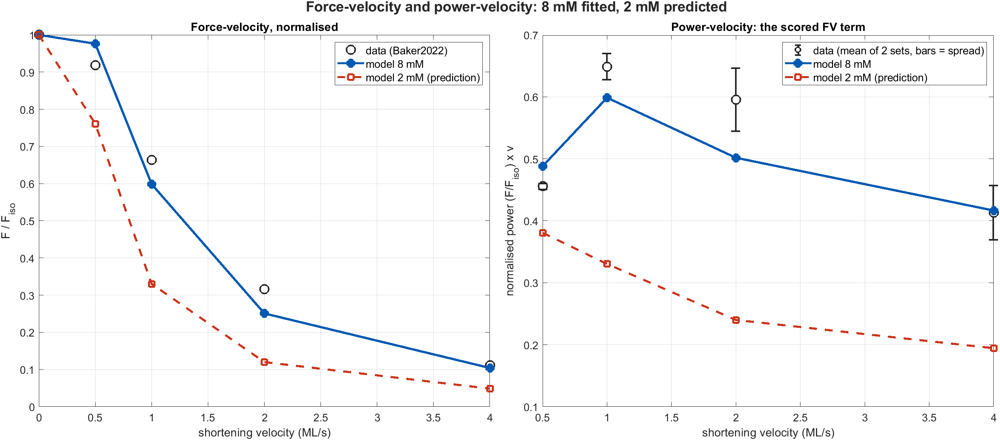
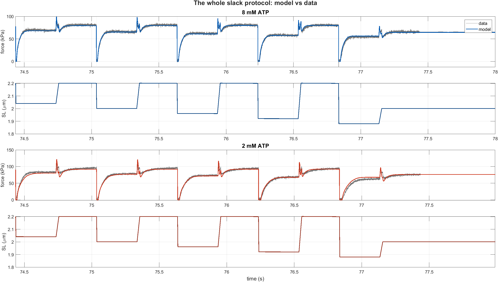
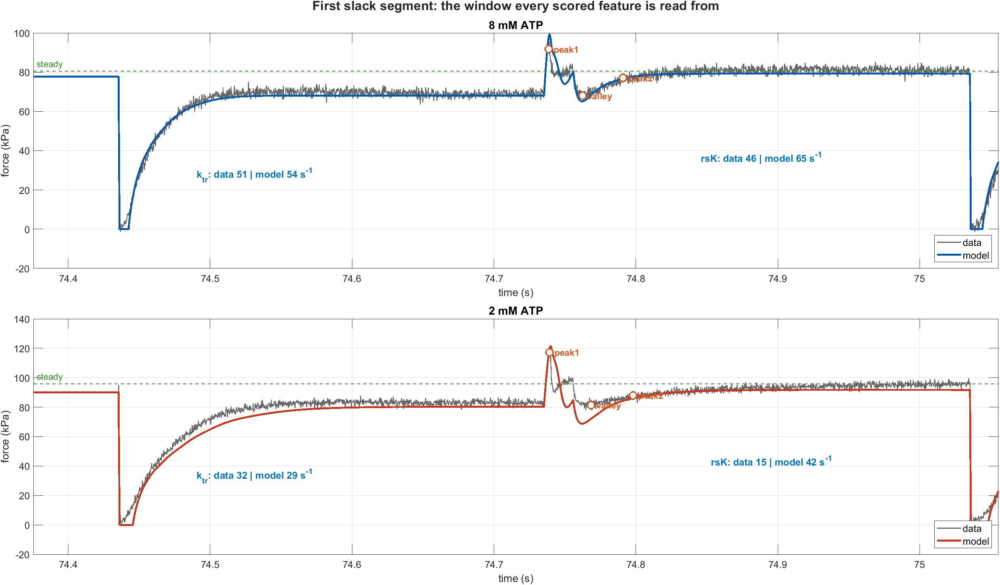
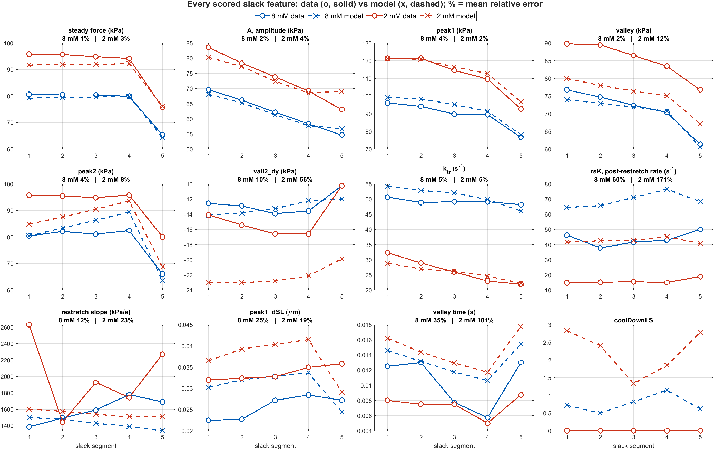

# Which pathways does [ATP] act on? — the hypothesis ladder

**Question.** The 21-gate fit lets [ATP] modulate *any* rate or mechanical parameter,
including ones with no nucleotide chemistry. That is the wildest hypothesis. How does
it compare with progressively more constrained, physiologically defensible sets?

**Answer. Three chemically-defensible parameters capture 97.8 % of the entire ATP
effect; seven capture 99.5 %. The other fourteen buy 0.5 %, and they buy it with
mechanics, not chemistry.**

---

## 1. Setup

Core frozen at realign4 — only ATP-gate exponents move. Every gate is exactly 1 at
`MgATP_ref`, so the 8 mM leg is invariant by construction; this was **asserted for
every rung at |Δ| = 0.000e+00**, which is also what makes the experiment affordable
(only the 2 mM leg needs scoring).

**The 2 mM objective now includes force-velocity and power** — see §5.

The 21 gateable knobs, classified by whether ATP *should* touch them:

| class | members | rationale |
|---|---|---|
| **CHEM** | `k2`, `kah`, `kamh` | the nucleotide is a substrate of the step. `k2` = ATP-induced actomyosin dissociation; `kah`/`kamh` = hydrolysis and its reverse |
| **SRX** | `kmsrd`, `ksr0`, `ksr2srd`, `ksrd2sr` | no ATP in the rate law, but the states differ in bound nucleotide — arguable |
| **MECH** | `kstiff2`, `kSE`, `kSE_M`, `mu_neg`, `dr`, `dr2`, `P_bound_max` | stiffness/viscosity/geometry. No nucleotide chemistry |
| **OTHER** | `ka`, `kd`, `k1`, `k_1`, `tau_reg`, `A0` | kinetic but not ATP steps: actin attachment, power stroke, availability |

## 2. The ladder

| hypothesis | DOF | ablated | **refit** | per DOF | % of span captured |
|---|---|---|---|---|---|
| H0 no ATP effect | 0 | 271.26 | — | — | 0 % |
| **H1 CHEM only** | **3** | 31.39 | **19.53** | 6.51 | **97.8 %** |
| **H2 + SRX** | **7** | 17.33 | **14.96** | 2.14 | **99.5 %** |
| H3 + 3 mechanical (= previous fit) | 10 | 16.56 | 14.63 | 1.46 | 99.7 % |
| H4 all 21 (the wild one) | 21 | 16.56 | 13.79 | 0.66 | 100 % |

Marginal gains, and how they compare with the measured noise floor (§3):

| step | Δcost | DOF added | vs peak-to-peak |
|---|---|---|---|
| H0 → H1 | **−251.7** | 3 | 2384× |
| H1 → H2 | −4.57 | 4 | 43× |
| H2 → H3 | −0.32 | 3 | 3.1× |
| H3 → H4 | −0.85 | 11 | 8.0× |

**Two caveats, both against the conclusion I am drawing:**

1. **H4 did not converge.** 21 gates × 4 steps needs ~84 evaluations per sweep and its
   budget allowed one sweep. 13.79 is a **floor**, not an optimum. H1–H3 all converged
   (they stopped improving, not timed out).
2. **The accept threshold was too strict, not too loose.** 0.25 against a measured
   peak-to-peak of 0.106 means every rung rejected real improvements. The bias is
   equal across rungs, so the *ranking* holds, but every absolute number is
   pessimistic.

Neither caveat rescues the wild hypothesis: it is given every benefit and still costs
14 extra parameters for 1.17.

## 3. The noise floor — I predicted this wrong

I expected the floor to *rise* when FV entered the objective (bigger cost, more terms).
It **fell**, by a factor of 2.4:

| objective | σ | peak-to-peak |
|---|---|---|
| 2 mM slack only (AtpGateHillForm) | 0.076 | 0.25 |
| **2 mM slack + FV (this one)** | **0.0362** | **0.106** |

Measured by nudging `pAtp_kmsrd` along ±1e-9 … ±1e-5 — deltas far too small to mean
anything — and confirming the response is **non-monotone in δ**, i.e. scatter rather
than sensitivity.

The reason is instructive: force-velocity is a set of steady isovelocity forces with no
event-triggered feature extraction, so it adds a large *smooth* component that dilutes
the rough slack-transient one. **Adding data made the objective better-conditioned, not
just bigger.** Consequently all three marginal gains above are real — H3 and H4 genuinely
are better than H2. They are just negligible in proportion, and they are not chemistry.

## 4. What the gates actually did

| gate | class | H1 | H2 | H3 | H4 |
|---|---|---|---|---|---|
| `k2` | CHEM | +0.387 | +0.317 | +0.317 | +0.317 |
| `kah` | CHEM | **+0.250** | **+0.030** | +0.100 | +0.100 |
| `kamh` | CHEM | −0.480 | −0.350 | −0.200 | −0.200 |
| `kmsrd` | SRX | — | +0.494 | +0.494 | +0.494 |
| `ksr0` | SRX | — | **−0.120** | −0.050 | −0.050 |
| `ksr2srd` | SRX | — | **−0.098** | −0.098 | −0.098 |
| `ksrd2sr` | SRX | — | +0.100 | +0.100 | +0.100 |
| `eta_M` | MECH | — | — | −0.203 | −0.203 |
| `kSE` | MECH | — | — | +0.150 | +0.150 |
| `mu_neg` | MECH | — | — | +0.150 | +0.150 |
| `kSE_M` | MECH | — | — | — | **−0.150** |
| `tau_reg` | OTHER | — | — | — | **−0.300** |

Three things worth reading off this table:

**(a) The wild hypothesis's two finds are both non-chemical.** `kSE_M` (Maxwell spring,
−0.52) and `tau_reg` (registration-availability recovery, −0.32) are H4's entire
advantage. Given free rein over 21 knobs, the fit does not discover a new ATP pathway —
it bends mechanics. That is what a competing hypothesis looks like when it is *flexible*
rather than *right*.

**(b) Adding the 2 mM FV data flipped the SRX-entry gates.** `ksr0` and `ksr2srd` both
go from ATP-**suppressed** (+0.10, +0.05) to ATP-**enhanced** (−0.12, −0.10),
identically and reproducibly in H2, H3 and H4. Low ATP now drives heads *into* SRX —
the physiologically expected direction (energy conservation / IHM), and the opposite of
what the pre-FV fit said. **The new data corrected a sign error in the mechanism.**

**(c) The exponents are not individually identifiable.** `kah` refits to +0.250 in H1
and +0.030 in H2 — same step, same data, different companions. This has a consequence
beyond this run: [AtpGateHillForm](../AtpGateHillForm/conclusions.md) converted these
exponents into per-step Km values and tested them against solution chemistry, concluding
that `kmsrd`'s implied on-rate is 100–1000× too slow to be ATP binding. Those Km values
are **conditional on which gate set was free**, not properties of the step, so that
falsification is weaker than reported there.

## 5. The 2 mM force-velocity data, and a prediction of mine it kills

`Data_ATP` and `Data_ATP_AB2021` both carry a 2 mM column (`ATP_c = [8 4 2]`).
`runFVExperiment` already computed `i_atp = 3` correctly and the least-squares path
already used it — but the hardcoded `features_data` table scored **every** condition
against the 8 mM curve. That table is the one **I** introduced when resolving the
Further-optim merge, choosing transcribed constants over the version that indexed the
loaded data. Now fixed: both source sets are read at the current [ATP], with a guard for
AB2021's absent 4 mM arm. 8 mM cost moves 3.851300 → 3.851922 (Δ 0.0006, from the
isometric normaliser being 56.4048 rather than the transcribed 56.40).

**This falsifies a prediction I gave you two reports ago.** I wrote that the model
predicts peak power shifting from 1.0 → 0.5 ML/s at low ATP, called it "a cheap
discriminating experiment", and said the series did not exist. It existed.

| | peak power | at v |
|---|---|---|
| data, 8 mM | 0.649 | 1.0 ML/s |
| **data, 2 mM** | **0.469** | **1.0 ML/s — no shift** |
| model, 2 mM | 0.379 | 0.5 ML/s |

The data show **no leftward shift**. The model's shift is a model artifact, and 2 mM FV
is now a live residual: normalised force at v = 1 reads **0.512 in data vs 0.352 in
model**, 31 % low.

## 6. Figures — the H2 model

`params/lowATP_H2_chem_opt.m`: realign4 core + 7 chemically-defensible gates.

Honest reading of the feature grid: amplitudes stay excellent (`steady` 1 %/3 %,
`A` 2 %/4 %, `peak1` 4 %/2 %), and **`rsK` is still wrong — and slightly worse at 2 mM
than in H3** (171 % vs 153 %), because the mechanical gates H2 drops were the ones
slowing it. `vall2_dy` at 2 mM likewise degrades to 56 %. So H2 is the more defensible
model, not a uniformly better-fitting one; it buys interpretability with ~0.32 of cost
and some `rsK`.

## 7. What I take from this

- **Use H2 as the working low-ATP model.** Seven parameters, every one attached to a
  step where a nucleotide plausibly acts, 99.5 % of the achievable fit, and it now gets
  the SRX-entry direction right.
- **The wild 21-gate hypothesis is not supported.** It wins by 1.17 with 14 extra
  parameters, entirely via mechanics, and only as an unconverged floor.
- **`rsK` survives every version of this.** Three fitting campaigns and four hypothesis
  classes; it is 60 % off at 8 mM in all of them. It is not an ATP-pathway question at
  all — it is an 8 mM structural defect that low ATP merely amplifies.
- **The most valuable thing here was adding data, not parameters.** 2 mM FV cost nothing
  to include, tightened the objective's noise floor by 2.4×, flipped a mechanism sign to
  the physiologically correct direction, and killed a model prediction. That is a better
  return than any of the refits.

---

*Drivers: `RunAtpPathwayLadder.m` (ablation), `RunAtpPathwayLadder2.m` (refit),
`RunLadderNoiseFloor.m`. Results in `results/atp_ladder*.mat`, `results/ladder_noise.mat`.*
