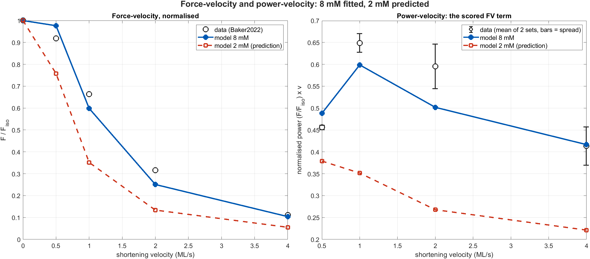
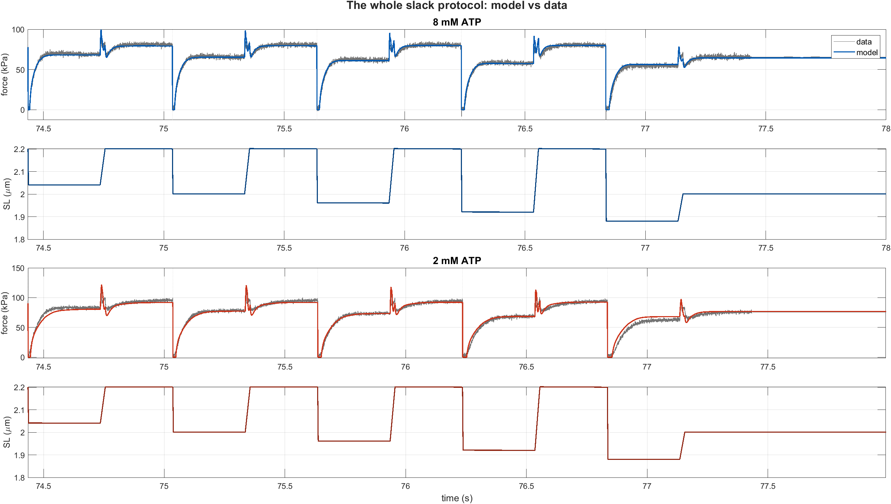
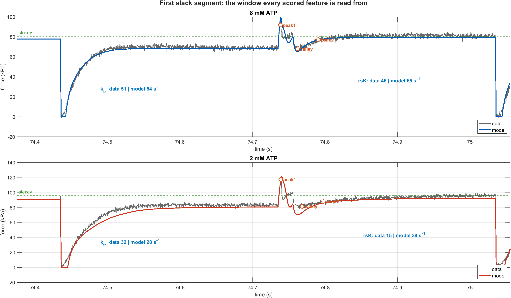
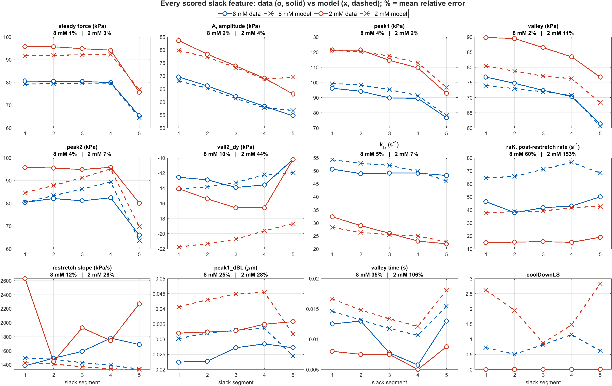

# Joint 8 + 2 mM refit — results, and the ATP-mechanism inventory

**Stopped early on request**, after ~1.5 of a planned 6 rounds (~50 min of a 6 h
budget). One round completed and was accepted; round 2 was mid-simplex at 13.4313
when it was killed, 0.09 below the written snapshot — under the 0.25 noise floor,
so nothing meaningful was lost.

**Bottom line: the refit did not improve the fit.** It bought −0.27 on the joint
objective, which is barely one noise peak-to-peak, and it did so by *trading*:
2 mM shape features improved, 8 mM and `rsK` got worse. `rsK` — the term that
matters — moved **backwards at both concentrations**.

---

## 1. What was refitted, and why it was different from last time

The previous round had only the 21 ATP-gate exponents, which are exactly 1 at
8 mM by construction and therefore cannot touch a defect the two conditions
share. This round freed **~80 core model parameters** (the pool that produced
realign4) plus the 10 non-zero gate exponents, scored on a genuine two-condition
objective:

    Et = E(8 mM: FV + slack + passive, 25 features)
       + E(2 mM: slack, 18 features)

Both legs verified fully scorable before launch (`checkFeatureCoverage`), and the
8 mM leg verified invariant to the gates at |Δ| = 0.0e+00.

## 2. The result

| | joint | 8 mM | 2 mM |
|---|---|---|---|
| seed | 13.8021 | 3.8513 | 9.9508 |
| refit | 13.5284 | 4.0094 | 9.5189 |
| **delta** | **−0.2737** | **+0.1581** | **−0.4319** |

Read that as a reallocation, not a gain. Against a measured noise floor of
σ ≈ 0.076 / peak-to-peak 0.25 on the 2 mM leg, a joint −0.27 is **one
peak-to-peak**. It is at the edge of meaning.

**Where it went, and what it cost:**

| improved | Δ | | degraded | Δ |
|---|---|---|---|---|
| `lo:vall2_dy` | −0.290 | | **`lo:rsK`** | **+0.175** |
| `lo:coolDownLS` | −0.193 | | `hi:rsK` | +0.077 |
| `lo:vall_y` | −0.120 | | `lo:steady` | +0.069 |
| `hi:peak1_y` | −0.037 | | `hi:FV_normpowerAvg` | +0.043 |
| `lo:peak2` | −0.033 | | `hi:ktr` | +0.036 |

**The optimiser sold `rsK` to buy valley shape.** Given a free choice across 90
parameters and a cost function that weights `rsK` at 0.25, it went the other way.

Only **8 parameters moved by more than 1 %**, and six of those by exactly 1.7 %
— the simplex's step size, not a real excursion. The one substantive move was
`k_cr` 1.519 → 1.374 (−9.5 %): that is the compliant-realignment gain, the
*designated `rsK` lever*, and lowering it makes `rsK` **faster** — away from the
data. The optimiser spent its only real move making the headline defect worse
because the shape features paid better.

## 3. The ATP effect, unchanged

| feature | data | seed model | m/d | refit model | m/d |
|---|---|---|---|---|---|
| `steady` | 1.180 | 1.162 | 0.985 | 1.163 | 0.986 |
| `A` | 1.184 | 1.192 | 1.007 | 1.192 | 1.007 |
| `peak1_y` | 1.254 | 1.229 | 0.980 | 1.230 | 0.981 |
| `vall_y` | 1.198 | 1.083 | 0.904 | 1.087 | 0.908 |
| `peak2` | 1.179 | 1.060 | 0.899 | 1.064 | 0.903 |
| `ktr` | 0.537 | 0.501 | 0.933 | 0.500 | 0.932 |
| **`rsK`** | **0.363** | 0.591 | 1.627 | **0.577** | **1.588** |

Absolute `rsK` (s⁻¹, mean over segments):

| | 8 mM | 2 mM |
|---|---|---|
| data | 43.7 | 15.9 |
| seed | 66.0 | 39.0 |
| **refit** | **69.3** | **39.9** |

Both got **worse**. The model's post-re-stretch recovery is now ×1.59 too fast at
8 mM and ×2.5 too fast at 2 mM.

## 4. Figures









Visually indistinguishable from the pre-refit figures, which is the honest
summary. The feature grid shows the two changes that did happen: `vall2_dy` at
2 mM improved 51 % → 44 %, and `rsK` degraded 53 % → 60 % (8 mM) and 147 % → 153 %
(2 mM).

## 5. Every ATP-effect mechanism currently in the model

Six exist; **one is doing all the work**. `MgATP_ref = 8 mM` throughout, and every
mechanism is normalised to be exactly 1 there, so all are inert at 8 mM by
construction.

| # | mechanism | switch | state | form |
|---|---|---|---|---|
| 1 | **General power/Hill gates** | `UseAtpPowerGates` | **ON** | `rate·(ATP/8)^p`, or `rate·Corr₈·ATPⁿ/(Kⁿ+ATPⁿ)` when `AtpGateForm='hill'` |
| 2 | Michaelis gate on strong-bridge detachment | `UseAtpDetachR2` | off | `R2 · [ATP/(ATP+K_T2)] / [8/(8+K_T2)]`, `K_T2 = 2.5 mM` |
| 3 | Strain-dependent Km for #2 | `UseStrainDepAtpGate` | off | `Km(s) = K_T2·(1 + kAtpStrain·max(0, s − sAtpStrain0))` |
| 4 | Michaelis gate on SRX-ADP return | `UseAtpKmsrd` | off | `kmsrd · [ATP/(ATP+K_srx)] / [8/(8+K_srx)]`, `K_srx = 9.3 mM` |
| 5 | ATP-saturated detachment ceiling | `UseR2Ceiling` | off | `R2max = k2max·ATP/(K_T2c+ATP)` in series with `R2` |
| 6 | Apo-pool re-entry | `UseD0State` | off | `RD0T = k_D0T·ATP/(K_D0T+ATP)·D0` |

**Mechanism 1 is the entire ATP effect.** 10 of its 21 possible gates are non-zero:

| gate | tier | exponent | ×factor at 2 mM | what it is |
|---|---|---|---|---|
| `kmsrd` | A | +0.494 | **0.505** | SRX-ADP return — the `ktr` lever |
| `k2` | A | +0.317 | 0.645 | strong-bridge detachment |
| `mu_neg` | B | +0.150 | 0.812 | negative-strain viscosity |
| `kSE` | B | +0.150 | 0.812 | series elastic stiffness |
| `kah` | A | +0.100 | 0.871 | hydrolysis / re-priming |
| `ksr0` | A | +0.100 | 0.871 | SRX entry |
| `ksrd2sr` | A | +0.100 | 0.871 | SRX-ADP → SRX |
| `ksr2srd` | A | +0.052 | 0.931 | SRX → SRX-ADP |
| `kamh` | A | −0.050 | 1.072 | reverse priming (ATP-*inhibited*) |
| `eta_M` | B* | −0.203 | **1.322** | Maxwell dashpot viscosity |

Turning them off costs 2 mM 9.52 → **137.10**, so they carry the whole phenotype.

### 5a. Two structural facts about this inventory

**There is no mass-action nucleotide chemistry in the active model.** In
`dPUdT_CombinedTransitions.m` — the primary ODE — the nucleotide bindings are
commented out:

```matlab
% MgATP = params.MgATP;
% Pi = params.Pi;
% MgADP = params.MgADP;
g1 = 1; g2 = 1; f1 = 0; f2 = 1;
```

Every ATP effect above is a **phenomenological multiplier on a rate**, not a
concentration entering a rate law. `K_Pi` is referenced only by the legacy
`dPUdTCa.m`.

**Consequently `Pi` and `MgADP` are dead inputs.** Verified directly, not
inferred — the 2 mM feature cost is *bit-identical* across Pi = 0, 0.8 and 5 mM
and MgADP = 0 and 2 mM:

| Pi (mM) | MgADP (mM) | 2 mM cost | steady | ktr |
|---|---|---|---|---|
| 0.8 | 0 | 10.7188989074 | 88.9415 | 25.386 |
| 0.0 | 0 | 10.7188989074 | 88.9415 | 25.386 |
| 5.0 | 0 | 10.7188989074 | 88.9415 | 25.386 |
| 0.8 | 2 | 10.7188989074 | 88.9415 | 25.386 |

Spread **0.000e+00**. Every 2 mM snapshot in this project carries
`params0.Pi = 0.8`, the joint objective carries `AtpJoint_Pi2 = 0.8`, and the
low-ATP write-ups describe a coupled ADP/Pi mechanism — **none of it does
anything** in the current model. That is not a bug so much as accumulated
vestigial configuration, but it is actively misleading: it looks like the model
has a Pi-dependent low-ATP mechanism, and it does not.

## 6. What I think this means

Three rounds of fitting now agree, from different directions:

1. **Gate-only refit** (21 exponents, converged): 3 moved, `rsK` moved 0.02.
2. **Structural lever** (`UseStrainDepAtpGate` over a 13-point grid): loses to a
   free exponent, 13.41 vs 9.98.
3. **Joint core refit** (90 parameters, this round): trades `rsK` *away* to buy
   valley shape.

The consistent reading is that **`rsK` is not reachable by parameter adjustment
in this model structure**, and the objective as weighted does not even want to
try — shape features are cheaper to satisfy. Two distinguishable causes remain,
and they need different fixes:

- **The objective is mis-weighted.** `rsK` carries 0.25 while `steady` carries
  50 and `A` carries 50. If the post-re-stretch rate is the physiologically
  interesting quantity, it is being outvoted ~200:1 by amplitudes the model
  already fits to 1–3 %. This is cheap to test: re-run with `rsK` at 5–10 and see
  whether the model *can* trade for it, and at what price in force.
- **The mechanism is absent.** Every ATP effect is a multiplier on a rate
  constant, and `rsK`/`ktr` are driven by the same rates, so no multiplier can
  separate them. The one mechanism designed to (`UseStrainDepAtpGate`) is nested
  inside a switch nobody uses and loses in its unfitted form.

I would do the weighting experiment first — it is one run, and it decides whether
the problem is the fit or the model. Restoring real nucleotide dependence
(mechanism 1 → mass action, with `Pi`/`MgADP` live) is the larger piece of work
and only worth it if the weighting experiment says the levers genuinely cannot
reach.

---

*Optimiser state is in `params/joint82_state.mat` and resumes with
`cfg.RESUME`; the run was stopped, not completed, so a longer budget remains a
legitimate option — but on this evidence I would change the objective before
spending it.*
