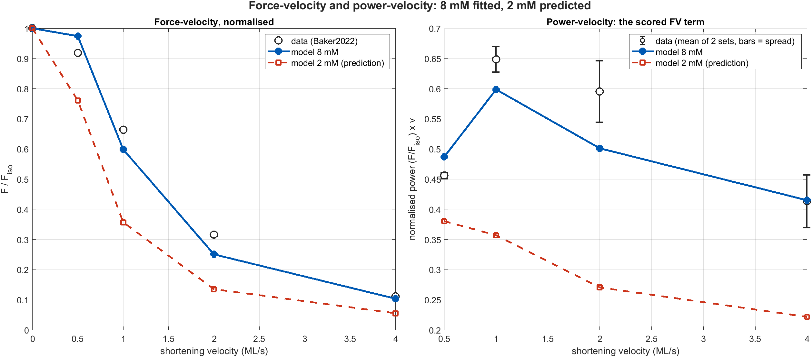
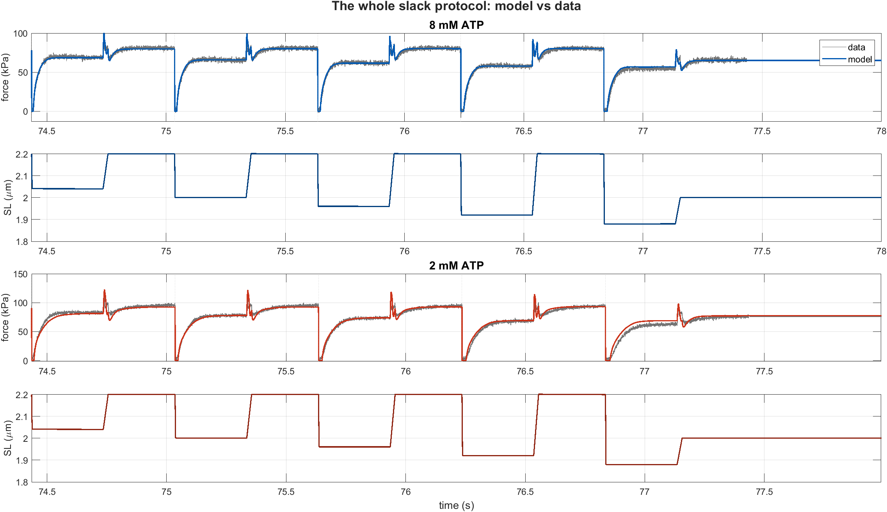
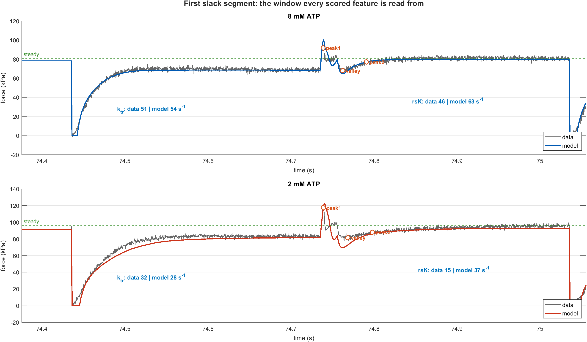
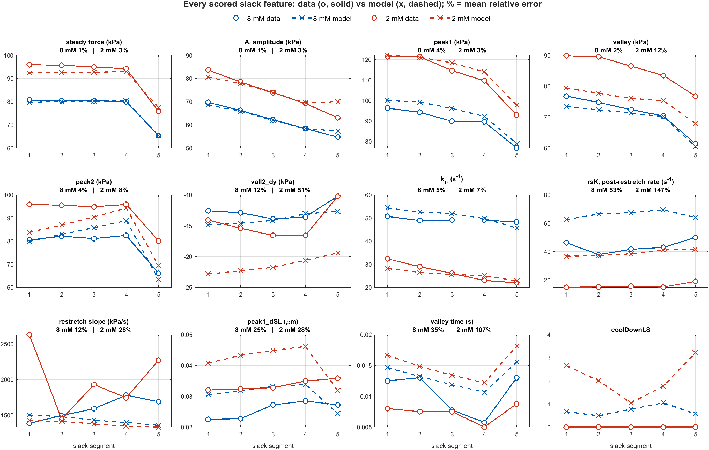

# Low-ATP fit on the realign4 baseline — figure report

**Parameters.** 8 mM = `params/realign4_opt.m` (the `Further-optim` load-realignment
best). 2 mM = `params/lowATP_realign4_gates_opt.m` — that same baseline plus the 21
ATP power gates, refitted here. The gates are exactly 1 at 8 mM by construction, so
**the two conditions share one parameter set**; every 2 mM curve below is produced by
changing `[MgATP]` alone.

**Headline.** 2 mM feature cost **19.58 → 12.44 → 11.20** (old baseline → re-based →
refitted), against an 8 mM floor of 3.11 on the same 18-term list and a measured noise
floor of 0.25. All costs include a constant +1.20 artifact (§5).

---

## 1. Force-velocity and power-velocity

Only 8 mM has force-velocity data, so the red curve is a **prediction**, not a fit.

| v (ML/s) | data F/F_iso | model 8 mM | error | model 2 mM |
|---|---|---|---|---|
| 0.0 | 1.000 | 1.000 | — | 1.000 |
| 0.5 | 0.919 | 0.974 | **+6.0 %** | 0.761 |
| 1.0 | 0.664 | 0.599 | **−9.8 %** | 0.357 |
| 2.0 | 0.316 | 0.251 | **−20.6 %** | 0.135 |
| 4.0 | 0.111 | 0.104 | −6.6 % | 0.055 |

| v (ML/s) | data power (mean ± spread) | model 8 mM | error | model 2 mM |
|---|---|---|---|---|
| 0.5 | 0.456 ± 0.005 | 0.487 | +6.8 % | 0.380 |
| 1.0 | 0.649 ± 0.021 | 0.599 | −7.7 % | 0.357 |
| 2.0 | 0.595 ± 0.051 | 0.501 | **−15.8 %** | 0.271 |
| 4.0 | 0.413 ± 0.044 | 0.415 | +0.4 % | 0.222 |

**The force-velocity fit is the weakest part of the 8 mM model, and its error is
structured, not random.** The curve is pinned at both ends — exact at v = 0 by
definition, −6.6 % at 4 ML/s — and sags through the middle, reaching **−20.6 % at
2 ML/s**. The model is too *concave*: it drops away from isometric too slowly (+6 % at
0.5) and then too fast (−10 %, −21 %). In power terms it under-produces peak power by
7.7 % and mid-range power by 16 %, well outside the ±0.02–0.05 spread between the two
source datasets.

That shape is a curvature error, so the lever is the strain dependence of detachment,
not a scalar rate. It is worth stating plainly that this is a **fitted** quantity that
the current objective already weights heavily (`FV_normpowerAvg`, weight 62.3), and it
still lands here.

**Two testable 2 mM predictions**, neither constrained by any data in the fit:

1. **Peak power falls to ×0.635** of its 8 mM value, while isometric force *rises*
   ×1.187. Low ATP is stronger and much less powerful.
2. **The optimal shortening velocity shifts down**, from 1.0 to 0.5 ML/s. The power
   curve does not merely scale — it moves left, because detachment is the step being
   slowed.

Prediction 2 is the more useful one: it is a shape change, so it survives the absolute
force-scale uncertainty that makes cross-prep comparisons hard, and a 2 mM
isovelocity series over 0.25–4 ML/s would settle it. That series does not exist yet.

## 2. The whole slack protocol

Five shorten/re-stretch cycles at descending sarcomere length. Grey is data, colour is
model; the lower trace of each pair is the commanded SL.

At this zoom the fit is good at both concentrations — the model reproduces the
isometric level, the slack drop to zero force, the redevelopment, the re-stretch spike
and the descending-limb trend as SL steps 2.04 → 1.88 µm. The 2 mM condition is
visibly the stronger one (~95 vs ~80 kPa) and visibly the slower one, which is the ATP
effect the whole project is about.

Two defects are already visible here and get quantified below: the **2 mM
redevelopment lags the data through the middle of each rise** (the red curve sits below
grey from ~74.46 to ~74.62 s), and the **model's re-stretch spike overshoots** at 2 mM.

## 3. Slack detail — where every feature is read

| | 8 mM | 2 mM | ratio 2/8 |
|---|---|---|---|
| `k_tr` data | 51 s⁻¹ | 32 s⁻¹ | 0.537 |
| `k_tr` model | 54 s⁻¹ | 28 s⁻¹ | 0.504 |
| `rsK` data | 46 s⁻¹ | **15 s⁻¹** | 0.363 |
| `rsK` model | 63 s⁻¹ | **37 s⁻¹** | 0.587 |

This panel contains the project's open problem, and it is visible by eye. Look at the
post-re-stretch recovery — the slow climb after `peak2`, right of 74.8 s:

- At **8 mM** the model recovers at 63 s⁻¹ against a measured 46 — **×1.4 too fast**.
- At **2 mM** the model recovers at 37 s⁻¹ against a measured **15** — **×2.5 too fast**.

The data slow this recovery down by ×0.36 when ATP drops; the model only manages ×0.59.
`k_tr` in the same trace is nearly right (×0.504 vs ×0.537), so this is not a global
kinetic scaling error — the model gets the isometric redevelopment rate right and the
post-re-stretch one wrong, in the same segment, from the same parameters.

Also visible: the model's `peak1` overshoots at 2 mM (~122 vs ~117 kPa) and its
subsequent valley digs ~8 kPa too deep before recovering — the `vall_y` and `vall2_dy`
residuals in §4.

## 4. Every scored feature

Mean relative error per feature, over the five slack segments:

| feature | 8 mM | 2 mM | verdict |
|---|---|---|---|
| `steady` force | 1 % | 3 % | excellent |
| `A` amplitude | 1 % | 3 % | excellent |
| `peak1_y` | 4 % | 3 % | good |
| `peak2` | 4 % | 8 % | good |
| `k_tr` | 5 % | 7 % | good |
| `vall_y` | 2 % | 12 % | 2 mM valley too shallow |
| `vall2_dy` | 12 % | **51 %** | 2 mM second valley far too deep |
| `restretch slope` | 12 % | 28 % | scattered in the data itself |
| `peak1_dSL` | 25 % | 28 % | systematic, both conditions |
| `vall_t` | 35 % | **107 %** | sub-millisecond timing, low weight |
| **`rsK`** | **53 %** | **147 %** | **the open defect** |
| `coolDownLS` | data ≡ 0 | data ≡ 0 | penalty term, no % defined |

Read the grid by colour: blue pairs (8 mM) mostly overlie each other; red pairs (2 mM)
separate. **The amplitude features are solved and the rate features are not.** Force,
amplitude and both peaks track the data across all five segments and both
concentrations to within a few percent, including the drop at segment 5 where SL
reaches 1.88 µm. That is the filament-overlap and stiffness machinery working.

`rsK` is the outlier by an order of magnitude — the only feature where the model and
data curves do not even overlap, at either concentration, in any segment. It is 24 % of
the total 2 mM residual on its own.

`vall_t` at 107 % looks alarming and mostly is not: the valley time is ~8–17 ms, so a
5 ms error reads as 60 %. It carries weight 0.2 for exactly that reason.

## 5. What the numbers mean, and one caveat

**Cost, on one fixed 18-term list:**

| configuration | 2 mM cost | 8 mM floor |
|---|---|---|
| old baseline (`rskR2`) + gates | 19.58 | 5.67 |
| re-based onto realign4, gates unchanged | 12.44 | 3.11 |
| **+ gates refitted here** | **11.20** | 3.11 |
| realign4 at 2 mM with gates **off** | 138.30 | — |

**The caveat, before anything is quoted from this page.** Every cost above carries a
constant **+1.200** that is not a fit residual: the composite bound term
`k2|…,ksrd|…,kmsrd|…` returns `MISSING_FEATURE_COST = 100` per sub-entry because a
slack-only run does not produce those three features. It is identical in every
configuration, so it cancels in every comparison here, but the honest numbers are
**10.00 against a floor of 1.91**.

**What the refit did.** Only 3 of 21 gates moved: `kSE` (−0.52), `eta_M` (−0.46) and
`kmsrd` (−0.25). Two of the three are *mechanical* levers, and every core rate constant
— `k2`, `kah`, `kamh`, `ka`, `kd`, `k1`, `k_1`, `ksr0`, `ksr2srd`, `ksrd2sr` — held
still. It recovered `k_tr`, `A` and `vall2_dy`, which the re-base had cost, and moved
`rsK` by **0.02**.

**The conclusion this report supports.** Twenty-one free ATP exponents, converged, and
`rsK` did not move. The obstruction is now specific: `k_tr` needs *less* low-ATP
suppression while `rsK` needs *more*, and both are driven by the same core cycle, so no
strain-*uniform* ATP gate can serve both — which is what §3 shows in one trace. The next
lever has to be structural. `UseStrainDepAtpGate` (wired, default-off, never fitted)
makes the apparent Km(ATP) rise with strain, which is exactly that separation.

---

*Figures: `MakeReportFigures.m`. Costs and per-feature decomposition:
`RunTransferCheck.m`, `RunGateRefit.m`. Full argument:
[conclusions.md](conclusions.md).*
