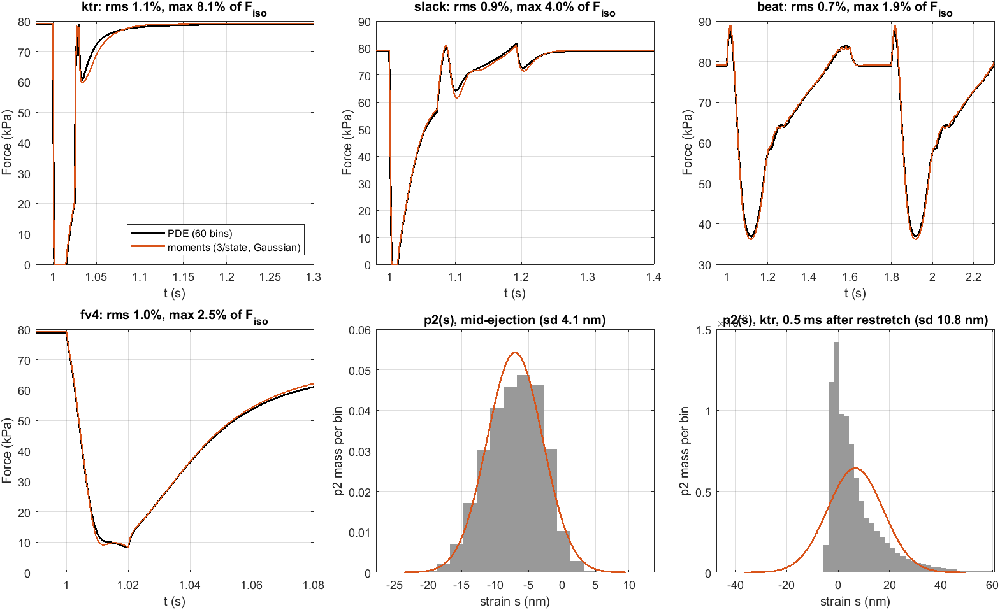

# Moments reduction of the cross-bridge model (Tewari / Marzban style)

**Status:** feasibility analysis + working prototype, 2026-10-27. Nothing in `Model/` was changed.
All numbers are measured on this machine (R2023a, `params/fastgate_best.m`, 2-state,
`RelTol 1e-3`, 0.5 ms output grid) unless marked *estimate*.

## Verdict

**Yes: a moments twin is viable, it can be kept in sync semi-automatically, and 3 moments per
attached state is the right number.** But the Tewari/Marzban recipe of Taylor-expanded rate
polynomials does **not** carry over. This model's kernels are far too curved for it. The closure
that works is a **Gaussian closure with Gauss–Hermite quadrature of the real kernels**.

| question | answer |
|---|---|
| How many moments? | **3 per attached state** (0th, 1st, 2nd), so 6 XB states + 9 scalars = **15 states vs 129**. Adding moments does *not* help: QMOM with 4 or 6 moments was 2–4× *worse* than the Gaussian 3 a-posteriori (§3). |
| How accurate (same parameters, no refit)? | Force trace within **0.4–2.2 % RMS of F_iso** on every protocol. Physiological beat: work −3.5 %, F_min −1.9 %, F_max +1.4 %. Staircase ≤0.13 %. F–V end-of-ramp ≤3 %. |
| Where does it break? | **Fast, large stretches.** On the ktr protocol (30 ML/s restretch) the redevelopment rate k80 is **−8 % vs the production PDE and −17 % vs the PDE's continuum limit** (which the production PDE itself misses by −10 %, §4b). The distribution there is one-sided with a long tail (figure, bottom right), which a Gaussian cannot represent. Slack (1 ML/s restretch) is +3 % vs converged, about one preparation-width. |
| How fast? | At the **same** per-call RHS cost in MATLAB (~0.9 ms, dominated by kernel evaluation), the beat integrates in **4.5 s vs 74 s (17×)**. Iso/FV/slack/ktr: 8–20×. A compiled 15-state RHS should add 1–2 orders of magnitude (*estimate*). |
| Keep both in sync? | **Semi-automatically, yes**, if the dxdt is split into *strain kernels* + *scalar periphery* + *distribution backend* (§5). Both backends already share `xbKernels`; parity is at machine precision (§1). |
| Your expectation (slack/ktr hard, twitches easy)? | **Confirmed, with nuance.** Twitch-like and physiological contractions are fine. Slack is borderline but usable. **ktr is not**, and neither is the production PDE: its own ktr result is set by a window-shift artefact (§4). |

*Black: the production PDE (60 bins). Orange: Gaussian 3-moment model with the same parameters.
Bottom middle/right: p2(s) mid-ejection (Gaussian is right) and 0.5 ms after the ktr restretch
(hard edge at the attachment pointer plus a 50 nm tail: the Gaussian puts mass at negative
strain).*

---

## 0. How the PDE actually works (what had to be understood first)

- **Lagrangian frame, no advection.** Bins are fixed in the head frame and their *labels* slide:
  `s = params.s - (-(SL-LSE) + LXBpivot)/2`. A moments model gets the exact equivalent for free:
  `dμ_k/dt += k·u·μ_{k-1}`, with `u = velHS/2`.
- **The sliding attachment pointer** has two parts.
  1. *In the dxdt:* where new heads land. With `UseA1AttachmentKernel = 0` but
     `A1AttachmentWidth = 0.006` (fastgate_best), the code takes the **`else` branch**: a
     **±6 nm triangular kernel** sampled on the grid around the moving zero. It is *not* the 2-bin
     point that `TriSegCoupling` §2b describes. As the zero slides through a bin the sampled
     kernel keeps mass and mean exactly, but its sd wobbles **2.31–2.52 nm** (exact 2.45). That
     moves the fresh cohort's stroke rate `k12` by ±4 % (1710–1838 s⁻¹ vs 1793 exact)
     ([AttachmentPointerArtefact.m](AttachmentPointerArtefact.m)). The moments model uses the
     continuous triangle's moments exactly (`μ_2 = Ax²/6`), so it has **no pointer at all**.
  2. *In `evaluateModel`:* the `movingWindow` event fires when the **pointer** nears a window
     edge and then shifts by `ss/3` bins, **zeroing the bins at the opposite edge**. See §4 for
     why this matters.

## 1. Sync foundation: shared kernels, verified

[xbKernels.m](xbKernels.m) returns every per-head strain function the dxdt integrates: the force
kernels `F1`/`F2` (with `UseNegativeKstiff`), `k1D`, `k12`, `k21`, `k2`, the SRX routing share
`fSRX` and the A2 hop `kHop`. It refuses any flag it does not model (`assertSupported`).
[checkKernelParity.m](checkKernelParity.m) checks it against `dPUdT_CombinedTransitions` on real
PDE states: **all six integrated quantities agree to ≤2e-16 relative.**

## 2. A-priori: how many moments, on the PDE's own distributions

[APrioriClosure.m](APrioriClosure.m) freezes the exact p1(s), p2(s) at every sample of every
protocol and asks what each closure would reconstruct. Worst-case error is given as % of that
flux's maximum. Excerpt (full tables in the script output; `results/apriori.mat`):

| kernel | protocol | T2 (Tewari Taylor) | **G3 (Gaussian)** | Q2 (4 mom.) | Q3 (6) | Q4 (8) |
|---|---|---|---|---|---|---|
| force | beat | 5.4 | **0.5** | 0.8 | 0.7 | 0.6 |
| force | fv4 | 16.6 | **1.5** | 2.9 | 1.9 | 1.0 |
| force | ktr | 26.5 | **1.7** | 1.4 | 1.0 | 1.0 |
| `k2` (detach) | slack | 84 | **14** | 17 | 12 | 16 |
| `k12` (stroke) | iso | 192 | **9** | 31 | 19 | 12 |
| `k12` | ktr | 16 555 | **71** | 24 | 10 | 7 |

- **Tewari-style Taylor truncation is unusable here.** The pchip kernels are steep at exactly
  the strains where heads sit: `k12` goes 598 → 9186 s⁻¹ between 0 and −6 nm, inside the
  attachment triangle. A quadratic in s cannot follow that. Marzban/Tewari get away with it
  because their kernels *are* low-order exponentials and they drop the strain dependence in the
  2nd-moment equation by hand.
- **Force is easy, `k12` is hard.** `k12` errors matter much less than they look, though: the
  stroke is so fast (fresh cohort ~1800 s⁻¹, about 0.5 ms) that p1 is a tiny pool, and the flux
  is attachment-limited. §3 confirms this.

## 3. A-posteriori: the closed moments model

[dMdT_Moments.m](dMdT_Moments.m) is a standalone RHS with the dxdt's tail layout unchanged
(`ss := K`, so `PU(Ns*ss+…)` indices are the same) and the scalar periphery copied verbatim for
the active flags. [evaluateMoments.m](evaluateMoments.m) mirrors `evaluateModel`'s segment loop,
with no events. [CompareMomentsVsPDE.m](CompareMomentsVsPDE.m) runs 10 protocols, each starting
with a 1 s activation from rest ([momentsProtocols.m](momentsProtocols.m)): iso, ktr, slack,
two physiological beats (0.15 ML half-sine ejection in 0.2 s and refill in 0.4 s), a 4-step
staircase, and isovelocity F–V at 0.1–4 ML/s.

Force error vs the production PDE, % of F_iso, after activation:

| protocol | **gauss3** rms / max | qmom4 rms / max | qmom6 rms / max | wall gauss3 / PDE |
|---|---|---|---|---|
| iso | **0.39 / 0.39** | 2.44 / 2.44 | 1.93 / 1.93 | 1.0 / 16.9 s |
| ktr | **1.12 / 8.12** | 3.16 / 23.0 | 2.99 / 10.8 | 2.0 / 24.3 s |
| slack | **0.87 / 3.97** | 3.16 / 15.2 | 2.43 / 7.9 | 2.1 / 26.2 s |
| beat | **0.73 / 1.88** | 3.78 / 7.7 | 2.59 / 5.1 | 4.1 / 74.4 s |
| stairs | **0.49 / 0.83** | 2.80 / 9.2 | 1.94 / 5.8 | 1.7 / 19.0 s |
| fv0.1–fv4 | **0.95–2.20 / 1.7–2.6** | 2.6–8.9 / 5.2–11.0 | 1.3–3.7 / 2.1–4.4 | 1.1–1.4 / 21–27 s |

Features, gauss3 vs PDE (`results/aposteriori_features.csv`): steady isometric +0.39 %; force at
50 ms of activation +1.8 %; t50 of activation identical. Beat F_max +1.4 %, F_min −1.9 %,
mid-ejection −2.5 %, loop work −3.5 %. Staircase peaks and holds ≤0.13 %. F–V end-of-ramp
−2.4…+2.9 %. The **only** large feature errors are the rates and one transient:

| feature | PDE | gauss3 | error |
|---|---|---|---|
| ktr `k80` | 59.2 s⁻¹ | 54.3 | **−8.3 %** |
| slack `k80` | 58.5 s⁻¹ | 62.5 | **+7.0 %** |
| fv4, mid-ramp (10 ms into a 20 ms 4 ML/s ramp) | 12.8 kPa | 10.8 | −15 % |

Note the two k80 errors have **opposite signs**, so the ktr/slack rate ratio (which
[RestretchVsKtrRecovery](../RestretchVsKtrRecovery/conclusions.md) found to be ~1) would be
distorted by ~15 %.

**Why more moments does not help.** QMOM replaces the distribution with N delta nodes (2 for
4 moments, 3 for 6). Steep kernels (`k12`, `k2`) sampled at 2–3 points are worse than a smooth
Gaussian sampled at 7 Gauss–Hermite points. Wheeler inversion is also noisy as the state moves.
If a richer closure is ever needed for fast stretches, the lever is **closure shape**, not order:
a two-Gaussian mixture (EQMOM, 5 moments), or splitting each state into a fresh cohort and an aged
cohort, matched to the one-sided ktr shape. *Not tested.*

## 4. Pitfalls found on the way (they affect the PDE too)

**4a. The production PDE is itself not converged on rates.** Keeping the 120 nm window and
refining the grid ([PDEGridConvergence.m](PDEGridConvergence.m)): dS 1 nm and 0.5 nm agree
(ktr k80 61.7 / 61.5), so dS 2 nm biases **k80 by −4 %** on both ktr and slack. Against the
converged PDE, gauss3 is **+2.9 %** on slack k80, which is smaller than the PDE's own grid bias.

**4b. Window shifts delete force-bearing heads on the ktr restretch.** `movingWindow` follows
the **attachment pointer**. During a fast lengthening the pointer runs toward the left edge, and
the shift zeroes the **right-most** bins: the most stretched, most force-bearing heads. In the ktr
protocol that drops cross-bridge force **61.4 → 48.7 kPa (−13 kPa) in one step** at the shift
([NumericsSensitivity.m](NumericsSensitivity.m), `results/ref_clamp_ktr.mat`, `LXBPivot` 2.04 → 2.12 µm at t ≈ 1.029 s, the end of the restretch).
This **refines** [StrainWindowNoise](../StrainWindowNoise/conclusions.md) ("shifts delete
≤1e-5 of mass"): that holds for slack (1 ML/s restretch, and confirmed here: window and clamp
change slack k80 by <0.03 %), **not** for the 30 ML/s ktr restretch.

| ktr protocol | restretch peak | k80 |
|---|---|---|
| production (dS 2, W 120 nm, unclamped) | 79.2 kPa | 59.2 |
| clamped kernels, W 120 | 86.1 | 61.1 |
| clamped kernels, **W 240** (no shift during restretch) | **99.5** | **65.5** |
| moments gauss3 + clamp (no window by construction) | 92.0 | 54.3 |
| W 240, **unclamped** | broken: k2 < 0 past +142 nm creates mass ("Leaking probs!", F_iso → 99 kPa) | — |

So for the ktr protocol, the production PDE is **−20 % on the restretch peak and −10 % on k80**
from its own continuum limit (clamped, wide window). Clamping alone recovers a third of the peak;
the rest is the deletion. The PDE and a moments model **cannot be synced on that protocol until the
PDE stops deleting heads**. ktr is the held-out validation protocol
([ktr Protocol Blind Spot](../KtrProtocolVsSlackKtr/conclusions.md)), so this matters beyond moments.

**4c. Kernel extrapolation must be clamped for moments.** Gauss–Hermite nodes sit at μ ± 2.65σ.
In ktr that is up to ~100 nm, well outside the fitted knots, where the unclamped `k2` cubic goes
negative (found already in StrainWindowNoise; `ClampStrainDepExtrapolation` is opt-in and **off**
in fastgate_best). A moments backend must force the clamp, or clamp inside `xbKernels`.

**4d. Path shadowing.** The CLAUDE.md boilerplate `addpath(genpath('.'))` also adds
`.claude/worktrees/*/Model`, and `which dPUdT_CombinedTransitions` resolved to a **worktree copy**
at the start of this analysis. [momentsSetup.m](momentsSetup.m) strips `.claude`/`_archive` and
asserts the real file. Any session can silently run another branch's model this way.

## 5. Keeping both models in sync

Classify every mechanism by what it needs from the distribution:

| class | examples (flags) | moments form | sync |
|---|---|---|---|
| **Scalar periphery**: reads only p_0, F_active, net fluxes | SE/`mu`, passive, Maxwell titin, SRX/SRD/PD, `A_reg`, `A_def`, overlap, lattice, global occupancy, catch-bond scalar, future **Ca gate on `ka_eff`** | identical code | **automatic** once shared |
| **Strain kernels**: per-head f(s) | all pchip rates, `F1`/`F2`, `fSRX`, yield gate, strict detachment, catch-bond mask, `UseA2Popping`, 3rd state | quadrature at closure nodes | **automatic** via `xbKernels` |
| **Landing sources**: where mass appears | attachment triangle, `A2Reattaching` at `dA2re`, hop landing, `YieldHop1`/`YieldHopShift`, `UseA2AttachmentShift` | source moments, e.g. Σw·k(s)·((s−d)^k − s^k) | **by hand**, one short formula each |
| **Per-bin density**: depends on p(s) locally | `UseTargetZoneSaturation` (deprecated) | **none** | not portable |
| **Numerics of the grid** | window shift / edge deletion, attachment kernel sampling | n/a | must be **removed from the PDE**, not copied |

**Recommended architecture** (one refactor of `dPUdT_CombinedTransitions`, bit-identical by test):

1. Promote `xbKernels(s, params, vel)` to `Model/` and make the dxdt call it. It is already
   parity-tested.
2. Extract `xbPeriphery(aggregates, scalars, params)`. Its inputs are `p1_0`, `p2_0`,
   `F_active`, `ΣJ1D`, `RdetSRX`, `RT2`, `dBound`. It returns every scalar derivative and `RD1`.
3. Two backends compute the aggregates: the **grid** (today's code) and **moments** (this
   prototype). Note the grid *is* a 60-node quadrature, so a moments backend fed grid nodes must
   reproduce the PDE exactly. That is the strongest parity test available.
4. Semi-automatic guard: CI-style regressions after any dxdt change. Run (a) `checkKernelParity`
   (machine precision), (b) the periphery parity at frozen states, and (c)
   `CompareMomentsVsPDE` on the beat/iso/staircase/FV battery with tolerances (e.g. beat RMS
   < 2 % F_iso). `assertSupported` makes the moments backend **refuse** any new flag it has not
   been taught, so drift fails loudly instead of silently.

Until that refactor, [dMdT_Moments.m](dMdT_Moments.m) is a hand copy of the periphery, the very
failure mode this section is meant to prevent. Treat it as a prototype.

## 6. Limits of the moments version (what it will never do)

- Shape-sensitive transients: any protocol that builds a **one-sided or bimodal** distribution
  (fast large stretch, the ktr restretch, the first ~10 ms of fast shortening). Expect ~10–20 %
  rate errors there.
- Mechanisms that need the local density p(s) (per-bin occupancy, explicit site-register effects).
- Strain-resolved readouts (`animateStateProbabilities`, per-bin fluxes, X-ray-like strain
  distributions) are only Gaussian caricatures.
- Parameter transfer is approximate: same parameters give ≤3 % on physiological features but
  up to 8 % on rates. Fits should be made, or at least polished, in the backend that will be used.

## 7. Recommended path

1. **Fix the PDE first, whatever happens with moments:** enable `ClampStrainDepExtrapolation`
   and stop edge deletion on the ktr restretch (wider window, or a window that follows the mass
   rather than the pointer, or conservative redistribution). Then re-score the ktr validation.
2. Do the §5 refactor (kernels + periphery split); it is useful even without moments.
3. Use **gauss3** for physiological/twitch/TriSeg work (with the Ca gate as a scalar on `ka_eff`),
   and the PDE for slack/ktr/stretch protocols. Compile the moments RHS once it is stable.
4. Only if fast stretches must be done in moments: try the fresh/aged two-cohort or two-Gaussian
   closure. Judge it against the **converged, clamped, wide-window** PDE, not production.

## Reproducing

All from `Analyses/MomentsReduction/` (each script calls `momentsSetup`, which fixes the path):

| script | does | time |
|---|---|---|
| `RunReferencePDE` | PDE runs → `results/ref_*.mat`. Options: `dSoverride`, `windowFactor`, `clampKernels`, `onlyRuns` | ~5 min (production set) |
| `checkKernelParity(ref, params, idx)` | xbKernels vs dxdt | s |
| `AttachmentPointerArtefact` | sampled vs continuous attachment triangle | s |
| `APrioriClosure` | frozen-distribution closure errors | ~1 min |
| `CompareMomentsVsPDE` | closed moments model, 10 protocols × 3 closures | ~1.5 min |
| `PDEGridConvergence`, `NumericsSensitivity` | dS / window / clamp variants (need the matching `RunReferencePDE` runs) | s (+ PDE runs ~10 min) |
| `PlotMomentsSummary` | the figure | s |
