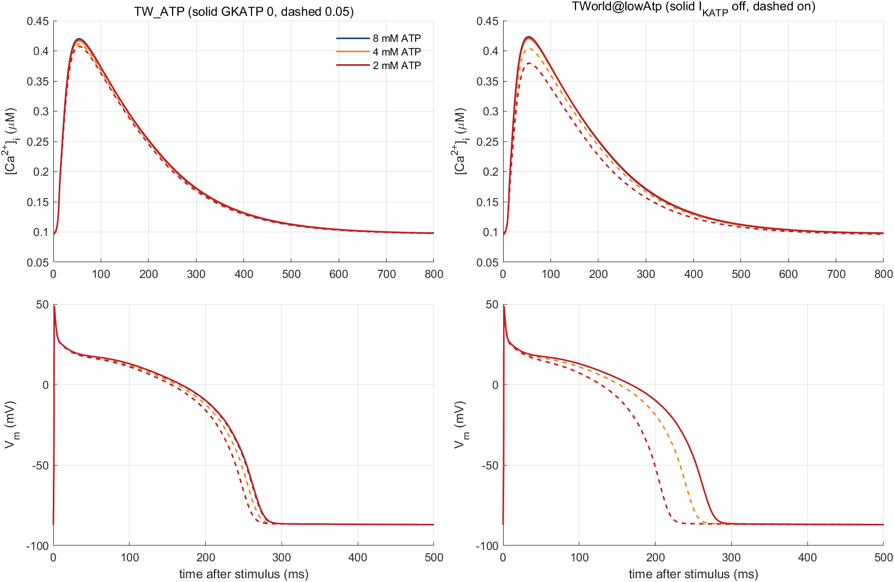
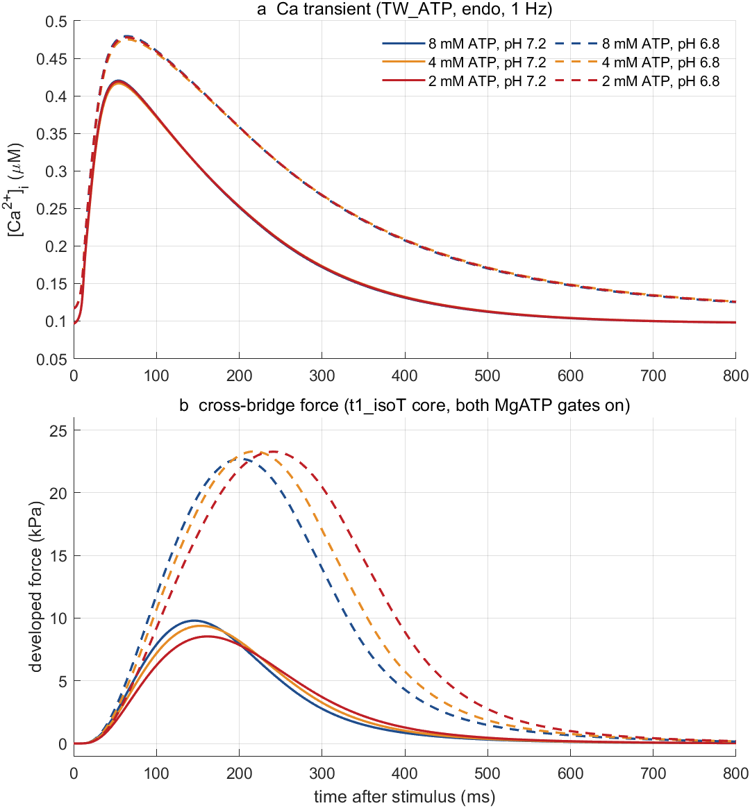
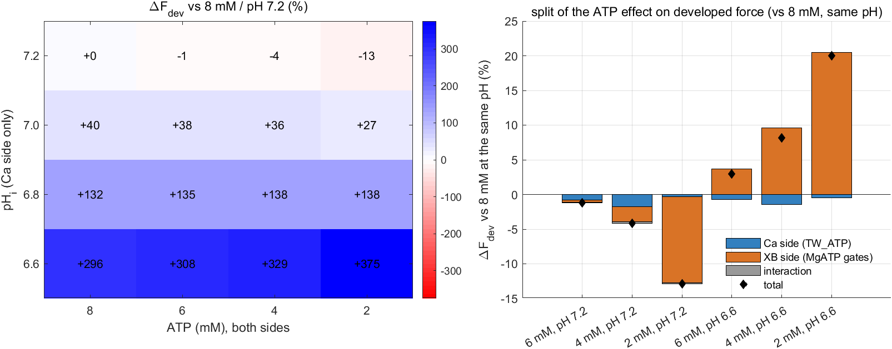
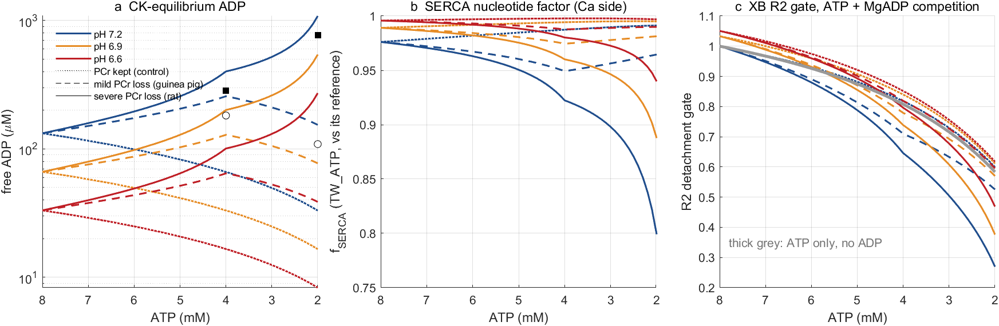
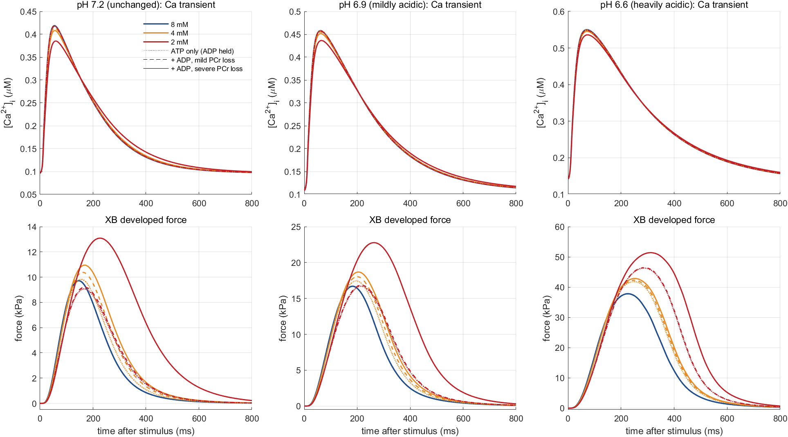
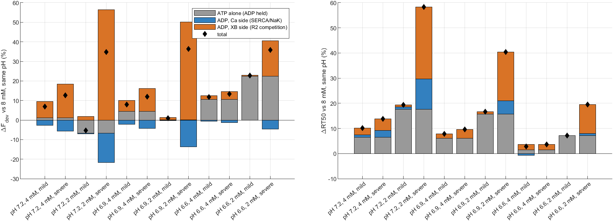

# TWorldATPTwitch: the ATP/ADP/pH-sensitive T-World, and the coupled twitch over ATP × pH

**Issue:** [#76](https://github.com/beards-lab/ATP-depletion-and-heart-failure/issues/76) · **Branch:** `76-tworld-atp-twitch` (from `HumanTwitch` d1ede98) · **Status:** done, needs PI review · **Authors:** Claude (AI agent) for Filip Jezek · **Date:** 2026-11-05

**Question.**
1. How does the new ATP/ADP/pH-sensitive T-World (`TW_ATP/model_TWorld_shock_ATP`, local and uncommitted) differ from the ATP-dependent T-World we built earlier (`C:\home\git\TWorld`, branch `lowAtp` f700fe9)?
2. When TW_ATP drives our cross-bridge model on a paced twitch at MgATP 8/6/4/2 mM × pH 7.2/7.0/6.8/6.6, what happens, and which side carries each effect: Ca handling or the cross-bridges?

## Bottom line

- **Low ATP:**
  - **The Ca transient barely responds to low ATP in either T-World unless K_ATP channels open.** On pumps alone (I_KATP off), the CaT amplitude changes by at most 1.1 % in both models; the two T-Worlds agree to within 0.1 percentage point.
  - The only real difference between them is I_KATP. At 2 mM it shortens APD90 by 5 % in TW_ATP (Michailova, GKATP 0.05) against 21 % in lowAtp (Mena Tobar), and the CaT amplitude falls 3.7 % against 13.1 %.
- **In the coupled twitch at pH 7.2**, 2 mM ATP lowers developed force by **13 %** and slows it (TTP +16 ms, RT50 +16 %). It also cuts myosin ATP use per beat by **42 %**.
  - About 97 % of the force change is on the **cross-bridge side**; the Ca side gives −0.3 %.
  - That XB number is the small difference of two large, opposing gates: at 2 mM, ATP-limited detachment alone gives +63 % and SRX trapping alone gives −44 %. The **sign flips with activation**: −13 % at pH 7.2, **+20 %** at pH 6.6.
  - Our other human core (`s3_free`) gives −41 % at pH 7.2. The size of the net ATP effect is therefore not robust; only the mechanism is.
- **Acidosis in TW_ATP raises the Ca transient** (pH 6.6: diastolic Ca +48 %, amplitude +25 %, decay t50 +50 %). Our XB model has no pH sensitivity, so its twitch force rises **×4.0**.
  - TW_ATP's own Land myofilament, which *is* pH-desensitised, loses 83 % of its tension at the same pH.
  - So our pH sweep shows how steep the twitch's Ca sensitivity is. It is not a prediction of acidotic force (#60).

- **ADP, derived from CK equilibrium (section 4), is the larger lever once PCr is gone.**
  - Free ADP ∝ ATP·Cr/PCr·10^(pH−7). It rises only as PCr is spent (at 2 mM: 154 µM on the mild path, 1.08 mM on the severe one, at pH 7.2), and acidosis cuts it 2×/4× (pH 6.9/6.6).
  - At 1.08 mM, ADP turns the 2 mM twitch from −7 % to **+35 %** force. It slows relaxation (RT50 +58 %) and raises diastolic force +72 %: the XB side gives +57 %, SERCA inhibition on the Ca side −15 %.
  - On the mild path ADP moves force by ≤ 8 %.

The prediction held for ATP: pumps ~1 %, and the XB side dominates. The pH and ADP results were not predicted.

## Method

| | |
|---|---|
| **Ca models** | **TW_ATP** `model_TWorld_shock_ATP`: Cortassa 2006 SERCA and Na/K factors normalised to ATP_ref 7.9875 / ADP_ref 0.0125 mM (total), Michailova 2005 I_KATP (not normalised), pH multipliers on RyR, SERCA, NCX, IK1/Ito and Land's ca50/Tref. **lowAtp** `TWorld@lowAtp`: Cortassa SERCA/NaK/PCa normalised to ATP_ref 8 / ADP_ref 93.7 µM (free, CK equilibrium), Mena Tobar I_KATP counted only in excess of the reference, no pH. Both are read-only; `twPaths.m` puts exactly one copy on the path and asserts where `modelRunner`/`model_TWorld`/... resolve. |
| **Shared nucleotide ladder** | ATP 8/6/4/2 mM with free ADP 93.7/138/182/109 µM: lowAtp's lowest published ischaemic ADP, with 6 mM interpolated (`atpLadder.m`). The ladder is **not monotonic in ADP**: 2 mM has less ADP than 4 mM. |
| **Standalone** | endo, 1 Hz, 37 °C, normoxic, 150 beats from `TW_endo`, last beat analysed (`runStandalone.m`). Beat-to-beat CaT amplitude change ≤ 5×10⁻⁵ everywhere. |
| **Coupling** | `CaInput = 'tworld'`, coupling `'land'`: the 93 TW_ATP states inside the XB ODE, open loop (Land buffers the TnC Ca). T-World starts from the 150-beat steady state at the same ATP/ADP/pH. New option `CaTworld.model` (default `@model_TWorld`, so existing runs are unchanged) selects the T-World function. |
| **XB model** | `params/human_twitch_t1_isoT.m` (HumanTwitch t1 core and thin filament) with both MgATP gates on: `UseAtpDetachR2` (K_T2 2.5 mM) and `UseAtpKmsrd` (K_srx 9.3 mM), each exactly 1 at 8 mM. Isometric SL 2.2 µm, 2 s diastole + 3 beats, `simHumanTwitch` (ode15s RelTol 1e-3). ATP use = net hydrolysis flux integrated over the beat. |
| **Split** | Ca side and XB side get their ATP independently, giving 40 cases (`coupledCases.m`). For each ATP *a* at pH *p*, measured from (8, *p* \| 8): **Ca side** = (*a*, *p* \| 8), **XB side** = (8, *p* \| *a*), **interaction** = total − Ca − XB. pH has no XB side by construction. |
| **Checks** | TW_ATP at its own reference vs its plain `model_TWorld`: max \|ΔCa\| 1.3×10⁻⁵ µM. lowAtp at 8 mM, I_KATP on vs off: 2×10⁻⁷ µM (bitwise as documented). The base beats agree: peak 0.4235 (lowAtp) vs 0.4201 µM (TW_ATP at ladder ADP), APD90 269.2 vs 269.1 ms. Coupled vs standalone Ca: ≤ 9×10⁻⁴ µM in all 42 cases. Coupled beat-to-beat Fdev drift ≤ 0.98 %. 0 solver failures. |

## 1. TW_ATP vs lowAtp (pH 7.2)

**Figure 2.** Ca transient (top) and action potential (bottom) at 8/4/2 mM. Left: TW_ATP (solid I_KATP off, dashed Michailova GKATP 0.05). Right: lowAtp (solid I_KATP off, dashed Mena Tobar on).

| change vs the model's own 8 mM | 6 mM | 4 mM | 2 mM |
|---|---|---|---|
| CaT amplitude, TW_ATP pumps only | −0.56 % | −1.15 % | −0.36 % |
| CaT amplitude, lowAtp pumps only | −0.57 % | −1.13 % | −0.28 % |
| CaT amplitude, TW_ATP + I_KATP (Michailova) | −0.90 % | −2.5 % | −3.7 % |
| CaT amplitude, lowAtp + I_KATP (Mena Tobar) | −2.1 % | −5.8 % | **−13.1 %** |
| APD90, TW_ATP + I_KATP | −0.5 % | −2.0 % | −5.1 % |
| APD90, lowAtp + I_KATP | −2.9 % | −8.4 % | **−21.1 %** |
| peak I_KATP (µA/µF), TW_ATP / lowAtp | 0.023 / 0.046 | 0.069 / 0.146 | 0.153 / 0.416 |
| f_SERCA, TW_ATP / lowAtp | 0.974 / 0.990 | 0.964 / 0.980 | 0.974 / 0.990 |

1. **Same pump physics, same answer.** Both use Cortassa's SERCA factor with K_m(ATP) = 10 µM. ATP at 2–8 mM keeps SERCA saturated, so the pump factor follows **ADP**, not ATP. The non-monotonic ADP ladder gives the non-monotonic CaT: −1.1 % at 4 mM (182 µM ADP), −0.3 % at 2 mM (109 µM).
2. **Different normalisation offsets the baseline.** TW_ATP's pumps are normalised to ADP_ref = 12.5 µM. At the ladder's 8 mM point (93.7 µM ADP) its f_SERCA is already 0.984 and the CaT amplitude 1.0 % below its own reference. lowAtp is normalised at 93.7 µM, so its factor is 1. The *relative* ATP effects are identical.
3. **I_KATP is the whole difference, ×3.5 at 2 mM.**
   - Michailova's channel is gated by free ATP, i.e. after Mg binding: (0.6/(ATP_free+0.6))⁴. With GKATP = 0.05 it carries **0.15 µA/µF** at 2 mM. Mena Tobar's α = 0.32 endo channel carries **0.42**.
   - TW_ATP's I_KATP is not referenced to 8 mM: 0.009 µA/µF is already open there, and the CaT is 0.2 % smaller than with GKATP = 0. lowAtp adds only the excess over the reference.
   - Which g₀ is right is the open question lowAtp's write-up already flagged (human K_ATP density).
4. **What TW_ATP adds:** pH (section 3) and a Mg-dependent free-ATP/MgADP split for the channel. lowAtp adds the sarcolemmal Ca pump factor (f_pCa) and the ca50 knob.

## 2. Coupled twitch over ATP × pH

**Figure 1.** (a) TW_ATP cytosolic Ca and (b) developed force of the XB model, last of 3 coupled beats, at 8/4/2 mM ATP (colour), pH 7.2 (solid) and 6.8 (dashed). I_KATP off. Within a pH the Ca transients overlap (≤ 1.4 % amplitude). The force differences come from the cross-bridges.

**Figure 3.** Left: developed force across the grid relative to 8 mM / pH 7.2. Right: the ATP effect at pH 7.2 and 6.6, split into Ca side, XB side and interaction (diamond = total).

| pH 7.2, full coupling | 8 mM | 6 mM | 4 mM | 2 mM |
|---|---|---|---|---|
| Fdev (kPa) | 9.80 | 9.67 (−1.2 %) | 9.39 (−4.2 %) | 8.54 (**−12.9 %**) |
| … Ca side / XB side / interaction (%) | | −0.8 / −0.3 / −0.1 | −1.8 / −2.1 / −0.3 | −0.3 / **−12.4** / −0.1 |
| time to peak force (ms) | 146 | 149 | 154 | 162 |
| RT50 (ms) | 107 | 109 | 114 | 124 (+16 %) |
| Fdia (kPa) | 0.906 | 0.907 | 0.906 | 0.880 |
| ATP per head per beat | 0.349 | 0.327 | 0.287 | 0.203 (**−42 %**, all XB side) |
| peak thin-filament gate | 0.141 | 0.138 | 0.135 | 0.131 |

- **Interactions are small:** ≤ 0.5 % of Fdev anywhere. The Ca and XB sides add.
- **The ATP effect's sign depends on activation** (Fdev vs 8 mM at the same pH):

  | ATP | pH 7.2 | 7.0 | 6.8 | 6.6 |
  |---|---|---|---|---|
  | 4 mM | −4.2 % | −2.4 % | +2.6 % | +8.2 % |
  | 2 mM | −12.9 % | −9.2 % | +2.5 % | **+20.0 %** |
  | peak gate at 8 mM | 0.14 | 0.19 | 0.31 | 0.61 |

  The time course slows at every pH. TTP at 2 mM is +11 % at pH 7.2 and +26 % at 6.6.
- **Why the sign flips: two opposing XB gates.** Ca side held at 8 mM, XB at 2 mM, one gate at a time (`runGateSplit.m`):

  | | ΔFdev pH 7.2 | ΔFdev pH 6.6 | min SRX during the beat, pH 7.2 |
  |---|---|---|---|
  | both gates (= XB side) | −12.4 % | +20.4 % | 0.45 (8 mM: 0.24) |
  | R2 detachment gate only (K_T2 2.5 mM) | **+62.7 %** | +34.5 % | 0.17 |
  | SRX-return gate only (K_srx 9.3 mM) | **−43.6 %** | −27.3 % | 0.51 |

  - Slower ATP-limited detachment keeps heads bound longer, so force goes up.
  - Slower SRX-ADP return traps heads off. The diastolic SRX pool rises from 0.34 to 0.57, and fewer heads are recruited, so force goes down.
  - At low activation recruitment limits force and the SRX gate wins. At high activation the recruited pool is large and duty time wins. This matches the skinned-muscle finding: low ATP raises *maximal* force (×1.34 at 2 mM).
  - The gates are also strongly non-additive (+63 % and −44 % alone, −12 % together).
- **Robustness.** On the `s3_free` core (fewer heads, attachment ×0.35), 2 mM at pH 7.2 gives −40.8 % (5.28 → 3.13 kPa) instead of −12.9 %. The sign holds at this activation, the magnitude does not.

## 3. pH (Ca side only)

| TW_ATP standalone, 8 mM | pH 7.2 | 7.0 | 6.8 | 6.6 |
|---|---|---|---|---|
| diastolic Ca (µM) | 0.097 | 0.103 | 0.117 | 0.143 (+48 %) |
| CaT amplitude (µM) | 0.323 | 0.337 | 0.362 | 0.403 (+25 %) |
| CaT decay t50 (ms) | 143 | 171 | 199 | 214 (+50 %) |
| APD90 (ms) | 269 | 259 | 249 | 239 (−11 %) |
| SR Ca, diastolic (mM) | 0.709 | 0.716 | 0.734 | 0.765 (+8 %) |
| Land Ta peak, TW_ATP's own myofilament (kPa) | 19.3 | 14.3 | 8.3 | **3.3 (−83 %)** |
| **our XB Fdev, coupled (kPa)** | 9.8 | 13.7 | 22.7 | **38.8 (×4.0)** |

- Acidosis slows SERCA (decay t50 +50 %) and NCX, so diastolic Ca and SR load build up. The CaT grows despite the RyR inhibition.
- Our XB model has **no H⁺ (or Pi) sensitivity**. It reads only the larger, slower Ca, sitting on the steep foot of its force–Ca curve (peak gate 0.14 at pH 7.2), and force quadruples.
- TW_ATP's Land model applies the known myofilament desensitisation and goes the other way. Without that, the pH axis of this grid measures the twitch's Ca sensitivity, not acidosis.
- Myosin ATP use per beat rises ×4.4 with the force.

## 4. ADP: how it follows ATP at a given pH, and what it does to contraction

*Added 2026-11-05.* The ATP ladder above kept free ADP at lowAtp's fixed values (94–182 µM). This section derives ADP from ATP and pH instead, and adds ADP to the cross-bridges. Scripts: `adpScenario.m`, `adpCases.m`, `runStandalone('adp')`, `runCoupledADP.m`, `AnalyzeADP.m`. pH is 7.2 (unchanged), 6.9 (mildly acidic) and 6.6 (heavily acidic).

**ADP model.** Creatine kinase sits at equilibrium (PCr + ADP + H⁺ ⇌ Cr + ATP), so free ADP = ATP · Cr / (K′·PCr) with K′ = 166·10^−(pH−7) and human pools (TWorld@lowAtp, Weiss 2005). Two consequences:
1. ADP depends on how much **PCr is left**. PCr is spent before ATP, and that fraction is the uncertain part.
2. H⁺ is a substrate of the ATP-forming direction, so at any creatine state **ADP ∝ 10^(pH−7)**: halved by pH 6.9, quartered by 6.6.

The PCr fraction left is bracketed by two depletion paths, each anchored on published ischaemic free ADP (read as CK-derived at pH 7.05):
- **mild**: guinea pig, 182 µM at 4 mM, 109 µM at 2 mM.
- **severe**: rat, Bak & Ingwall 1994, 284 / 767 µM.

**Figure A1.** (a) Free ADP vs ATP, by pH (colour) and PCr path (dotted: PCr kept; dashed: mild; solid: severe; markers: the anchors). (b) The TW_ATP SERCA factor it implies. (c) The XB R2 detachment gate with MgADP competing (thick grey: ATP alone).

| free ADP (µM) | pH 7.2 | pH 6.9 | pH 6.6 | PCr left |
|---|---|---|---|---|
| 8 mM (control) | 132 | 66 | 33 | 100 % |
| 4 mM, mild / severe | 257 / 401 | 129 / 201 | 65 / 101 | 35 % / 24 % |
| 2 mM, mild / severe | 154 / **1083** | 77 / 543 | 39 / 272 | 30 % / 5 % |
| 2 mM, PCr kept | 33 | 17 | 8 | 100 % |

- **ADP rises only if PCr is lost.** With PCr kept, ADP *falls* in proportion to ATP.
- **On the severe path, ADP climbs steeply as the last PCr goes** (5 % left at 2 mM).
- **Acidosis divides every value by 2 (pH 6.9) or 4 (pH 6.6).** Acidosis therefore protects against the ADP rise. The worst case is ATP depletion with PCr exhausted at preserved pH.

**XB side.** New flag `UseAdpCompR2` (default off). MgADP competes with ATP in the R2 detachment gate: Km(ATP) = K_T2·(1 + MgADP/K_D), with K_D = 0.194 mM (Yamashita 1994, already in the params) and MgADP = 0.42 × free ADP (TW_ATP's Mg 0.5 mM). The gate is normalised at (8 mM, 132 µM).
- This is the classic ADP effect: rebinding of ADP to the post-stroke head delays detachment.
- The SRX gate stays ATP-only.

**Design.** 48 coupled cases. At each pH and ATP, the ATP effect is the run with ADP held at that pH's 8 mM value. On top of it come **ADP on the Ca side only** (TW_ATP SERCA/NaK) and then **ADP on the XB side** (R2 competition), each against the same pH's 8 mM reference.
- Checks: all 48 cases ran, drift ≤ 0.73 %, coupled Ca = standalone to ≤ 1.2×10⁻³ µM.

**Figure A2.** Ca transient (top) and XB force (bottom) at 8/4/2 mM, per pH. Dotted: ATP alone (ADP held). Dashed: + ADP, mild path. Solid: + ADP, severe path.

**Figure A3.** Change vs 8 mM at the same pH in developed force (left) and RT50 (right): ATP alone (grey), ADP on the Ca side (blue), ADP on the XB side (orange), total (diamond).

| vs 8 mM, same pH | ADP (µM) | ΔFdev total | ATP alone | ADP Ca side | ADP XB side | ΔRT50 | ΔFdia | ΔCaT amp | ΔCaT t50 |
|---|---|---|---|---|---|---|---|---|---|
| pH 7.2, 4 mM, mild | 257 | +6.8 % | +1.2 | −2.6 | +8.3 | +10 % | +10 % | −1.6 % | +2 % |
| pH 7.2, 4 mM, severe | 401 | +12.7 % | +1.2 | −5.7 | +17.3 | +14 % | +19 % | −3.3 % | +4 % |
| pH 7.2, 2 mM, mild | 154 | −5.3 % | −6.7 | −0.4 | +1.8 | +19 % | +5 % | −0.4 % | +1 % |
| **pH 7.2, 2 mM, severe** | **1083** | **+34.7 %** | −6.7 | **−15.1** | **+56.5** | **+58 %** | **+72 %** | **−10.6 %** | **+16 %** |
| pH 6.9, 2 mM, severe | 543 | +36.4 % | 0.0 | −13.7 | +50.1 | +40 % | +45 % | −6.7 % | +6 % |
| pH 6.6, 2 mM, mild | 39 | +22.8 % | +22.4 | −0.1 | +0.4 | +7 % | +3 % | −0.5 % | 0 % |
| pH 6.6, 2 mM, severe | 272 | +35.9 % | +22.4 | −4.6 | +18.1 | +20 % | +30 % | −4.0 % | +2 % |

Findings:
1. **ADP matters only once PCr is gone, and then it dominates.**
   - On the mild path, ADP stays ≤ 257 µM and moves force by ≤ 8 %.
   - On the severe path at 2 mM, 1.08 mM ADP at pH 7.2 turns the ATP-alone loss (−6.7 %) into a **+35 % gain**.
   - It also slows relaxation (RT50 +58 %, TTP +55 %) and raises diastolic force **+72 %**. This is the ADP signature of ischaemic diastolic dysfunction: delayed detachment, the route toward rigor contracture.
2. **On the two sides, ADP pulls in opposite directions.**
   - Ca side: SERCA is inhibited by ADP (f_SERCA 0.80 at 1.08 mM), so the CaT amplitude falls 10.6 % and decay t50 slows 16 %. That costs −15 % force through the steep force–Ca curve.
   - XB side: MgADP competition slows R2 (gate 0.27 vs 0.54 with ADP held), adding +57 %. The XB side wins.
   - ADP does **not** change myosin ATP use per beat (≤ 2 %; −44 % vs −42 % with ATP alone).
3. **Acidosis blunts the ADP effect, through the CK equilibrium.** At pH 6.6 the severe-path 2 mM point has only 272 µM ADP, and its ADP contribution is +14 % instead of +41 % at pH 7.2.
   - Two caveats apply to the pH 6.6 numbers. The large "ATP alone" +22 % there is the high-activation regime of section 2, where slower detachment wins. And the pH axis still has no myofilament H⁺ desensitisation (section 3).
4. **The ATP-alone effect is smaller here than in section 2** (2 mM, pH 7.2: −6.7 % vs −12.4 %). This is a consequence of the model, not a numerical artefact.
   - K_T2 = 2.5 mM was set on skinned fibres, where ADP ≈ 0. With 132 µM ADP at baseline, the apparent Km(ATP) of R2 is 3.2 mM, so the R2 gate bites harder and offsets more of the SRX-gate loss.
   - Whether K_T2 should be read as the ADP-free constant (as here) or as the in-vivo apparent one is a judgment call. It moves the ATP-alone number by ~6 points.

## Caveats

- **XB ATP gate constants are not identified for human tissue.** K_T2 and K_srx come from the snapshot, never fitted on human data (see DrugTargets). The net twitch ATP effect is their small difference, so its sign and size inherit that uncertainty (#23).
- **ADP model.** The CK equilibrium with human pools, and the two PCr paths anchored on animal ischaemic ADP, bracket the possibilities; they do not measure it. ADP enters the XB model only as competition in the R2 gate (K_D 0.194 mM), not in the SRX gate or as a strain-dependent ADP-release step. Pi, which rises alongside ADP in ischaemia and lowers force, is not modelled anywhere.
- **Low activation.** The EHT-fitted thin filament driven by adult T-World Ca peaks at a gate of 0.14 (Fdev 9.8 kPa vs F0 ≈ 54 kPa), so every Ca change is amplified.
- **Open loop.** Land, not our thin filament, buffers the TnC Ca. The `'xb'` closed loop raised the Ca peak 37 % in TWorldCoupling, so absolute levels would shift.
- **Nucleotides.** The XB MgATP is set equal to the T-World *total* ATP. TW_ATP takes total ADP, lowAtp free ADP; the ladder is fed to both as given. Pi is not modelled anywhere.
- **I_KATP off in the coupled grid.** With Mena Tobar's channel the Ca side would add about −13 % CaT amplitude at 2 mM. Through the steep force–Ca curve that would be a larger force effect. Not run.
- RT50/TTP are read on a 1 ms grid.

## Next steps

- **#60 (scope pH sensitivity):** any pH result on the coupled twitch needs myofilament H⁺ desensitisation (ca50/Tref as in Land, or on the XB rates) before it means anything. TW_ATP's Land shows the scale: −83 % at pH 6.6.
- **#23 (fit the low-ATP gate):** the sign of the twitch ATP effect is decided by K_srx vs K_T2. Twitch data at two activation levels, or force–pCa at 8/2 mM (CalciumTwitch next step 2), would constrain the pair.
- Optional: rerun the coupled 2 mM point with Mena Tobar's I_KATP (TW_ATP with GKATP scaled to it) to bound the Ca-side contribution.

## Reproduce

From `Analyses/TWorldATPTwitch/`, each step in its own MATLAB process (`matlab -batch`, R2023a). `TW_ATP/` must exist in the main checkout and `C:\home\git\TWorld` must be on `lowAtp`.

1. `runStandalone('twatp')`, `runStandalone('lowatp')`: 30 runs, about 75–150 s each; we used 6 parallel processes, about 12 min.
2. `runCoupled()`: 42 cases, 50–120 s each; 4–9 processes, about 15 min. Needs step 1.
3. `runGateSplit()`: 4 cases, about 2 min.
4. ADP study: `runStandalone('adp')` (30 runs), then `runCoupledADP()` (48 cases; waits for its standalone states, so both can be launched together), then `AnalyzeADP`. About 20 min on 12 processes.
5. `AnalyzeTWorldATPTwitch`: tables to `results/*.csv`, figures to `figures/`, under 1 min.

Every run is cached in `results/` (git-ignored). Delete a `.mat` file to rerun that case.
