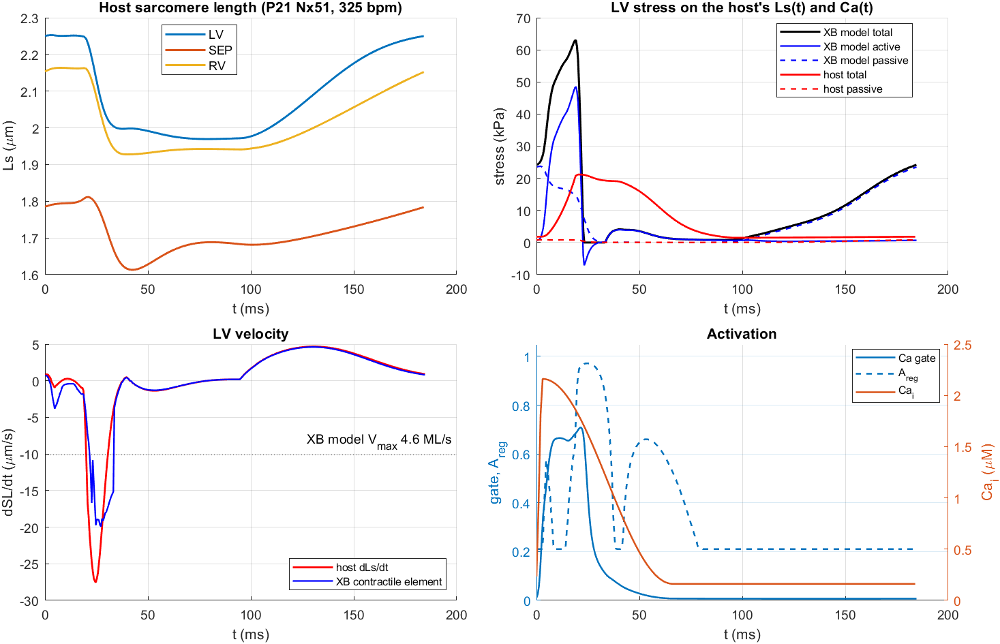
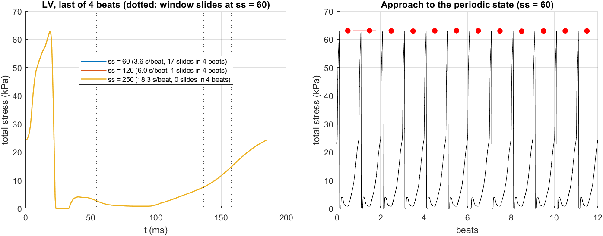
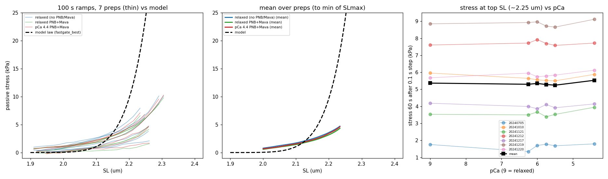
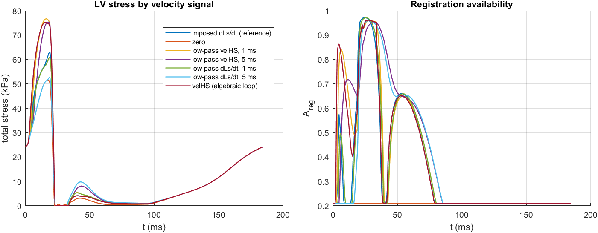
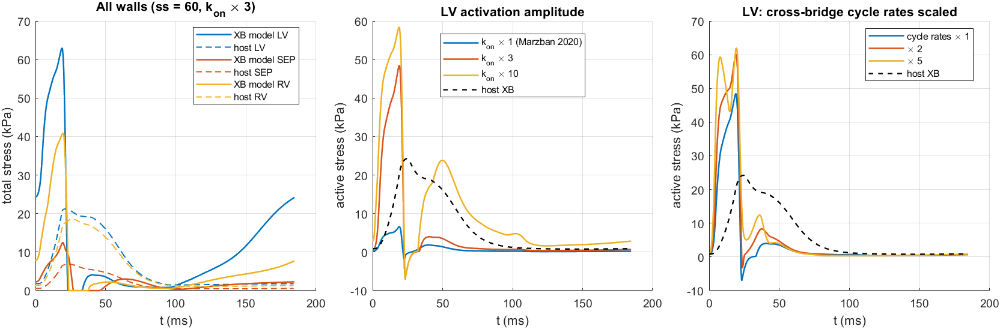

# TriSeg + Ca with the full XB model: problems and implementation plan

**Issue:** #82 · **Milestone:** 5 · Organ model · **Status:** findings, for the PI's review · **Authors:** Claude (AI agent) for fjezek · **Date:** 2026-11-12
**Builds on:** [TriSegCoupling](../TriSegCoupling/conclusions.md) (2026-09-23), [CalciumTwitch](../CalciumTwitch/conclusions.md), [PassiveForceID](../PassiveForceID/conclusions.md)
**Model:** `robust1_seed` (the incumbent), unchanged model files. **Host:** `../Multiscale-Hx-P21-Model` (Kim, Jezek, Oomen, Barton, Beard, Goss, Colebank, Chesler, bioRxiv 2025, doi:10.1101/2025.10.01.679825), fit Nx51 (P21 rat, 325 bpm) unless stated.
**No coupling code was written.** Everything here is open loop: one wall's sarcomere is driven by the host's own Ls(t) and Ca(t).

## Bottom line

1. **The numerics are not the blocker.** Wrapping the unchanged right-hand side works: on a hold–shorten–hold–stretch protocol the wrapper matches `evaluateModel` to 0.08 kPa (0.1 % of peak). One host beat of one wall costs 3.6 s at 60 strain bins. Window slides lose no attached heads on this beat, so the wide grid is not needed for correctness.
2. **On the host's kinematics the model fails in three ways, all of them scientific.**
   - **Speed.** At the start of ejection the host's LV sarcomere shortens at 27.6 µm/s (12 lengths/s). The model's force collapses from 63 kPa to zero within 3 ms, it is slack for 10.5 ms, and it carries about 4 kPa through ejection where the host carries 19 kPa.
   - **Passive.** At the host's end-diastolic length (2.25 µm) the incumbent passive law gives 23.6 kPa; the host has 0.8 kPa. The ventricle would not fill.
   - **Activation.** With the host's (literature) thin-filament constants the Ca gate opens to 0.05 and the active stress is 6.6 kPa; the host's own cross-bridges give 24.3 kPa.
3. **The velocity the mechanisms see changes peak stress by ±20 %.** Imposed dLs/dt gives 63 kPa, the contractile-element velocity 75 kPa, no velocity 51 kPa. The model was calibrated with the imposed velocity, so the coupling must supply dLs/dt.
4. **Recommended architecture: one monolithic DAE that wraps the unchanged model**, with no `UseTriSeg` flag. An explicit co-simulation would need macro-steps of 0.1 ms or less (a 0.1 ms lag already costs 2.5 kPa), which is no cheaper than the 3,000 steps per beat the solver takes anyway.
5. **The biggest cost lever is the Jacobian.** 63 % of all right-hand-side calls are finite-difference Jacobian columns, because 25 rows are dense. Supplying those rows analytically (#54) cuts the calls by 61 % at 60 bins and makes a 250-bin grid cost the same number of calls as a 60-bin one.
6. **Calcium does stiffen the passive response, but only the fast part.** Peak stress on a 0.1 s ramp is ×4.0 at pCa 4.4; on a 100 s ramp ×1.07; 60 s into the hold there is no difference. The beating wall needs a Ca-dependent viscoelastic passive (#85), not a Ca-dependent static one.

The implementation plan (Q10) puts a closed-loop harness first, run with the host's passive and a calibrated activation so the numerics can be finished, and treats speed, passive and activation as separate science packages. Until those three land, the coupled model will run but its pressures and volumes mean nothing.

## Method

`dPUdT_HostWall.m` wraps `dPUdT_CombinedTransitions` without changing it. It adds a thin-filament state N (the factorised Ca gate of `CalciumTwitch`: the gate scales `ka`), makes the sarcomere follow the host (dSL/dt = host dLs/dt), and chooses which velocity the velocity-driven mechanisms see. `runHostBeats.m` integrates it with `ode15s` and the production sliding window. `hostSignals.m` reads one periodic beat of a saved host fit (pchip through its 1 ms samples).

Each run is 0.5 s of pre-equilibration at the end-diastolic length and diastolic Ca, then 4 beats (12 for the steady-state run). Numbers are from the last beat. `RunHostProbe.m` holds experiments E0–E9, `RunWrapperParity.m` the parity test, `hostFits.py` the table of the 19 saved host fits, `passiveBackground.py` and `passiveDynamic.py` the passive data. Background notes with sources are in `background/`.

Wall-clock times varied by a factor of 5 between runs on this shared machine (3.6 to 18 s per beat for the same case); the solver counts (steps, right-hand-side calls, Jacobians) are exact. The times in Q2 come from one run with nothing else on the machine; one right-hand-side call takes 190 µs at 60 bins and 203 µs at 250.



## Q1. Coupling architecture

**Evidence**

- **The wrapper is exact.** Same length protocol through `evaluateModel` and through the wrapper with the gate held open: maximum difference 0.083 kPa at 60 bins and 0.106 kPa at 250 bins, on a force range of 33.5–72.2 kPa (`RunWrapperParity.m`).
- **The interface is the host's.** The host has `sigma = Kse·(Ls − Lsc)` and `dLsc/dt = (sigma − sigma_pas − sigma_XB)/eta`; the model has `Force = kSE·LSE` and `velHS = (Force − F_total)/mu` (TriSegCoupling §1). In a coupled system `Lsc` replaces `SL` as the state, `dLsc/dt = velHS`, and `Ls` comes from the wall geometry. The wall stress the geometry needs depends on `Ls` and `Lsc` only, not on the strain distribution.
- **A kinematic lag is expensive.** Delaying the host's Ls(t) by a fixed lag changes the last-beat force by:

| Lag (ms) | 0.1 | 0.5 | 1 | 2 |
|---|---|---|---|---|
| max \|ΔF\| (kPa) | 2.5 | 12.6 | 24.7 | 46.0 |
| rms ΔF (kPa) | 0.27 | 1.32 | 2.59 | 4.87 |

- **The solver takes 3,000 steps per beat** whatever the grid (11,870–11,919 in 4 beats), 550 of them failed. A C2 spline through the host's samples instead of pchip changes that by 4 % (11,492), so the step count is the model's own stiffness, not the stored signal.
- **The host is a DAE**: four algebraic geometry variables (`xm_LV`, `xm_SEP`, `xm_RV`, `ym`) solved through a mass matrix by `ode15s`.

**Options**

| Option | What it is | Assessment |
|---|---|---|
| A. Monolithic DAE | The host's states plus three copies of the wall state; the wrapper hands `Ls` to the unchanged RHS and returns `velHS` | Exact, one solver, one tolerance. A window slide in one wall restarts all three (about 7 per beat at 60 bins: LV 4.3, RV 2.3, SEP 0.3), which is small against 3,000 steps. Jacobian cost is the issue (Q2) |
| B. Explicit co-simulation | Host and walls exchange `Ls` and `sigma` every macro-step, `evaluateModel` reused per wall | Needs a macro-step of 0.1 ms or less for a 2.5 kPa error, so 1,850 or more exchanges per beat, each a solver restart. No saving over A, and a new error source |
| C. Split with stiffness at the interface | Host integrates `Lsc` with the frozen distribution's stiffness; the distribution is updated per macro-step | Removes the stiff loop from the exchange, but first-order in the macro-step against rates up to 1,500 s⁻¹. More code than A for an approximation |

**Recommendation: A.** The model files stay unchanged and no `UseTriSeg` flag is needed: coupling is a way of using the model. The wrapper's parity test (`RunWrapperParity.m`, tolerance 0.2 kPa) guards it, and the same test with the closed-loop wrapper driven by a recorded Ls(t) guards the coupled code. Decision draft: `decisions/0003-triseg-coupling-architecture.md`.

**Work package:** WP1 (closed-loop harness).

## Q2. Strain grid and cost

LV, 4 beats, imposed velocity, `robust1_seed`:

| Strain bins | States | Slides in 4 beats | Steps (failed) | RHS calls | Jacobians | Share of RHS calls spent on Jacobians | Peak stress, last beat (kPa) | Wall clock per beat (s) | With `JPattern` (s) |
|---|---|---|---|---|---|---|---|---|---|
| 60 (incumbent window) | 131 | 17 | 11,919 (2,198) | 65,714 | 316 | 63 % | 62.94 | 3.6 | 3.5 |
| 120 | 251 | 1 | 11,870 (2,199) | 100,598 | 303 | 76 % | 62.95 | 6.0 | — |
| 250 | 511 | 0 | 11,885 (2,219) | 180,891 | 305 | 86 % | 62.94 | 18.3 | 13.6 |

- **The grid does not change the answer.** Peak stress agrees to 0.01 kPa across 60, 120 and 250 bins, and the slides at 60 bins lose 2·10⁻¹² of attached mass. Head deletion on a slide (#52) does not occur on this beat.
- **The 104.9 kPa at 200 bins reported on 2026-11-09 was the first beat.** With `fastgate_best` the per-beat peaks are 104.9, 68.4, 68.1, 68.0 kPa at 200 bins against 67.8, 68.2, 68.1, 68.0 at 60 bins: a start-up transient of the wide grid, not a different periodic state.
- **`JPattern` helps little as the model stands** (nothing at 60 bins, 26 % at 250). The Jacobian is 20 % dense at 60 bins (8 % at 250), but 25 rows (37 at 250) are dense: the integrals over the distribution (force, bound fraction, the availability and SRX drives). Every column touches them, so the solver still needs 129 of 131 column groups. Without those rows it would need 4.
- **What #54 would buy.** If the dense rows are supplied analytically, each Jacobian costs 4 RHS calls instead of n. From the measured counts: 25,600 calls instead of 65,700 at 60 bins (−61 %), 25,800 at 120 bins (−74 %) and 26,300 at 250 bins (−85 %). The grid size then stops mattering for the RHS count; what remains is the linear algebra on the larger matrix. At 190 µs per call the right-hand side is 3.1 of the 3.6 s per beat at 60 bins, so the estimate is about 1.5 s per beat.
- **The other walls** at 60 bins: SEP 1 slide and RV 9 slides in 4 beats, at 0.4 and 0.7 times the LV's wall clock in the same run.
- **Non-uniform grid, co-simulation per wall:** not measured. Neither removes the dense rows, which is where the cost is.

- **For the monolithic system** the finite-difference Jacobian must at least be told the block structure (walls couple only through the geometry), or every column of every wall costs a full three-wall right-hand side.

**Recommendation:** start the closed loop at 60 bins with the sliding window, and take the structured Jacobian (#54) as the first optimisation. Move to a wide grid only if slides turn out to cost steps in the coupled system or #52 shows up on another host beat.



## Q3. Passive (background for #83 and #85)

Seven skinned mouse trabeculae with PNB + Mava (`data/PassiveCaSrc2`), ramp from 0.95 to 1.1757 Lo; details in `background/passive_background.md` and `background/passive_dynamic.md`.

Quasi-static (100 s ramp), mean of 7 preparations, kPa. Values in brackets are extrapolated: only one preparation reaches 2.3 µm.

| Condition | SL 2.0 | 2.1 | 2.2 | 2.3 |
|---|---|---|---|---|
| Relaxed, no drug | 0.78 | 1.71 | 3.58 | (7.4) |
| Relaxed, PNB + Mava | 0.58 | 1.43 | 3.16 | (7.0) |
| pCa 4.4, PNB + Mava | 0.67 | 1.56 | 3.41 | (7.5) |
| Incumbent law, `k_pas·(Lsc − 1.80)^7.69` | 0.05 | 1.05 | 9.67 | 54 |
| Host law, `6.67·(Ls − 1.51)^7` | 0.05 | 0.17 | 0.50 | 1.3 |

Transient (peak stress at the end of the ramp, rise above the 0.95 Lo hold, top SL about 2.27 µm):

| Ramp duration (s) | Peak relaxed (kPa) | Peak pCa 4.4 (kPa) | pCa 4.4 / relaxed (range over preparations) | Peak / hold, relaxed | Peak / hold, pCa 4.4 |
|---|---|---|---|---|---|
| 100 | 6.6 ± 2.8 | 7.0 ± 3.0 | 1.07 (1.00–1.14) | 1.21 | 1.25 |
| 10 | 7.5 ± 3.2 | 11.0 ± 4.6 | 1.48 (1.32–1.63) | 1.46 | 2.06 |
| 1 | 8.7 ± 3.7 | 25.1 ± 10.4 | 2.94 (2.29–4.12) | 1.71 | 4.83 |
| 0.1 | 10.5 ± 4.6 | 41.0 ± 16.8 | 4.03 (2.91–5.92) | 2.08 | 8.14 |

- **The static passive does not depend on Ca.** Relaxed and pCa 4.4 differ by 7–15 % on slow ramps and not at all 60 s into a hold (5.4 against 5.5 kPa), with no trend across pCa 6.25 to 4.4. The spread between preparations is a factor of 4.
- **The viscous passive does.** At a stretch rate of 2.3 lengths/s (the 0.1 s ramp) the peak is 4 times higher at pCa 4.4. The host's filling stretches the LV at up to 2.1 lengths/s, so this is the regime a beat is in.
- **The incumbent law is not the Ca-stiffened static passive.** It is 3 times the measured static passive at 2.2 µm at either Ca, and its exponent makes it 54 kPa at 2.3 µm. It was fitted on the slack battery, where the passive part is read during fast length changes at high Ca.
- **On the host beat** the incumbent law gives 23.6 kPa at end diastole (Ls 2.25 µm) against the host's 0.81 kPa, a factor of 29. The measured relaxed static passive at that length is about 5 kPa, still 6 times the host's.
- **In-vivo anchor.** Rat end-diastolic sarcomere length is inferred at 1.75–1.90 µm with an end-diastolic pressure of 9.2 ± 2.7 mmHg (Pearson et al., Biophys J 2007;93:4319, doi:10.1529/biophysj.107.111740). The host's 19 fits put the LV at 1.91–2.33 µm at end diastole because its length scale is assumed (`Lsref` = 2.0 µm), so only stress against volume is constrained. A mouse in-vivo measurement exists (Kobirumaki-Shimozawa et al., J Gen Physiol 2016, doi:10.1085/jgp.201511484) but its values could not be read; no end-diastolic wall stress was found in a primary source.

**Options for the organ model**

| Option | Diastole | Systole | Cost |
|---|---|---|---|
| Keep the host's law | fits the host by construction | no Ca-dependent viscosity | none |
| Incumbent law as is | 29 times too stiff | as calibrated | none, but the ventricle does not fill |
| Measured relaxed static law + host re-scaling | needs `Lsref`, `Amref`, volumes re-fitted | no Ca-dependent viscosity | #83 |
| Ca-dependent viscoelastic passive (titin model or a reduction) + host re-scaling | soft and viscous | stiff and viscous | #85, then #83 |

**Recommendation:** use the host's law for the first closed loop (WP1), so the harness can be finished without the passive question. The native passive is the last row: #85 first, then #83. Decision draft: `decisions/0004-passive-law-for-the-organ-model.md`.



## Q4. Velocity signal (background for #84)

LV, last beat, against the imposed velocity. In `robust1_seed` only `RegAvailShorteningOnly` and the velocity terms of the mechanics read the imposed velocity; `UseA2Reattaching` is off (it is on in `fastgate_best`).

| Velocity the mechanisms see | Peak stress (kPa) | max \|ΔF\| (kPa) | rms ΔF (kPa) | max \|ΔA_reg\| |
|---|---|---|---|---|
| Imposed dLs/dt (reference) | 62.9 | — | — | — |
| Zero | 51.4 | 14.0 | 3.07 | 0.76 |
| Contractile-element velocity (two passes) | 75.2 | 18.2 | 4.32 | 0.54 |
| Low-pass of the contractile-element velocity, 1 ms | 76.7 | 18.9 | 4.20 | 0.58 |
| same, 5 ms | 75.3 | 15.8 | 3.30 | 0.68 |
| Low-pass of dLs/dt, 1 ms | 60.9 | 3.8 | 0.62 | 0.25 |
| same, 5 ms | 52.7 | 10.7 | 3.03 | 0.66 |

- **The contractile-element velocity is not a substitute.** It differs from dLs/dt whenever the series element stretches or recoils, and it raises the peak by 20 %.
- **A 1 ms low-pass of dLs/dt is within 3.8 kPa** (0.62 kPa rms); 5 ms is not usable.
- **The two-pass version ran here**, but it is an algebraic loop (the velocity depends on a force that depends on the velocity) and failed to integrate with `fastgate_best` on 2026-11-09.

**Recommendation for #84:** supply dLs/dt itself. In the monolithic DAE it follows from differentiating the geometry constraints, or as an extra state with a time constant of 1 ms or less. Tolerance to state: 4 kPa maximum, 1 kPa rms on this beat.



## Q5. Kinetics at the host's rate

Active stress, last beat (times from the start of the Ca transient):

| Trace | Peak (kPa) | Time of peak (ms) | Peak to 50 % (ms) | Peak to 10 % (ms) | Minimum (kPa) |
|---|---|---|---|---|---|
| Host's own cross-bridges (9 moments) | 24.3 | 24 | 34 | 56 | 0.78 |
| XB model, `k_on` ×3 | 48.5 | 19 | 2.5 | 3.5 | −7.1 |
| XB model, cycle rates ×2 | 60.2 | 19 | 3.0 | 4.0 | −3.4 |
| XB model, cycle rates ×5 | 61.9 | 19 | 3.0 | 5.5 | +0.35 |

- **Relaxation is not the problem.** Active stress is below 2 kPa from 70 ms and the total returns to the passive level before the next beat (period 185 ms). The periodic state is reached in the first beat.
- **Shortening speed is.** The host ejects in about 15 ms: the LV sarcomere goes from 2.25 to 2.00 µm between 20 and 35 ms, peaking at 27.6 µm/s (12.3 lengths/s; 16.7 and 22.7 µm/s in SEP and RV). The model's unloaded speed is 4.6 ML/s. Its force peaks at 19 ms during the isovolumic phase, collapses within 3 ms when ejection starts, goes negative (−7 kPa of cross-bridge force, the total clamps at zero) and stays slack for 10.5 ms. Its contractile element shortens at up to 19.9 µm/s in that phase.
- **Across the 19 host fits** the peak LV shortening speed is 6.2–16.9 lengths/s at 13–21 % of the beat, and the median speed while shortening is 0.2–1.4 lengths/s. The demand is a brief spike at the start of ejection in every fit.
- **Scaling the cycle rates** (`kah`, `kamh`, `ka`, `kd`, `k1`, `k_1`, `k2`) by 5 removes the slack and raises the isovolumic peak, but the force still falls to about 5 kPa at the spike and recovers to 12 kPa. A factor of 5 is what a Q10 of 3.5 gives from 22 to 37 °C for ktr in permeabilised rat trabeculae (de Tombe and Stienen, J Physiol 2007;584:591, doi:10.1113/jphysiol.2007.138693). The rig temperature of our data is not recorded (#43).
- **This is open loop.** In a closed loop the muscle's own force–velocity relation limits ejection, so the sarcomere would not shorten this fast; the failure would show as a low stroke volume and a slow ejection, not as slack.

**Options:** (a) a Q10 block per rate group (#44), anchored by the rig temperature (#43); (b) a host at the preparation's own temperature and rate, which does not exist; (c) accept the mismatch for the harness and say so. **Recommendation:** (c) for WP1, (a) as its own package before any organ-level claim (WP3).



## Q6. Ca transient and activation amplitude

- **The host's transient** is analytic (raised cosine): 0.161 to 2.161 µM, peak at 3 ms, back to diastolic by about 65 ms, the same in all 19 fits.
- **With the host's thin-filament constants** (`k_on` 101.2 µM⁻¹ s⁻¹, `k_off` 723.9 s⁻¹, `K_coop` 9.68, the set `CalciumTwitch` also used) on this core:

| `k_on` multiplier | Gate, peak | Active stress, peak (kPa) | Total, peak (kPa) |
|---|---|---|---|
| ×1 (literature) | 0.046 | 6.6 | 27.1 |
| ×3 | 0.708 | 48.5 | 62.9 |
| ×10 | 0.961 | 58.3 | 71.8 |

- **`k_on` is one steep knob**: a factor of 3 moves the gate from 5 % to 71 %. The host's own peak cross-bridge stress on this fit is 24.3 kPa (12.5–27.2 kPa across the 19 fits), which lies between ×1 and ×3.

**Options:** fix `k_on` so the isovolumic peak matches a host target; or identify it from force–pCa data (#41, #42). The first makes the organ model's contractility a fitted number of the host, the second makes it a property of the preparation. **Recommendation:** the host target for WP1 (it is a harness), and force–pCa for any claim; keep the host's analytic Ca(t) until a model-generated transient is needed (#76, #49). This leaves the α milestone's question (how ATP changes the Ca transient) untouched: the gate takes any Ca(t).

## Q7. Host choice

The 19 saved fits (`background/host_fits.md`, `figures/host_fits.csv`):

| Quantity | Range over 19 fits |
|---|---|
| Heart rate | 292–388 bpm |
| LV end-diastolic volume (data) | 0.032–0.064 mL |
| LV end-systolic pressure (data) | 6.9–11.3 kPa |
| LV end-diastolic pressure (data) | 0.27–1.07 kPa |
| LV sarcomere length, maximum / minimum | 1.91–2.33 / 1.66–2.12 µm |
| RV sarcomere length, maximum / minimum | 1.64–2.28 / 1.41–2.01 µm |
| LV shortening per beat | 0.14–0.40 µm |
| Peak cross-bridge stress, LV / SEP / RV | 12.5–27.2 / 6.1–23.8 / 18.4–39.5 kPa |
| Peak passive stress, LV | 0.01–1.66 kPa |

- **Mismatches with the cross-bridge data:** rat at postnatal day 21 against (adult) mouse; 37 °C in vivo against an unrecorded rig temperature; 292–388 bpm; sarcomere lengths down to 1.41 µm in the RV, below anything the model was calibrated on (the slack battery starts at 2.2 µm and the passive ramps at 1.92 µm).
- **What the host has:** the same sarcomere interface, working code, 19 fitted animals with their data, and a steady-state routine.
- **Alternatives on disk:** `../CVS_TriSeg` appears to be a human clinical model (CMR and catheter data files); it belongs with the humanised model (milestone 2), not here. A mouse 37 °C TriSeg model was not found in a verified source.

**Recommendation:** keep the P21 rat host for the harness and the numerics, and record that nothing it produces is a prediction until Q3, Q5 and Q6 are resolved. Revisit the host when #43 and #44 are answered. Decision draft: `decisions/0005-host-for-the-first-organ-model.md`.

## Q8. Initialisation and steady state

- **Open loop:** 0.5 s at the end-diastolic length and diastolic Ca, from the snapshot's initial state with the thin filament closed, costs 4–11 s of wall clock. After it the beat is periodic at once: over 12 beats the peak stress stays within ±0.17 % with no trend.
- **Closed loop:** the host's own routine (`model_sol.m`) runs 10 beats, tests for a steady state, and repeats; then 2 more beats. With three walls that is 30 wall-beats per test, about 75 s at 3.6 s per beat for the LV and 0.7 and 0.4 times that for RV and SEP.
- **Consistent initial conditions:** the host's `calc_xm_ym` gives the geometry for given volumes; each wall then starts from its own pre-equilibrated distribution at that geometry's Ls and diastolic Ca, with `Lsc = Ls − LSE`.

**Recommendation:** initialise from a saved host fit's last state (volumes, geometry), pre-equilibrate each wall for 0.5 s, and reuse the host's steady-state test. Expect 20 beats, so 60 wall-beats per run.

## Q9. Validation targets

How well the host reproduces its own data, over the 19 fits (the tolerance a new sarcomere inherits):

| Quantity | LV: median / max error | RV: median / max error |
|---|---|---|
| End-diastolic volume | 4 % / 8 % | 3 % / 14 % |
| End-systolic volume | 3 % / 32 % | 3 % / 15 % |
| End-diastolic pressure | 18 % / 175 % | 44 % / 184 % |
| Peak pressure against end-systolic pressure | 5 % / 15 % | 4 % / 13 % |

**Recommendation:** validate the coupled model on the Nx animals against EDV, ESV and peak pressure of both ventricles, with a tolerance of twice the host's own median error (8 %, 6 %, 10 %). End-diastolic pressure is reported, not gated: the host itself misses it by 18–44 %. Secondary checks: ejection time, end-diastolic sarcomere length against the in-vivo range, and no slack during the beat.

## Q10. Implementation plan

| | Work package | Depends on | Acceptance check | Effort | Issue |
|---|---|---|---|---|---|
| WP1 | **Closed-loop harness.** Monolithic DAE: the host's circulation and geometry, three walls through the unchanged RHS, host passive, host Ca(t), `k_on` set to the host's peak cross-bridge stress | — | Runs 20 beats to a periodic state (< 1 % beat to beat); driven by a recorded Ls(t) it reproduces the open-loop probe within 0.2 kPa; cost per beat reported | 1–2 weeks | #97 |
| WP2 | **dLs/dt for the velocity-driven mechanisms** | WP1 for the closed-loop check | Force within 4 kPa maximum and 1 kPa rms of the imposed-velocity reference on the Nx51 beat | 2–3 days | #84 |
| WP3 | **Kinetics at the host's temperature and rate** (Q10 per rate group; the ejection-onset collapse) | #43 for the temperature; #44 | On the host's Ls(t): no slack, and at least half of the host's stress carried through ejection | 1–2 weeks | #98, with #44 |
| WP4 | **Ca-dependent viscoelastic passive**, then the host re-scaled to it | #36 for the Ca signal | #85 and #83 as written | 2–3 weeks | #85, #83 |
| WP5 | **Activation amplitude from force–pCa** | #36 | `k_on` and cooperativity identified at 8 mM, with their uncertainty | 1 week | #41, #42 |
| WP6 | **Structured Jacobian** (dense rows analytic) | — | RHS calls per beat down by at least half at 60 bins; force unchanged to 0.01 kPa | 1 week | #54 |
| WP7 | **Validation on the P21 Nx fits** | WP1–WP5 | EDV, ESV, peak pressure of both ventricles within 8 %, 6 %, 10 % | 1 week | #99 |

- **Critical path:** WP1 → WP2 → WP7. WP3, WP4 and WP5 are the science and can run in parallel with WP1 and with each other; WP6 is an optimisation and can wait until WP1 shows the cost.
- **Follow-up:** the moment-truncated model (#55) uses the WP1 and WP7 runs as its reference.
- **Not planned here:** merging the Ca gate (#36), which WP1 can start without because the wrapper carries its own gate.

## Reproduce

```
matlab -batch "run('Analyses/TriSegCaPlan/RunHostProbe.m')"       % E0-E9, about 45 min, -> results/hostProbe.mat
matlab -batch "run('Analyses/TriSegCaPlan/RunWrapperParity.m')"   % 5 min
matlab -batch "run('Analyses/TriSegCaPlan/PlotHostProbe.m')"      % figures and the waveform table
python -I Analyses/TriSegCaPlan/hostFits.py                       % background/host_fits.md
python -I Analyses/TriSegCaPlan/passiveBackground.py              % passive tables and figure
python -I Analyses/TriSegCaPlan/passiveDynamic.py                 % background/passive_dynamic.md
```

The host repository must sit next to this one (`../Multiscale-Hx-P21-Model`), or set `HOSTROOT`.

## Caveats

- Open loop only. The speed and passive failures are stated for the host's kinematics; the closed loop will show them differently.
- One host fit (Nx51) for the probes; the 19-fit table shows it is typical in speed and stress.
- The Ca gate is the probe's own (the `CalciumTwitch` gate), not the unmerged `CaActivation` code.
- Several literature values in `background/literature_background.md` are from search snippets and are marked there; only the ones marked as read are used above.
