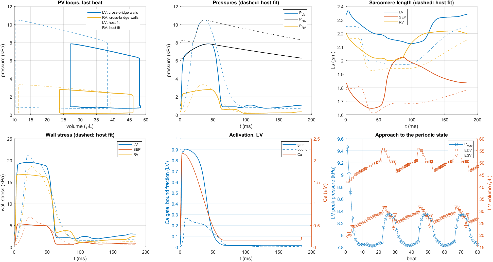
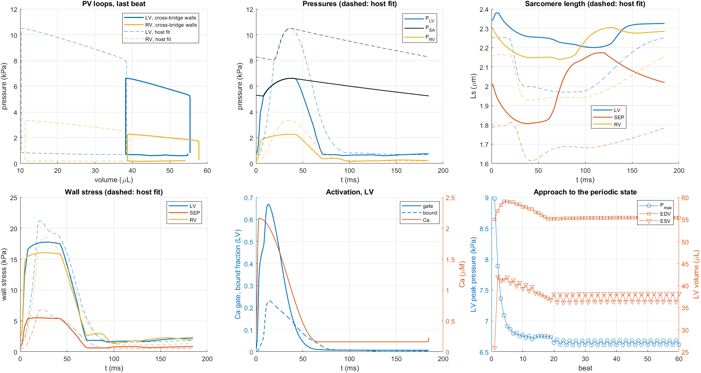

# TriSegHarness: the cross-bridge model in a closed-loop TriSeg heart

**Issue:** #97 · **Milestone:** 5 · Organ model · **Status:** findings, for the PI's review · **Authors:** Claude (AI agent) for fjezek · **Date:** 2026-11-13
**Code:** [`Organ/`](../../Organ/README.md). **Model:** `robust1_seed`, model files unchanged. **Host:** `../Multiscale-Hx-P21-Model` @ 80f86d3, fit Nx51 (P21 rat, 325 bpm).
**This is a software result, not a prediction** (decision 0005): the walls carry the host's passive law, the host's Ca transient and a calibration factor on `k_on`.

## Bottom line

1. **The coupled system is built and runs.** One monolithic DAE of 406 states: the host's geometry and circulation, and the unchanged cross-bridge model in the LV, septal and RV walls. 80 beats run without a solver failure at 15–18 s per beat, and blood volume is conserved to six digits.
2. **Its building blocks are exact.** The host block reproduces the host's stored strain exactly and its pressures to 9·10⁻⁴ kPa. The wall matches `evaluateModel` to 0.03 kPa and the open-loop probe to 0.04 kPa (tolerance 0.2 kPa).
3. **The heart it gives is weak, as the open-loop analysis predicted.** At the best activation tried, stroke volume is 21–23 µL on most beats (20.7–27.3 over its slow cycle) against the host's 28, LV peak pressure 7.8–8.3 kPa against 10.5, ejection fraction 43–54 % against 73 %, and ejection takes 42 ms. No wall goes slack: in a closed loop the speed mismatch shows as a small stroke volume.
4. **It does not settle to a steady beat at any activation tried.** `k_on` ×3 gives a two-beat alternation; ×5.3 a slow oscillation with a period of 20–22 beats; ×10 a steady beat, but with negative cavity volumes. The alternation and the slow oscillation both persist on a 120-bin grid, so they belong to the coupled model, not to the sliding strain window.
5. **No activation level reproduces the host.** Peak pressure and stroke volume stay below the host's from ×3 to ×10, so the plan's calibration of `k_on` to the host could not be done. The gap is kinetics (#98), not activation.

## What was built

| Block | Files | Provenance |
|---|---|---|
| Host geometry, tension balance, circulation, Ca transient | `hostP21Geometry.m`, `hostP21Balance.m`, `hostP21Ca.m`, `hostP21Load.m` | copied from the host's `model.m`, with the source lines fenced in comments |
| Cross-bridge wall | `xbWall.m` | calls `Model/dPUdT_CombinedTransitions.m` unchanged; glue for state packing, the Ca gate and the velocity signal |
| Assembly and integration | `trisegXB_rhs.m`, `setupTrisegXB.m`, `runTrisegXB.m`, `setupXbWall.m`, `shiftXbWall.m`, `runXbWallOpenLoop.m` | glue |

Every file states its provenance in its header; `Organ/README.md` has the table, the state layout and what to do when the host or the cross-bridge model changes (decision 0003, point 5). No file under `Model/`, `params/` or `Auxiliary/` is changed on this branch.

Choices inside the harness, all from the accepted decisions:

- **Passive:** the host's law `k·(L − 1.51)^7` in the model's own passive slot; the model's Maxwell element (its velocity-dependent passive) is off.
- **Velocity signal:** a 1 ms low-pass of dLs/dt, from one extra state per wall, so the geometry is not differentiated (#84 replaces it).
- **Grid:** 60 strain bins with the sliding window; a slide in any wall restarts the solver.
- **Start:** volumes and geometry from the host fit's stored beat; each wall pre-equilibrated 0.5 s at its end-diastolic length and diastolic Ca; the geometry then solved to balance the new wall stresses (residual 2·10⁻¹²).

## Parity tests (`Organ/Tests/TestOrganParity.m`)

| Test | Result | Tolerance |
|---|---|---|
| 0. Host block against the host's stored outputs, 185 samples | strain error 0; LV pressure 8.7·10⁻⁴ kPa, RV 2.8·10⁻⁴ kPa; Ca 1.1·10⁻⁵ µM; algebraic rows balanced to 4·10⁻⁴ kPa·cm | strain 10⁻⁸, pressure 0.2 % |
| A. Wall against `evaluateModel` (gate open, native passive, 10 µs velocity signal) | 0.032 kPa maximum, 0.0045 kPa rms on 33.5–72.2 kPa | 0.2 kPa |
| B. Wall against the open-loop probe on the host beat (1 ms velocity signal) | 0.036 kPa maximum, 0.0048 kPa rms; 9 slides in both | 0.2 kPa |

With a 0.1 ms velocity signal test A reads 0.33 kPa: a lag of 0.1 ms in the velocity alone costs that much, which is the size of the effect #84 has to remove.

## Closed loop

Each run against the host fit and the data (LV; volumes µL, pressures kPa). ×3 gives its two alternating beats, ×5.3 the range over beats 25–80, ×10 its last beat:

| | `k_on` ×3 | ×5.3 | ×10 | Host fit | Data |
|---|---|---|---|---|---|
| End-diastolic volume | 55.4 | 46.5–55.8 | 19.0 | 38.4 | 36.0 |
| End-systolic volume | 36.3 / 38.2 | 23.1–31.8 | −0.6 | 10.3 | 10.0 |
| Stroke volume | 19.0 / 17.2 | 20.7–27.3 | 19.7 | 28.1 | 26.0 |
| Peak pressure | 6.68 / 6.62 | 7.82–8.34 | 7.29 | 10.50 | 9.33 |
| End-diastolic pressure | 0.61 / 0.80 | 0.70–1.75 | 1.07 | 0.69 | 0.80 |
| Peak wall stress | 17.7 | 18.5–20.7 | 12.2 | 21.2 | |
| Sarcomere length (µm) | 2.20–2.38 | 2.01–2.39 | 1.80–2.15 | 1.97–2.25 | |
| Ejection time (ms) | 33 | 42 | 48 | about 15 | |
| Ca gate, peak | 0.67 | 0.90 | 0.96 | | |
| Behaviour | two-beat alternation | 20–22-beat oscillation | steady | | |
| Beats run | 60 | 80 | 20 | | |



- **Weak and dilated at ×3 and ×5.3.** The ventricle fills to 47–56 µL and empties to 23–38 µL. The LV sarcomere works at 2.0–2.4 µm, above the host's range and near the top of what the model was calibrated on.
- **No slack.** Total wall stress never falls below 0.6 kPa in any wall. Peak sarcomere shortening in the LV is 8.3 µm/s at ×3 and 9.3 µm/s at ×5.3, just under the model's unloaded speed.
- **×10 is not usable.** The gate saturates, the ventricle cannot relax in time to fill, and the cavity volumes go negative (LV −0.6 µL, RV −8.6 µL at end systole). The host's geometry and valve laws do not stop that.
- **Two-beat alternation at ×3.** From beat 30 every second beat is identical to four digits: stroke volume 17.2 and 19.0 µL, peak pressure 6.62 and 6.68 kPa. A 120-bin grid, on which the LV wall never slides, gives the same two beats to four digits, so this is the coupled model and not the sliding window.
- **Slow oscillation at ×5.3.** End-diastolic volume creeps up by 0.6 % per beat for about 18 beats, jumps by 10 %, and resets; peak pressure moves between 7.82 and 8.34 kPa. The volume peaks at beats 23, 45 and 67: three cycles of 22 beats that look the same. On a 120-bin grid, where the LV wall hardly slides and no heads are lost, the same oscillation appears with the same amplitude (end-diastolic volume 46.5 to 55.2 µL) and a period of 20 beats instead of 22. So it is the coupled model's own, and the timing of the jump is sensitive to the grid.



## Cost

| Run | Seconds per beat | Steps (failed) per beat | RHS calls per beat | Jacobians per beat | Slides per beat, LV / SEP / RV |
|---|---|---|---|---|---|
| ×3, 60 bins | 18.4 | 4,484 (858) | 20,901 | 85 | 1.3 / 6.0 / 0.02 |
| ×3, 120 bins | 23.0 | 4,477 (866) | 30,667 | 83 | 0 / 1.4 / 0 |
| ×5.3, 60 bins | 15.1 | 5,602 (1,079) | 24,181 | 94 | 3.0 / 6.1 / 2.0 |
| ×5.3, 120 bins | 25.1 | 5,579 (1,088) | 35,257 | 94 | 0.12 / 1.1 / 0 |
| ×10, 60 bins | 15.9 | 5,964 (1,135) | 25,391 | 98 | 5.4 / 2.8 / 2.8 |

- One right-hand-side call is three wall calls plus the host block. The Jacobian pattern tells the solver that walls couple only through the geometry, so a Jacobian costs about one wall's worth of columns, not three.
- Wall-clock times on this machine vary with its load (see the #82 report); the counts are exact.
- **Head loss at slides is small but not zero in the septum:** 6.7·10⁻³ of attached mass over 80 beats at ×5.3 (3.5·10⁻⁴ over 60 beats at ×3). This is #52 appearing; the LV loses 10⁻⁴ or less, and on the 120-bin grid nothing is lost (10⁻⁹). The results above do not depend on it.

## Acceptance check (#97)

| Item | Result |
|---|---|
| 20 beats without a solver failure | met: 60 and 80 beats |
| Periodic state, beat-to-beat change of LV peak pressure and stroke volume below 1 % | **not met as written.** ×3: 1.0 % and 10.7 % (a stable two-beat alternation). ×5.3: below 1 % on most beats, but a 20–22-beat oscillation with a 10 % jump once per cycle. ×10: 0.2 %, nonphysical volumes |
| Parity A, wall against `evaluateModel`, within 0.2 kPa | met: 0.03 kPa |
| Parity B, closed-loop wall code on a recorded Ls(t) against the open-loop probe, within 0.2 kPa | met: 0.04 kPa |
| `robust1_seed` 8 mM objective unchanged | met by construction: no file under `Model/`, `params/`, `Auxiliary/` differs from `main`; the objective was not re-run |
| Provenance explicit in the code | met: headers, fenced blocks, `Organ/README.md` |
| Reported: volumes, pressures, ejection time, slack, cost | above |

## Deviations from the plan

- **`k_on` was not calibrated to the host's peak active stress.** In the closed loop the peak wall stress falls as `k_on` rises (the ventricle works at shorter lengths), so that target has no solution. Three values were run; ×5.3 is the default because it gives the largest stroke volume.
- **The velocity signal uses a low-passed length, not a low-passed velocity.** Same transfer function, but no derivative of the geometry is needed.
- **The branch is stacked on the #82 branch** (PR 100), because the parity test uses that analysis' open-loop probe.
- **The folder is `Organ/`**, as proposed.

## Side findings

- **The host's code and its stored fits disagree on diastolic Ca**: `model.m` has 0.0161 µM, the stored transients run from 0.161 µM. The harness uses the stored value.
- **Negative cavity volumes are possible in the host's equations.**
- **The stored fit's lumped-compartment volumes are not in model units**; the harness rebuilds them from the stored pressures and compliances.

## Reproduce

```
matlab -batch "run('Organ/Tests/TestOrganParity.m')"                                  % 3 min
matlab -batch "NBEATS = 2; run('Organ/Tests/TestTrisegClosedLoop.m')"                 % 1 min
matlab -batch "KONMULT = 3; TAG = 'kon3'; run('Analyses/TriSegHarness/RunTrisegHarness.m')"            % 60 beats, 18 min
matlab -batch "KONMULT = 5.3; MAXBEATS = 80; TOLPER = 0.002; TAG = 'kon5p3_long'; run('Analyses/TriSegHarness/RunTrisegHarness.m')"
matlab -batch "TAG = 'kon5p3_long'; run('Analyses/TriSegHarness/PlotTrisegHarness.m')"
```

The host repository must sit next to this one (`../Multiscale-Hx-P21-Model`), or set `HOSTROOT`.

## Open

- What drives the alternation and the slow oscillation (candidates: beat-to-beat carry-over of the super-relaxed pool or the availability gate at 325 bpm; septal geometry). They would need to be understood before any closed-loop result is compared with data.
- The exact dLs/dt (#84), the structured Jacobian (#54), kinetics at body temperature (#98), the native passive (#85, #83).
