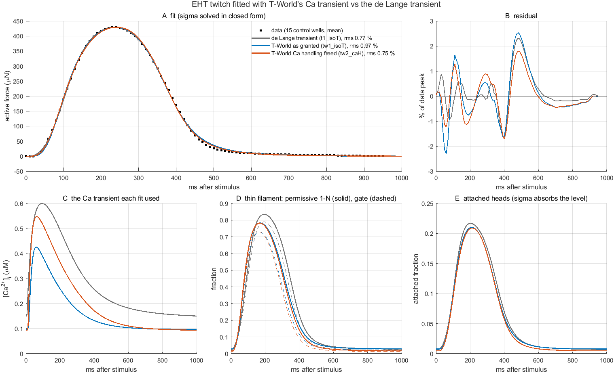

# T-World as a Ca source of the cross-bridge model

Reference for the `CaInput = 'tworld'` extension (branch `HumanTwitch`, commit `4e72ca7`,
2026-10-14). Measurements and the harness are in
[`Analyses/TWorldCoupling/conclusions.md`](../../Analyses/TWorldCoupling/conclusions.md).

## 1. What is included

| piece | where | role |
|---|---|---|
| T-World, verbatim | `ThirdParty/TWorld/` (`model_TWorld.m`, `getDefaultParameters.m`, `getStartingState.m`, `modelRunner.m`, `getCurrentsStructure.m`, `LICENSE`, `README.md` with author / repo / commit / date) | the human ventricular myocyte: membrane voltage, Na/K/Ca/Cl handling, buffers, SR, RyR, CaMKII, Land 2017 contraction; 93 states, ms and mM |
| `Model/tworldCaLayer.m` | new | resolves the `'tworld'` source once per `getParams`: starting state, optional pre-pacing, the T-World argument list, the standalone reference beat, the Ca table for `'signal'`, per-state tolerances; cached on `params.ca.tw` |
| `Model/calciumActivation.m` | extended | Ca source case 4 (`'tworld'`) and the embedded derivatives (`tworldDerivs`), including the `'xb'` buffer substitution |
| `Model/getParams.m` | extended | defaults `CaInput 'tworld'`, `CaTworld` (struct); `buildCaLayer` case 4 appends the 93 states and their `AbsTol` |
| `Model/evaluateModel.m` | extended | per-state `AbsTol` vector when the Ca layer declares one |
| `Analyses/TWorldCoupling/` | new | harness, results, conclusions |
| `Analyses/HumanTwitch/` | extended | `simHumanTwitch`, `buildModel`, `tierConfigs` accept `CaInput 'tworld'`, `CaTworld`, and a `'tw'` parameter type for fitting T-World parameters; tiers `tw1_isoT`, `tw1_isoT_xb`, `tw2_caH` |

Everything is off unless `params.CaInput = 'tworld'` **and** `params.CaModel` is `'twoState'`
or `'myosim'`. With `CaModel = 'none'` (every snapshot) nothing is built, nothing is called,
and the state vector is unchanged: the default path was checked byte-identical on
`ExampleHighATP` and `human_twitch_t1_isoT` (same `PU0`, max |ΔRHS| = 0). The de Lange
transient (`CaInput = 'analytic'`, kind `'risedecay'`) is untouched; the two sources differ only
by that one setting, so they live on the same branch.

## 2. Schematic

```
                 T-World myocyte (93 states, ms / mM)                      cross-bridge model (s / uM)
 ┌─────────────────────────────────────────────────────────┐    ┌─────────────────────────────────────────┐
 │ stimulus ─► I_Na, I_CaL, I_K... ─► V_m                   │    │  thin filament  N  (non-permissive)     │
 │                 │                                        │    │   Jon  = k_on·Ca·N·(1+K_coop(1−N))      │
 │                 ▼                                        │    │   Joff = k_off·Pu·(1+K_coop·N)          │
 │  I_CaL ─► Ca_junc ─► RyR / SR ─► Ca_sl ─► [Ca]_i (y8) ───┼──► │   Pu = 1 − N − bound                    │
 │                                   ▲   │                  │    │        │                                │
 │   SERCA ◄─────────────────────────┘   │                  │    │        ▼  gate = Pu/(1−bound)           │
 │   NCX, PMCA                           │                  │    │   ka_eff ·= gate ─► attachment PD→p1    │
 │   buffers: CaM, SRB, TnC_high ◄───────┤                  │    │        │                                │
 │                                       │                  │    │        ▼                                │
 │   TnC_low (y13):                      │                  │    │   p1, p2 (strain distributions) ─► F    │
 │     d/dt = Bmax_TnC·dCa_TRPN/dt  ◄────┘  'signal','land' │    │        │ bound = p1_0+p2_0 ─┐           │
 │     d/dt = Bmax_TnC·dA/dt        ◄─ ─ ─ ─ ─ ─ ─ ─ ─ ─ ─ ─┼─ ─ ┼─ ─ ─ ─ ┘ A = 1−N      'xb' │ holds      │
 │                                                          │    │                         └─► sites on    │
 │   Land 2017: Ca_TRPN, TmBlocked, XS, XW, ζ ─► Ta (unused)│    └─────────────────────────────────────────┘
 └─────────────────────────────────────────────────────────┘
```

Solid arrow: T-World's cytosolic Ca drives the thin filament of the cross-bridge model
(all three couplings). Dashed arrow: only in `'xb'`, the cross-bridge model's thin filament is
what buffers the troponin Ca in T-World. Land's own tension `Ta` is computed but drives nothing
(it does not feed back in T-World either; `lambda = 1` is hard-coded there).

State vector with the embedded couplings:

```
PU = [ p1(1..ss), p2(1..ss), P_SR, NP, SL, LSE, PD, P_SRD, x_dash, [A_reg], [D0], [A_def],
       N,                       <- thin filament (params.ca.idx(1))
       y_TW(1..93) ]            <- T-World, as in model_TWorld.m (params.ca.idx(2:end))
```

## 3. Equations

**Couplings** (`params.CaTworld.coupling`):

| | Ca seen by the thin filament | extra states | troponin buffer in T-World | loop |
|---|---|---|---|---|
| `'signal'` | one standalone T-World beat at `CaPeriod`, resampled at 4 kHz, Hermite-interpolated, repeated every beat | 0 | Land's | open |
| `'land'` | `[Ca]_i = 1e3·y_TW(8)` integrated with everything else | 93 | Land's | open (validation of the embedding) |
| `'xb'` | same | 93 | the XB thin filament | closed |

**Time and units.** For `t ≥ CaFirstBeat`:

```
t_ms = 1000 · mod(t − CaFirstBeat, CaPeriod)          stimulus on while t_ms ≤ stimDur (1 ms)
d y_TW / dt  [1/s] = 1000 · model_TWorld(t_ms, y_TW)  [1/ms]
Ca [uM] = 1000 · y_TW(8) [mM]
```

For `t < CaFirstBeat` the block is frozen (`d y_TW/dt = 0`) at its pre-paced state and `Ca` is
that state's diastolic value, so beat 1 starts from exactly the standalone steady state.

**Thin filament** (`twoState`, unchanged from the Ca layer):

```
Jon  = k_on · Ca · N · (1 + K_coop (1 − N))
Joff = k_off · Pu · (1 + K_coop · N),     Pu = max(0, 1 − N − bound),  bound = p1_0 + p2_0 (+ p3_0)
dN/dt = Joff − Jon,     gate = Pu / (1 − bound),     ka_eff ← ka_eff · gate
```

The permissive fraction is `A = 1 − N` (`myosim`: `A = N_on`).

**Land's troponin buffer** (T-World, `model_TWorld.m`):

```
dCa_TRPN/dt = koff · ( (Ca/ca50)^n (1 − Ca_TRPN) − Ca_TRPN ),   koff 0.0785 /ms, ca50 0.765 uM, n 1.65
d(TnC_low)/dt = Bmax_TnC · dCa_TRPN/dt,     Bmax_TnC = 70 uM
d[Ca]_i/dt = −J_SERCA·Vsr/Vmyo − ( d(TnC_low)/dt + other buffers ) + diffusion
```

**The `'xb'` substitution**, applied to the returned derivative vector (no vendored line is changed):

```
J_xb = Bmax_TnC · dA/dt                       (mM/ms, dA/dt from Jon − Joff)
ẏ(8)  ← ẏ(8) + ẏ(13) − J_xb                   put Land's flux back, take ours out
ẏ(13) ← J_xb                                  state 13 now books the Ca held by the XB thin filament
```

(`ẏ(13) ≡ Bmax_TnC · ẏ(71)` was verified numerically.)

**Tolerances.** The T-World states are mM and mV, so `evaluateModel` and `simHumanTwitch`
pass `AbsTol = 1e-6` for those 93 entries (T-World's own default) and the usual scalar for the
rest. `RelTol 1e-3` is recommended (an action potential is stiff).

## 4. Options and usage

```matlab
P = loadParams('human_twitch_t1_isoT');
P.CaModel = 'twoState';  P.CaInput = 'tworld';
P.CaPeriod = 1;  P.CaFirstBeat = 0.3;
P.CaTworld = struct('coupling', 'xb', ...      % 'signal' | 'land' | 'xb'
                    'prebeats', 0, ...          % standalone beats before the start state is taken (stored states are 1 Hz)
                    'state', 'TW_endo', ...     % 'TW_endo' | 'TW_epi' | 'TW_mid', or X0 = [1x93]
                    'param', struct('Jup_Multiplier', 1), ...  % any getDefaultParameters.m field
                    'absTol', 1e-6);
P.odeRelTol = 1e-3;  P.Velocity = 0;
P = getParams(P, [], true, false);  P.Vums = 0;  P.v = 0;
[~, out] = evaluateModel(@dPUdT_CombinedTransitions, [0 3.3], P);
% out.Ca (uM), out.CaGate, out.CaState(:,1) = N, out.CaState(:,2:end) = y_TW;  P.ca.tw.ref = standalone beat
```

`CaTworld` is a struct, so `writeParamsToMFile` never writes it: a snapshot carrying
`CaInput = 'tworld'` resolves to `'land'` from the stored 1 Hz endocardial state. The C MEX path
is refused with any Ca model, as before. Cost (0.3 s rest + 3 beats, isometric, one worker):
`'signal'` 8–18 s, `'land'`/`'xb'` 17–35 s.

## 5. What the harness showed

Beat 1 of `'land'` reproduces the standalone T-World beat to 5e-4 uM; `'signal'` matches `'land'`
to 2e-3 uM. T-World's adult 1 Hz transient (0.097 → 0.42 uM, TTP 54 ms) opens only 15 % of the
EHT-fit thin filament and gives a 10 kPa twitch, where the de Lange transient (0.15 → 0.60 uM,
TTP 93 ms) gave 46 kPa. Closing the loop (`'xb'`) raises the Ca peak by 37 % with the EHT-fit
thin filament and 2.6× with the Marzban one. The reason is the next section.

## 6. The open question: what `'xb'` substitutes, and what is missing

In T-World (Land 2017) one state, `Ca_TRPN`, plays two roles at once:

1. **buffer** — the fraction of troponin C with Ca bound; `70 uM × Ca_TRPN` of Ca is taken out
   of the cytosol;
2. **activator** — the tropomyosin unblocking rate is `∝ Ca_TRPN^(n/2)`.

In the cross-bridge model the thin filament has one state too, `N`, but it is the fraction of
**non-permissive regulatory units**, i.e. the tropomyosin switch itself, with cooperativity
(`K_coop`) and the bound-head hold built in. Ca binding to troponin and the switch are lumped
into one step. `N` is a *switch*, not a count of Ca ions on troponin.

`'xb'` deletes Land's buffer and puts `70 uM × A` in its place, with `A = 1 − N`. That is, it
assumes every permissive unit holds its Ca and every non-permissive unit holds none. The
Marzban case shows what that costs: the switch stays below 2 % permissive, so the 70 uM buffer
all but disappears and the Ca transient more than doubles, while physically the troponin
would still be ~27 % occupied (Land's `Ca_TRPN`). Troponin occupancy and tropomyosin state are
not the same thing, and the lumped model has no quantity for the former.

So what is missing is **a stoichiometric Ca-bound troponin fraction** between Ca and the
switch. The two ways to have one:

- **keep Land's** (`'land'`): T-World's `Ca_TRPN` buffers the Ca as it does standalone, and
  the cross-bridge model's `N` only takes the Ca and gates attachment. Consistent and cheap,
  but the buffer and the activator are then two different models of the same troponin, and
  bound heads do not hold Ca on troponin.
- **add a state** `B` (fraction of TnC with Ca bound) to the Ca layer and let it drive the
  switch instead of free Ca:

  ```
  dB/dt = kon_B · Ca · (1 − B) − koff_B · B                 mass action; Land's numbers give
                                                            koff_B ≈ 78 /s, kon_B ≈ koff_B/ca50 ≈ 100 /(uM s)
  Jon  = k_on' · B · N · (1 + K_coop (1 − N))               the switch is driven by occupancy
  Joff = k_off · Pu · (1 + K_coop · N)
  buffer flux = Bmax_TnC · dB/dt                            replaces Land's TnC_low flux in T-World
  ```

  This is the Rice 2008 / Campbell 2018 form (Ca ⇌ TnC·Ca, then the RU switch). It is
  identifiable only if something constrains `B` separately from `N`; a measured Ca transient
  would, the twitch alone does not. The bound-head hold would then act on the switch (as now),
  not on Ca occupancy, which matches the biochemistry (strong binding slows Ca dissociation
  only indirectly).

Both existing couplings stay available; the choice is a modelling decision, not a code fix.

## 7. Fitting the EHT twitch with T-World's Ca

Pipeline: `Analyses/HumanTwitch/` (`tierConfigs` tiers `tw1_isoT`, `tw2_caH`; `simHumanTwitch`
takes `CaInput 'tworld'`; `buildModel` has a `'tw'` parameter type for T-World parameters;
`tworldSequencer.sh` ran the ladder). Target: the Plate 6 control EHT twitch (15 wells, 1 Hz),
objective = rms of the residual in % of the data peak with the µN/kPa scale solved in closed
form, as in the rest of the HumanTwitch campaign. Comparison figure and table:
[`Analyses/TWorldCoupling/CompareTwitchFits.m`](../../Analyses/TWorldCoupling/CompareTwitchFits.m),
[`results/twitch_fit_tw1_tw2.png`](../../Analyses/TWorldCoupling/results/twitch_fit_tw1_tw2.png),
[`results/twitch_fit_tw1_tw2.csv`](../../Analyses/TWorldCoupling/results/twitch_fit_tw1_tw2.csv).



**What was tuned.** The same free set as the campaign's tier 1: the isoform factor `r_iso`
(on k2, k_2, kah, kamh, ka, kd), the temperature factor `r_T` (on all eight cycle rates), the
thin filament (`tf_k_on`, `tf_k_off`, `tf_K_coop`) and the stimulus offset; Pi rates fixed at
×0.3 as in t1_isoT; warm-started from the t1_isoT optimum. `tw2_caH` adds three T-World
Ca-handling multipliers, each evaluation pre-paced 20 beats: SERCA (`Jup_Multiplier`, decay),
L-type Ca current (`ICaL_Multiplier`, trigger and amplitude) and NCX (`INaCa_Multiplier`,
extrusion). T-World's electrophysiology is taken as granted in both: nothing in a twitch
constrains the action potential. The Ca handling is not, because T-World is an adult
ventricular myocyte and the data are an immature EHT whose Ca was never measured.

| | de Lange transient (t1_isoT) | **T-World as granted (tw1_isoT)** | **T-World Ca handling freed (tw2_caH)** |
|---|---|---|---|
| rms (% of peak) | 0.773 | 0.965 | **0.749** |
| TTP / RT50 / RT90 / W50 (ms); data 230 / 152 / 243 / 275 | 235 / 145 / 252 / 272 | 240 / 140 / 248 / 274 | 240 / 140 / 243 / 274 |
| Ca: dia → peak (µM), TTP (ms) | 0.15 → 0.60, 95 | 0.097 → 0.43, 60 | 0.093 → 0.55, 63 |
| Ca → force lag (ms) | 140 | 180 | 178 |
| r_iso × r_T (net cycle factor) | 0.065 × 6.9 = **0.45** | 0.127 × 1.9 = **0.24** | 0.154 × 1.4 = **0.22** |
| thin filament k_on / k_off / K_coop | 9.2 / 5.1 / 20 | 13.3 / 4.5 / 19.9 | 12.4 / 5.9 / 20 |
| shift (ms) | +1.7 | +7.3 | +7.6 |
| SERCA / ICaL / NCX multipliers | – | 1 / 1 / 1 | 0.81 / 2.76 / 2.01 |
| activation (% of saturating force) | 84 | 74 | 73 |

**Reading.** T-World's adult beat, taken as granted, fits the twitch to 0.97 %, within 0.2 pp
of the de Lange fit, and freeing its Ca handling closes the gap (0.75 %). The three levers
moved in a readable direction: more Ca entry and more extrusion, slightly less uptake, giving a
larger and longer transient than the adult default (0.55 µM peak, 63 ms TTP). Every timing
metric lands within 12 ms of the data in both fits; what is left is a ±2 % ripple on the
rising limb and around 480 ms that no tier of this campaign removes. The force, the attached
fraction and the permissive fraction are nearly the same curves in all three fits (panels A, D,
E) while the Ca transients differ (panel C): the twitch pins the thin-filament *output*, not
the Ca. The cost is in the identified core: the net cycle factor is 0.22–0.24 with T-World's Ca
and 0.45 with de Lange's, because T-World's faster, lower transient makes the thin filament do
less of the shaping (Ca → force lag 180 vs 140 ms) and the cycle more. This is the
Ca-shape sensitivity found earlier in the campaign, now with a mechanistic transient instead
of a prescribed one; the same twitch is consistent with a cycle twice as slow or twice as fast
depending on which Ca is assumed.

**The closed loop was also tried and failed, for a reason.** `tw1_isoT_xb` fitted the same
free set with the `'xb'` coupling, the 93 T-World states embedded and the cross-bridge
model's thin filament buffering the troponin Ca, to test whether a self-consistent Ca would do
better than an open-loop one. It stalled at 6.7 % (developed force 15 kPa, TTP 202 ms, RT90
359 ms, offset +43 ms) after 50 iterations. The cause is §6: the fit needs a mostly-off,
slow thin filament to shape the twitch, but in `'xb'` a mostly-off thin filament removes most of
the 70 µM troponin buffer, so the Ca transient grows and sharpens, which the thin filament
then has to counter, and the two requirements have no common solution. It means the lumped
switch `N` cannot carry the troponin buffering role; closing the loop requires the separate
occupancy state `B` of §6, and until that exists the open-loop couplings (`'signal'`, `'land'`)
are the ones to fit with.
